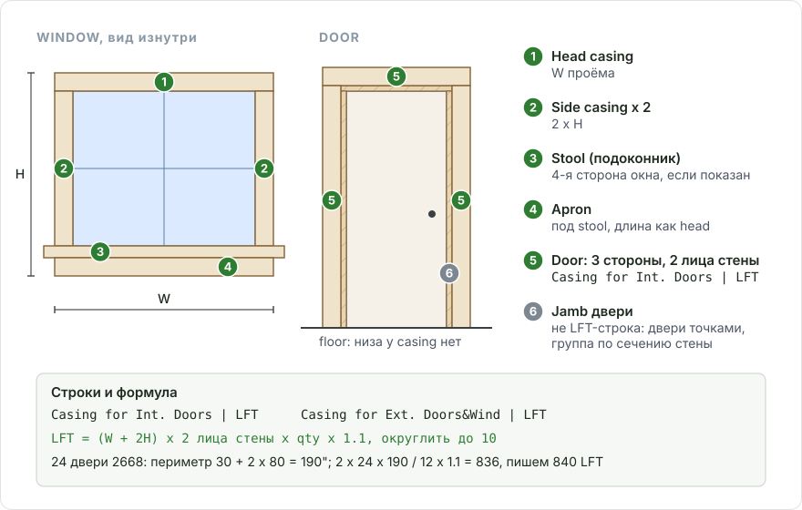

# Casing

<figure markdown>
  
  <figcaption markdown="span">Window from the inside: head casing, side casing, stool, apron; door: head and two sides. Casing is counted in LFT with a formula from the opening list.</figcaption>
</figure>

## What it is

The trim around a door or window on the inside. Counted in LFT: the perimeter of one
opening multiplied by the number of such openings. The list of doors and cased openings,
size designations and Excel entry are on the
[Door and Window Trim](door-window-trim.md) page; this page has the casing and jamb formula.

## Where to find it on the plans

| Sheet | What to take |
| --- | --- |
| Door schedule | Size, type, number of doors; usually no trim type there |
| Window schedule and interior elevations | Windows with casing, stool and apron |
| Finish schedule and notes | Casing profile (`1" x 3-1/2" Polyurethane casing`), stained or painted |

## How to measure in OurPlanCore

No separate measurement is needed: casing is calculated with a formula from the list of doors and
windows per floor. The door list comes from the plan (open door symbol) or the
door schedule, windows from `openings`. Odd-shaped casing (arched, a cased
opening across the whole wall) can be traced with a Line.

## Tree name and DFL row

| DFL row | Unit | Formula |
| --- | --- | --- |
| `Casing for Int. Doors` | LFT | `=(2*H+W)*qty` for each door size, both sides of the opening |
| `Casing for Ext. Doors&Wind` | LFT | perimeter of 3 or 4 sides (with stool and apron) x quantity |
| `Int. Door jambs` | LFT | `= casing / 2`, if the template counts jambs through casing |
| `Cased Openings` casing | LFT | separate from doors |

- Group casing by location and type when common areas differ from
  units.
- Keep the profile from the notes in the row or a note (`Note: All door trim to be 1"
  x 3-1/2" Polyurethane casing`); hardware numbers are not part of trim.

## Common mistakes

- Casing counted on one side of the door instead of two.
- Interior casing mixed with exterior casing and flashing.
- A made-up profile instead of `not specified`.
- All Excel mistakes: [Excel DFL and notes](../../start/common-mistakes.md#excel).

## Example

```text
Int. Doors 2680                     24  pcs
Casing for Int. Doors   1x3-1/2     1008 LFT   =(2*8+2.5)*2*24
Int. Door jambs                     504  LFT   =C<casing>/2
```

## See also

- [Door and Window Trim](door-window-trim.md), [Base](base.md), [Room Schedule](room-schedule.md), [Interior Trims](overview.md)
- [Exterior Trims - Casing, Corner & Band](../exterior-trims/casing-corner-band.md)
