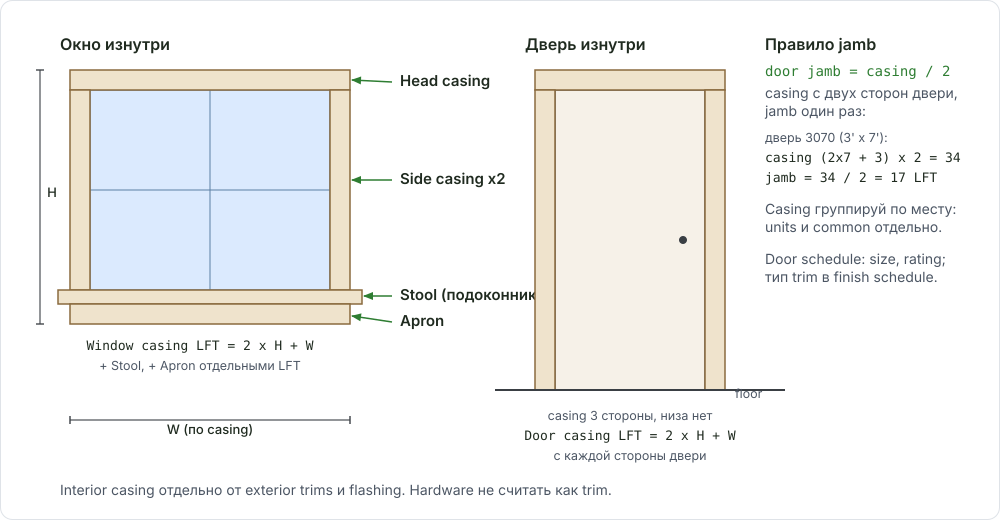

# Casing (наличники дверей и окон изнутри)

<figure markdown>
  
  <figcaption markdown="span">Окно изнутри: head casing, side casing, stool, apron; дверь: head и две стороны. Casing считается LFT формулой от списка проёмов.</figcaption>
</figure>

## Что это

Наличник вокруг двери или окна изнутри. Считается LFT: периметр одного
проёма, умноженный на число таких проёмов. Список дверей и cased openings,
обозначения размеров и ввод в Excel на странице
[Door and Window Trim](door-window-trim.md); здесь формула casing и jamb.

## Где искать на чертежах

| Лист | Что взять |
| --- | --- |
| Door schedule | Размер, тип, количество дверей; trim type там обычно нет |
| Window schedule и interior elevations | Окна с casing, stool и apron |
| Finish schedule и notes | Профиль casing (`1" x 3-1/2" Polyurethane casing`), stained или painted |

## Как мерить в OurPlanCore

Отдельный замер не нужен: casing считается формулой от списка дверей и
окон по этажам. Список дверей берётся из плана (символ открытой двери) или
door schedule, окна из `openings`. Casing сложной формы (arched, cased
opening во всю стену) можно обвести Line.

## Как назвать в дереве и строка DFL

| Строка DFL | Unit | Формула |
| --- | --- | --- |
| `Casing for Int. Doors` | LFT | `=(2*H+W)*qty` по каждому размеру двери, две стороны проёма |
| `Casing for Ext. Doors&Wind` | LFT | периметр 3 или 4 стороны (со stool и apron) x количество |
| `Int. Door jambs` | LFT | `= casing / 2`, если шаблон считает jamb через casing |
| `Cased Openings` casing | LFT | отдельно от дверей |

- Casing группируй по месту и типу, когда common areas отличаются от
  units.
- Профиль из notes держи в строке или ноте (`Note: All door trim to be 1"
  x 3-1/2" Polyurethane casing`), hardware numbers в trim не входят.

## Частые ошибки

- Casing посчитан с одной стороны двери вместо двух.
- Interior casing смешан с exterior casing и flashing.
- Профиль придуман вместо `not specified`.
- Все ошибки по Excel: [Excel DFL и ноты](../../start/common-mistakes.md#excel).

## Пример

```text
Int. Doors 2680                     24  pcs
Casing for Int. Doors   1x3-1/2     1008 LFT   =(2*8+2.5)*2*24
Int. Door jambs                     504  LFT   =C<casing>/2
```

## См. также

- [Door and Window Trim](door-window-trim.md), [Base](base.md), [Room Schedule](room-schedule.md), [Interior Trims](overview.md)
- [Exterior Trims - Casing, Corner & Band](../exterior-trims/casing-corner-band.md)
