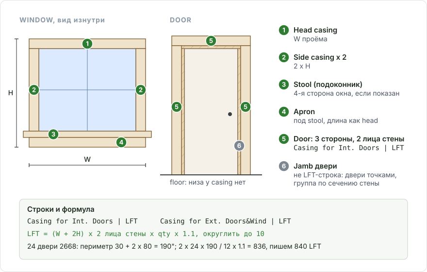

# Casing (наличники дверей и окон изнутри)

<figure markdown>
  
  <figcaption markdown="span">Окно изнутри: head casing, side casing, stool, apron; дверь: head и две стороны. Casing считается LFT формулой от списка проёмов.</figcaption>
</figure>

## Что это

Наличник вокруг двери или окна изнутри. Считается LFT формулой от списка
проёмов: периметр каждой двери (ширина плюс две высоты), две стороны стены
и waste 1.1. Список дверей и cased openings, обозначения размеров и ввод в
Excel на странице [Door and Window Trim](door-window-trim.md); здесь формула
casing.

## Где искать на чертежах

| Лист | Что взять |
| --- | --- |
| Door schedule | Размер, тип, количество дверей; trim type там обычно нет |
| Window schedule и interior elevations | Окна с casing, stool и apron |
| Finish schedule и notes | Профиль casing (`1" x 3-1/2" Polyurethane casing`), stained или painted |

## Как мерить в OurPlanCore

Отдельный замер не нужен: casing считается формулой от списка дверей и
окон по этажам. Список дверей берётся из плана (символ открытой двери) или
door schedule, окна из `openings`. Casing сложной формы (arched, cased
opening во всю стену) можно обвести Line.

## Как назвать в дереве и строка DFL

| Строка DFL | Unit | Формула |
| --- | --- | --- |
| `Casing for Int. Doors` | LFT | `=CEILING(2*SUM(perimeters)/12*1.1,10)`: периметр двери = W + 2H в дюймах из кода двери, `2` = две стороны стены, `/12` = в футы, `1.1` = waste |
| `Casing for Ext. Doors&Wind` | LFT | `=CEILING(perimeter*1.1,10)`: периметр наружных дверей и окон этого этажа из таблицы проёмов, в E `4-sides` |
| `Window Stool` | LFT | `=CEILING(sill*1.1,10)`: длина подоконников окон этажа; нет stool на детали - строки нет |
| `Cased Openings` | unit | проём без двери своей строкой количества; его периметр входит в ту же сумму `Casing for Int. Doors` |

- В шаблоне DFL периметр считает сама строка двери: колонка G читает код
  размера (`2680` = 30" + 2 x 96" = 222") и умножает на количество, пары
  `(2)` удваиваются. `SUM` в формуле casing должен охватывать все строки
  дверей и cased openings этого этажа и только их.
- Отдельной строки `Int. Door jambs` в LFT нет. Межкомнатные двери считаются
  точками по юнитам и группируются по сечению стены, в которой стоят: точка
  у стены `2x6` это дверь с jamb под `2x6`.
- Casing группируй по месту и типу, когда common areas отличаются от
  units.
- Профиль из notes держи в колонке B или ноте (`Note: All door trim to be 1"
  x 3-1/2" Polyurethane casing`); профиль не задан: `TBD Casing`. Hardware
  numbers в trim не входят.

## Частые ошибки

- Casing посчитан с одной стороны двери вместо двух (в формуле нет `2*`).
- Waste 1.1 и округление вверх до 10 потеряны: формула заменена числом.
- Вставлена строка jambs в LFT (`casing / 2`): такой строки нет.
- Interior casing смешан с exterior casing и flashing.
- Профиль придуман вместо `TBD Casing`.
- Все ошибки по Excel: [Excel DFL и ноты](../../start/common-mistakes.md#excel).

## Пример

```text
Int. Doors              2680      24   unit   A601
Casing for Int. Doors   1x3-1/2   980  LFT    =CEILING(2*SUM(G)/12*1.1,10)

Одна дверь 2680: 30" + 2 x 96" = 222" (18.5')
24 двери: 222 x 24 = 5328"
Две стороны: 2 x 5328 / 12 = 888 LFT, то же что (2 x 8 + 2.5) x 2 x 24
Waste: 888 x 1.1 = 976.8, вверх до 10 = 980 LFT
```

## См. также

- [Door and Window Trim](door-window-trim.md), [Base](base.md), [Room Schedule](room-schedule.md), [Interior Trims](overview.md)
- [Exterior Trims - Casing, Corner & Band](../exterior-trims/casing-corner-band.md)
