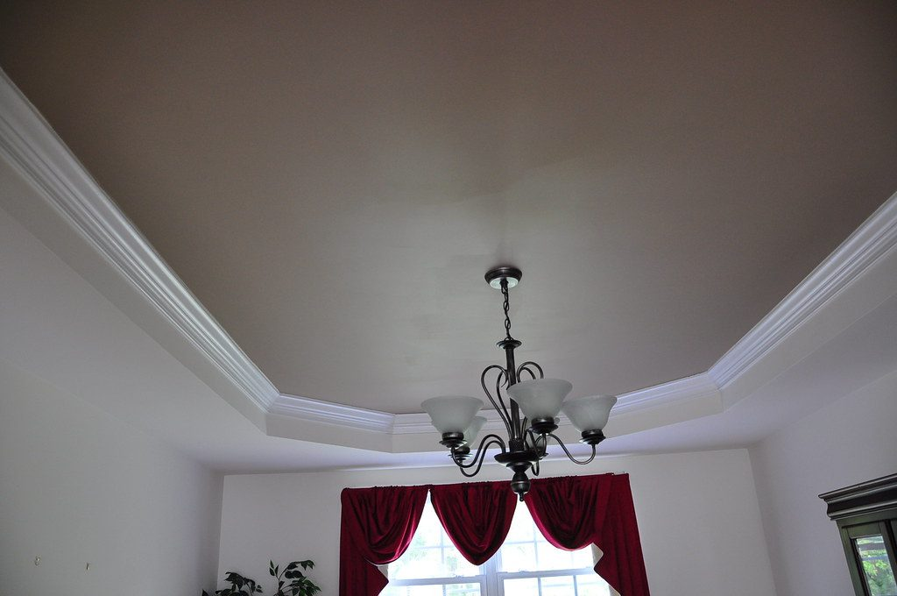
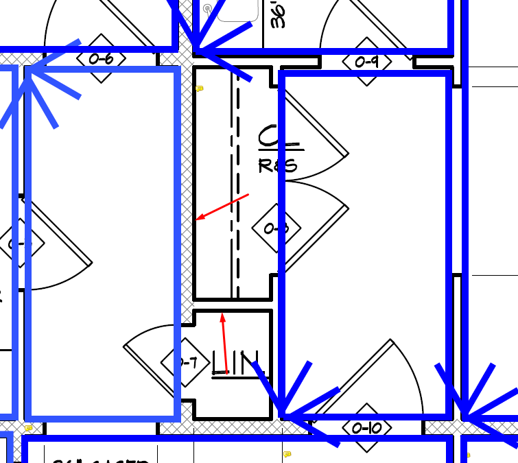
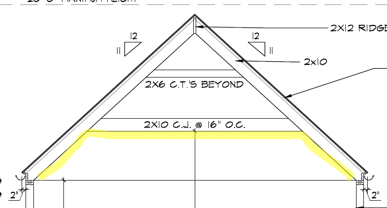
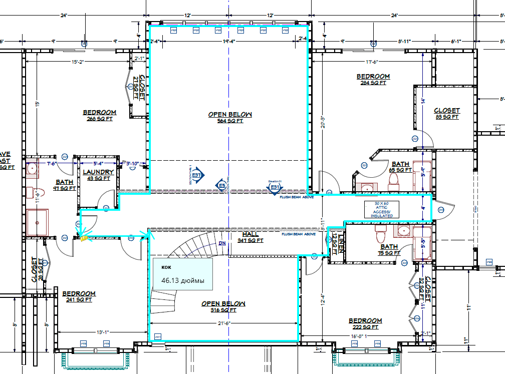

# Crown

<figure markdown>
  
  <figcaption markdown="span">Crown molding around the ceiling perimeter. Counted in LFT in the same rooms as base, but with its own exclusions. Photo: The Finishing Company Richmond Va, CC BY 2.0, [source](https://www.flickr.com/photos/23141008@N06/5084390501)</figcaption>
</figure>

## What it is

`Crowns`: the molding at the wall-to-ceiling joint. Counted in LFT along the room
perimeter, with the same logic as [Base](base.md), but crown must not be derived from
base: it has its own room list. It is included when the interior trim scope
is active and crown is shown in the schedule or notes.

## Where to find it on the plans

| Sheet | What to take |
| --- | --- |
| Room finish schedule, remarks | Which rooms get crown, material, `TBD` |
| RCP and ceiling notes | Sloped ceiling, tray ceiling, height |
| Interior elevations | Crown profile, where it is shown |

## How to measure in OurPlanCore

Line along the perimeter of rooms with crown on the plan with the W point, one item per floor
(`crown 1st`, `crown 2nd`). Second floor separately: crown there is often only
in the hall, foyer and large bedrooms.

## Rules

| Rule | What to check |
| --- | --- |
| No crown in closets | Exclude `Closet` / `CLO.` unless the scope says otherwise |
| Sloped ceiling: no crown | Watch for `slope ceiling` on the RCP |
| Garage, mechanical, crawl space, unfinished: no crown | Do not run the perimeter through them |
| Bathrooms may have crown | Do not exclude automatically, check the scope |
| Second level | Only the hall, foyer and large rooms where shown |
| Material `TBD Crowns` | Leave the note, do not pick a product |

Do not confuse crown with exterior cornice, fascia, frieze and rake trim.

## Tree name and DFL row

| Tree name | DFL row | Unit | Formula |
| --- | --- | --- | --- |
| `trims/crown 1st` | `Crowns` | LFT | `=58+44+71+...` all runs visible |
| `trims/crown 2nd` | `Crowns 2nd floor` | LFT | as a separate row |
| | `Crowns TBD` | LFT | note, if the material is not set |

## Common mistakes

- Crown counted in closets and rooms with a sloped ceiling.
- Crown derived from base without its own room list.
- Second floor counted in full.
- All Excel mistakes: [Excel DFL and notes](../../start/common-mistakes.md#excel).

## Example

```text
Takeoffs/Main/trims/crown 1st   Line   286 LFT (living, dining, foyer, hall)

Crowns   3-1/2" crown (per schedule)   286  LFT   =92+68+44+82   A701
Crowns   TBD                           0    LFT   Note: Crown material not specified; verify
```

<details class="kb-figures kb-figures--rows">
  <summary>Show 3 archived cards with illustrations</summary>
  <figure class="kb-figure-row">
    <figcaption class="kb-figure-row__text">
      <div class="kb-figure-row__title">No Crowns in closets</div>
      <div class="kb-figure-row__rule">Do not run the crown perimeter through closet walls.</div>
    </figcaption>
    <a class="kb-figure-row__image" href="../../../assets/images/trims/int-trims-17.png" target="_blank" rel="noopener"></a>
  </figure>
  <figure class="kb-figure-row">
    <figcaption class="kb-figure-row__text">
      <div class="kb-figure-row__title">Sloped ceiling</div>
      <div class="kb-figure-row__rule">Check the RCP before counting: a sloped ceiling breaks the usual rule.</div>
    </figcaption>
    <a class="kb-figure-row__image" href="../../../assets/images/trims/int-trims-18.png" target="_blank" rel="noopener"></a>
  </figure>
  <figure class="kb-figure-row">
    <figcaption class="kb-figure-row__text">
      <div class="kb-figure-row__title">Second level</div>
      <div class="kb-figure-row__rule">Only the hall, foyer and large rooms where it is required.</div>
    </figcaption>
    <a class="kb-figure-row__image" href="../../../assets/images/trims/int-trims-22.png" target="_blank" rel="noopener"></a>
  </figure>
</details>

## See also

- [Interior Trims](overview.md), [Base](base.md), [Room Schedule](room-schedule.md), [Casing](casing.md)
- [Standard notes](../../reference/standard-notes.md)
