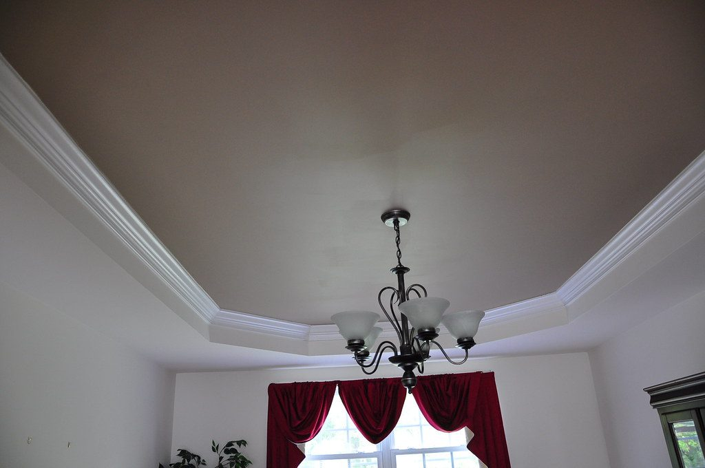
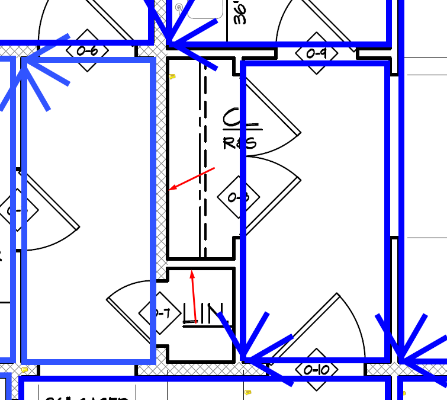
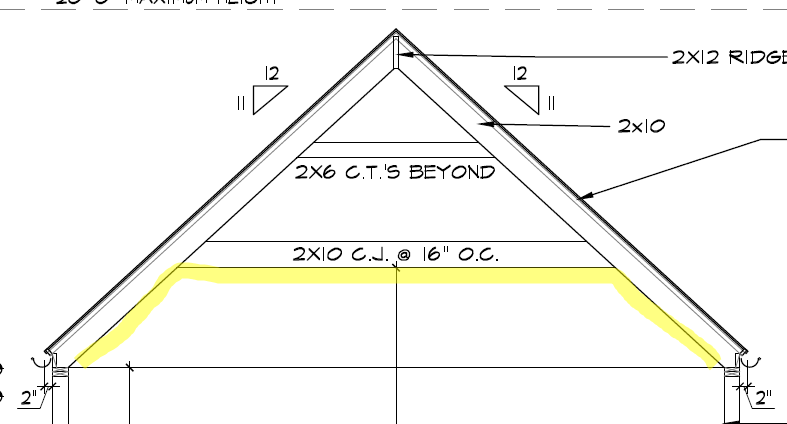
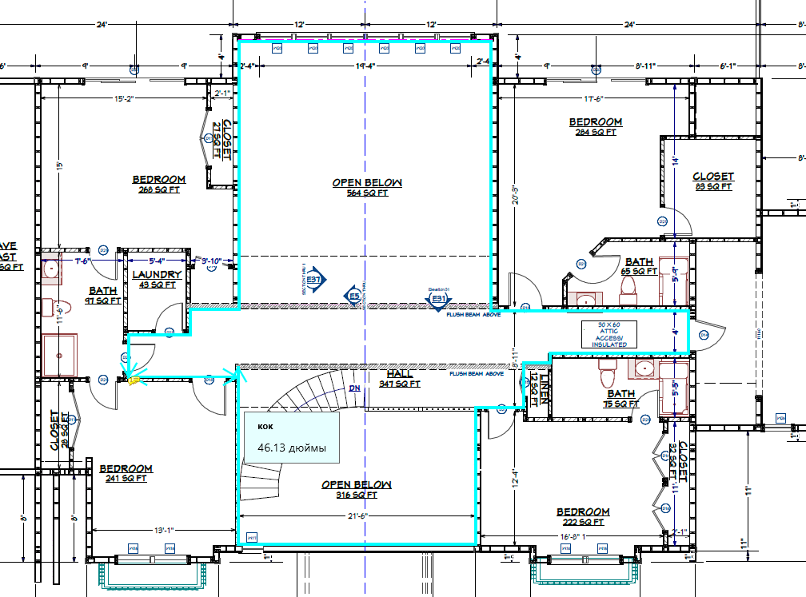

# Crown (потолочный карниз)

<figure markdown>
  
  <figcaption markdown="span">Crown molding по периметру потолка. Считается LFT по тем же комнатам, что и base, но со своими исключениями. Фото: The Finishing Company Richmond Va, CC BY 2.0, [источник](https://www.flickr.com/photos/23141008@N06/5084390501)</figcaption>
</figure>

## Что это

`Crowns`: молдинг по стыку стены и потолка. Считается LFT по периметру
комнат, той же логикой, что [Base](base.md), но crown нельзя выводить из
base: у него свой список комнат. Включается, когда interior trim scope
активен и crown показан в schedule или notes.

## Где искать на чертежах

| Лист | Что взять |
| --- | --- |
| Room finish schedule, remarks | В каких комнатах crown, материал, `TBD` |
| RCP и ceiling notes | Sloped ceiling, tray ceiling, высота |
| Interior elevations | Профиль crown, где он показан |

## Как мерить в OurPlanCore

Line по периметру комнат с crown на плане с точкой W, по итему на этаж
(`crown 1st`, `crown 2nd`). Second floor отдельно: там crown часто только
в hall, foyer и больших спальнях.

## Правила

| Правило | Что проверить |
| --- | --- |
| В closets crown нет | Исключать `Closet` / `CLO.`, если scope не говорит обратное |
| Sloped ceiling: crown нет | Следить за `slope ceiling` на RCP |
| Garage, mechanical, crawl space, unfinished: crown нет | Периметр через них не вести |
| Bathrooms могут иметь crown | Не исключать автоматически, смотреть scope |
| Second level | Только hall, foyer и большие комнаты, где показано |
| Материал `TBD Crowns` | Оставить ноту, не выбирать продукт |

Не путай crown с exterior cornice, fascia, frieze и rake trim.

## Как назвать в дереве и строка DFL

| Имя в дереве | Строка DFL | Unit | Формула |
| --- | --- | --- | --- |
| `trims/crown 1st` | `Crowns` | LFT | `=58+44+71+...` все участки видны |
| `trims/crown 2nd` | `Crowns 2nd floor` | LFT | отдельной строкой |
| | `Crowns TBD` | LFT | нота, если материал не задан |

## Частые ошибки

- Crown посчитан в closets и комнатах со sloped ceiling.
- Crown выведен из base без своего списка комнат.
- Second floor посчитан целиком.
- Все ошибки по Excel: [Excel DFL и ноты](../../start/common-mistakes.md#excel).

## Пример

```text
Takeoffs/Main/trims/crown 1st   Line   286 LFT (living, dining, foyer, hall)

Crowns   3-1/2" crown (per schedule)   286  LFT   =92+68+44+82   A701
Crowns   TBD                           0    LFT   Note: Crown material not specified; verify
```

<details class="kb-figures kb-figures--rows">
  <summary>Показать 3 архивные карточки с иллюстрациями</summary>
  <figure class="kb-figure-row">
    <figcaption class="kb-figure-row__text">
      <div class="kb-figure-row__title">В closets нет Crowns</div>
      <div class="kb-figure-row__rule">Не веди периметр crown через closet walls.</div>
    </figcaption>
    <a class="kb-figure-row__image" href="../../../assets/images/trims/int-trims-17.png" target="_blank" rel="noopener"></a>
  </figure>
  <figure class="kb-figure-row">
    <figcaption class="kb-figure-row__text">
      <div class="kb-figure-row__title">Sloped ceiling</div>
      <div class="kb-figure-row__rule">Перед подсчётом проверь RCP: наклонный потолок ломает обычное правило.</div>
    </figcaption>
    <a class="kb-figure-row__image" href="../../../assets/images/trims/int-trims-18.png" target="_blank" rel="noopener"></a>
  </figure>
  <figure class="kb-figure-row">
    <figcaption class="kb-figure-row__text">
      <div class="kb-figure-row__title">Second level</div>
      <div class="kb-figure-row__rule">Только hall, foyer и большие комнаты, где это требуется.</div>
    </figcaption>
    <a class="kb-figure-row__image" href="../../../assets/images/trims/int-trims-22.png" target="_blank" rel="noopener"></a>
  </figure>
</details>

## См. также

- [Interior Trims](overview.md), [Base](base.md), [Room Schedule](room-schedule.md), [Casing](casing.md)
- [Standard notes](../../reference/standard-notes.md)
