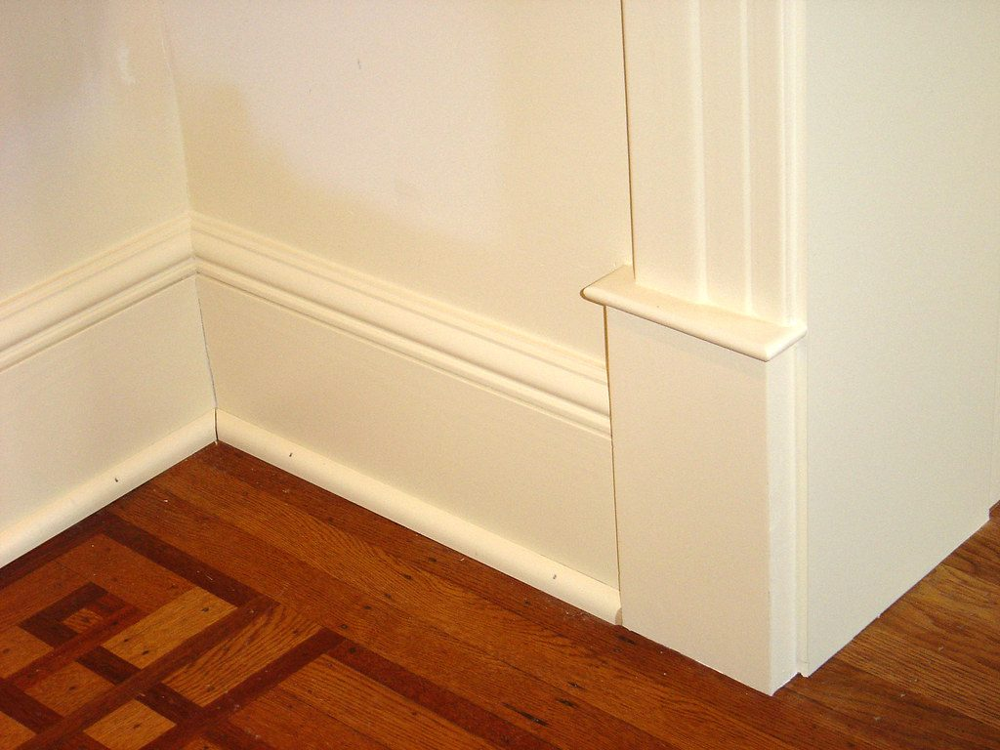
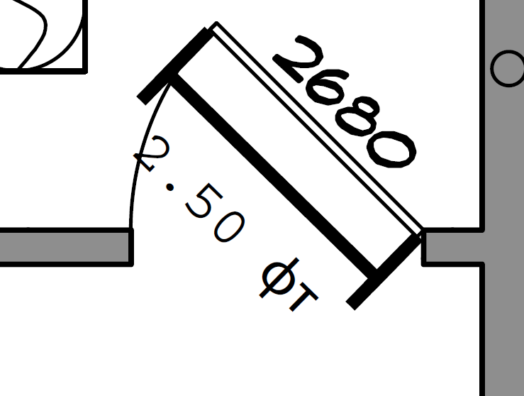
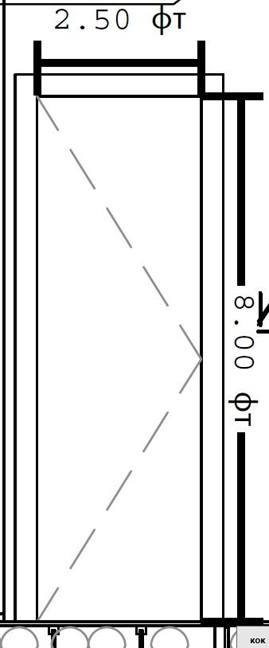
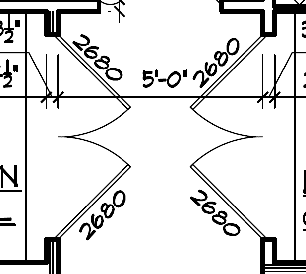
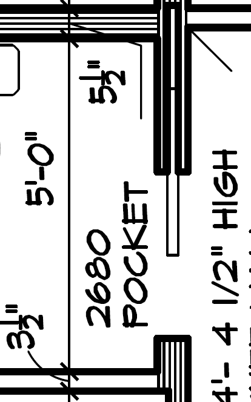
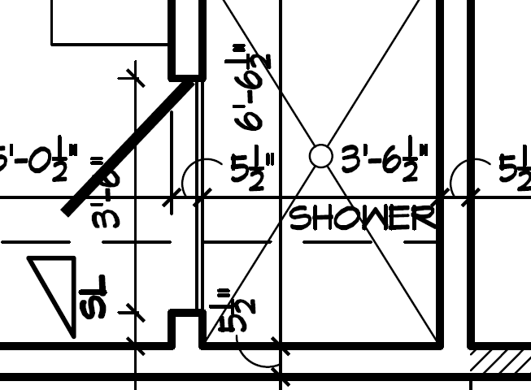
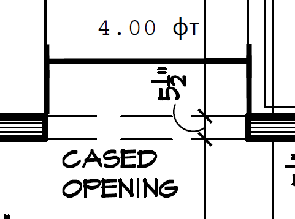
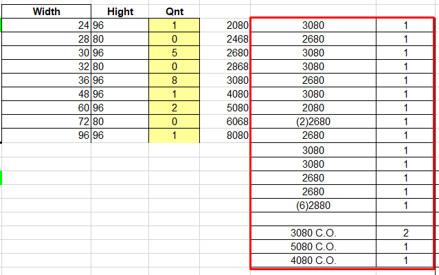
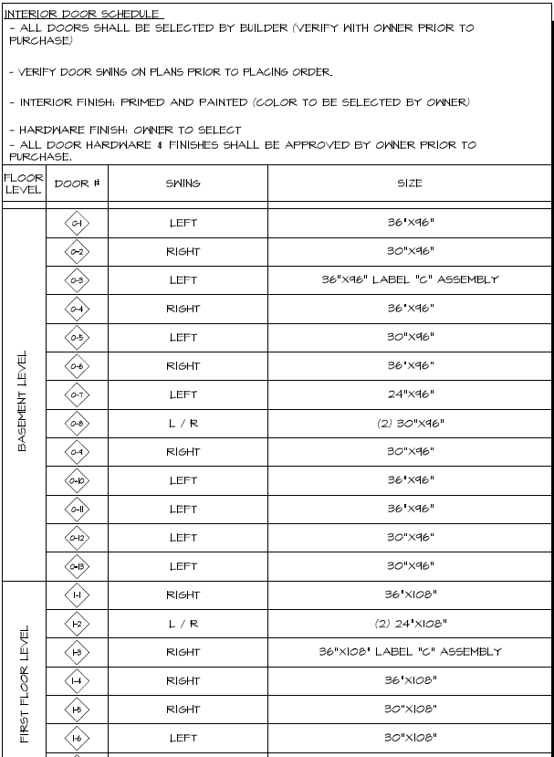

# Door and Window Trim

<figure markdown>
  
  <figcaption markdown="span">Baseboard and door casing on one wall: base is counted by perimeter, casing with a formula from the door list. Photo: gemteck1, CC BY 2.0, [source](https://www.flickr.com/photos/65303620@N00/712932547)</figcaption>
</figure>

## What it is

The list of interior doors and cased openings per floor, with size and
type designation, from which the casing is calculated with a formula. The door schedule wins over the plan:
if there is one, fill from it. The casing and jamb formula is on the
[Casing](casing.md) page; interior window trim (casing, stool, apron) only when it
is in the finish schedule or details.

## Where to find it on the plans

| Sheet | What to take |
| --- | --- |
| Door schedule (`dr sch`) | Size, type (pocket, slider, bi-fold), material, `F.R.`, `S.C.` |
| Floor plans | Open door symbol (count by it, not by the wall), cased openings `C.O.` |
| Finish schedule, interior elevations | Window casing, stool, apron; trim profile |
| Notes | Manufacturer or special product: keep it in the note, do not reduce it to a size |

## How to measure in OurPlanCore

Doors are counted with Count points on the open door symbol, one item per
size and type (`2680`, `(2)2680`, `4080 C.O.`), separately for each floor.
Shower glass doors are not included. Mark unit entry doors with a fire rating in the
name (`2680 F.R.`); hardware numbers are not needed.

## Size designations

| Example | Meaning | How to write it |
| --- | --- | --- |
| `2680` | 2'-6" x 8'-0" | regular single interior door |
| `(2)2680` | two doors 2'-6" x 8'-0" | double door, pair marker visible |
| `2680 Pocket` | pocket door | the word `Pocket` stays |
| `(2)3080 Slider` | two panels 3'-0" x 8'-0" | quantity and `Slider` stay |
| `(2)2680 Bi-Fold` | closet bi-fold | `Bi-Fold`, do not reduce it to slider |
| `9068 Bi-Fold` | wide bi-fold 9'-0" x 8'-0" | one opening, panels are not counted separately |
| `2680 Metal F.R. S.C.` | metal, fire-rated, self-closing | garage and mechanical; `F.R.` and `S.C.` stay |
| `4080 C.O.` | cased opening 4'-0" x 8'-0" | enter as a cased opening, not as a door |

`F.R.` on a door means fire-rated (door, frame and hardware as an assembly).
Do not confuse it with `FRT`: that is fire-retardant-treated framing lumber.

## Tree name and DFL row

| Tree name | DFL row | Unit | Rule |
| --- | --- | --- | --- |
| `openings/1/2680` | `Int. Doors 2680` | pcs | per floor, from the schedule |
| `openings/1/(2)2680` | `Int. Doors (2)2680` | pcs | double as a pair |
| `openings/1/4080 C.O.` | `Cased Openings 4080` | pcs | separate from doors |
| | `Casing for Int. Doors` | LFT | formula from the list, see [Casing](casing.md) |
| | `Interior Doors&Trims` | | block header with a note about the profile |

Excel entry:

1. All doors and cased openings are entered per floor before the casing formulas.
2. Sizes are rewritten in inches in a helper table: `2'-0" x
   6'-8"` becomes `24 x 80`.
3. Mark and quantity are copied to the helper table on the right; the casing formulas
   come from it; repeated doors are counted with a formula, not typed by hand.
4. Before output, select the quantity cells and compare the sum in the status
   bar with the number of doors on the plans.

## Common mistakes

- Doors counted by the wall or by a nearby note, not by the door symbol.
- Bi-fold panels counted as separate doors.
- Shower glass doors entered as interior doors.
- `Pocket`, `Slider`, `F.R. S.C.` lost on the way to Excel.
- A cased opening entered as a door.
- All Excel mistakes: [Excel DFL and notes](../../start/common-mistakes.md#excel).

## Example

```text
Takeoffs/Main/openings/1/2680          Count   18
Takeoffs/Main/openings/1/(2)2680       Count   3
Takeoffs/Main/openings/1/4080 C.O.     Count   2

Int. Doors 2680              18  pcs   A601
Int. Doors (2)2680           3   pcs   A601
Int. Doors 2680 Pocket       2   pcs   A601
Cased Openings 4080          2   pcs   A601
Casing for Int. Doors        1x3-1/2   ...  LFT   =(2*8+2.5)*2*18+...
```

<details class="kb-figures kb-figures--rows">
  <summary>Show 8 archived cards with illustrations</summary>
  <figure class="kb-figure-row">
    <figcaption class="kb-figure-row__text">
      <div class="kb-figure-row__title">Count by the open door symbol</div>
      <div class="kb-figure-row__rule">Count the actual swing, not a note by the wall.</div>
    </figcaption>
    <a class="kb-figure-row__image" href="../../../assets/images/trims/int-trims-26.png" target="_blank" rel="noopener"></a>
  </figure>
  <figure class="kb-figure-row">
    <figcaption class="kb-figure-row__text">
      <div class="kb-figure-row__title">Size notation 2680</div>
      <div class="kb-figure-row__rule"><code>2680</code> = 2'-6" x 8'-0". Keep the designation the same all the way to Excel.</div>
    </figcaption>
    <a class="kb-figure-row__image" href="../../../assets/images/trims/int-trims-27.png" target="_blank" rel="noopener"></a>
  </figure>
  <figure class="kb-figure-row">
    <figcaption class="kb-figure-row__text">
      <div class="kb-figure-row__title">Double doors</div>
      <div class="kb-figure-row__rule">Write <code>(2)2680</code>, pair marker visible.</div>
    </figcaption>
    <a class="kb-figure-row__image" href="../../../assets/images/trims/int-trims-28.png" target="_blank" rel="noopener"></a>
  </figure>
  <figure class="kb-figure-row">
    <figcaption class="kb-figure-row__text">
      <div class="kb-figure-row__title">Pocket and Slider</div>
      <div class="kb-figure-row__rule"><code>2680 Pocket</code>, <code>(2)3080 Slider</code>: the type stays in the designation.</div>
    </figcaption>
    <a class="kb-figure-row__image" href="../../../assets/images/trims/int-trims-29.png" target="_blank" rel="noopener"></a>
  </figure>
  <figure class="kb-figure-row">
    <figcaption class="kb-figure-row__text">
      <div class="kb-figure-row__title">Shower glass doors</div>
      <div class="kb-figure-row__rule">Do not enter them as interior doors: that is shower scope.</div>
    </figcaption>
    <a class="kb-figure-row__image" href="../../../assets/images/trims/int-trims-31.png" target="_blank" rel="noopener"></a>
  </figure>
  <figure class="kb-figure-row">
    <figcaption class="kb-figure-row__text">
      <div class="kb-figure-row__title">Cased opening</div>
      <div class="kb-figure-row__rule"><code>C.O.</code> is an opening with no door, entered separately.</div>
    </figcaption>
    <a class="kb-figure-row__image" href="../../../assets/images/trims/int-trims-34.png" target="_blank" rel="noopener"></a>
  </figure>
  <figure class="kb-figure-row">
    <figcaption class="kb-figure-row__text">
      <div class="kb-figure-row__title">Entry per floor and helper table</div>
      <div class="kb-figure-row__rule">Doors and C.O. per floor; mark and quantity in the helper table for the casing formulas.</div>
    </figcaption>
    <a class="kb-figure-row__image" href="../../../assets/images/trims/int-trims-37.png" target="_blank" rel="noopener"></a>
  </figure>
  <figure class="kb-figure-row">
    <figcaption class="kb-figure-row__text">
      <div class="kb-figure-row__title">There is a door schedule</div>
      <div class="kb-figure-row__rule">Fill from the schedule first, the plan comes second.</div>
    </figcaption>
    <a class="kb-figure-row__image" href="../../../assets/images/trims/int-trims-43.png" target="_blank" rel="noopener"></a>
  </figure>
</details>

## See also

- [Casing](casing.md), [Base](base.md), [Room Schedule](room-schedule.md), [Interior Trims](overview.md)
- [Windows and Doors](../vertical/openings/windows-doors.md), [Standard notes](../../reference/standard-notes.md)
