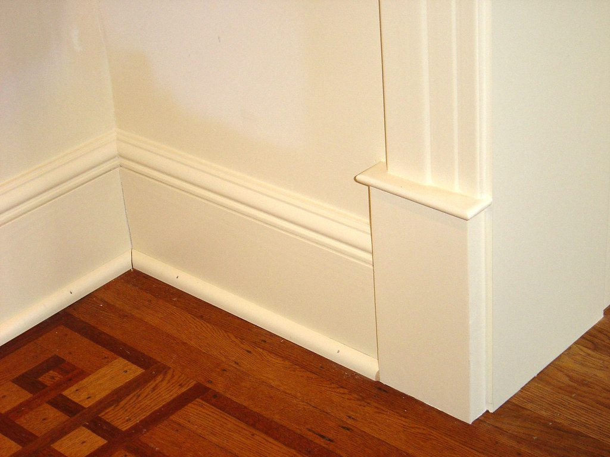
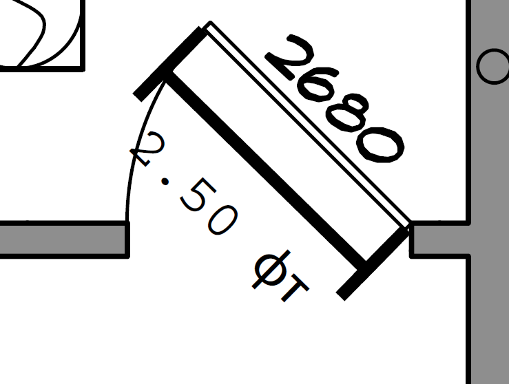
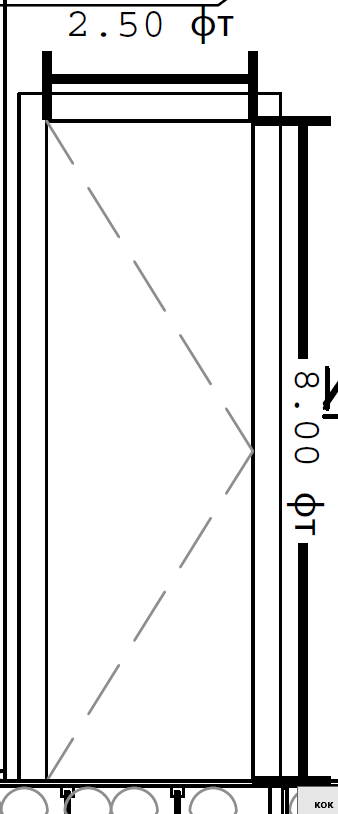
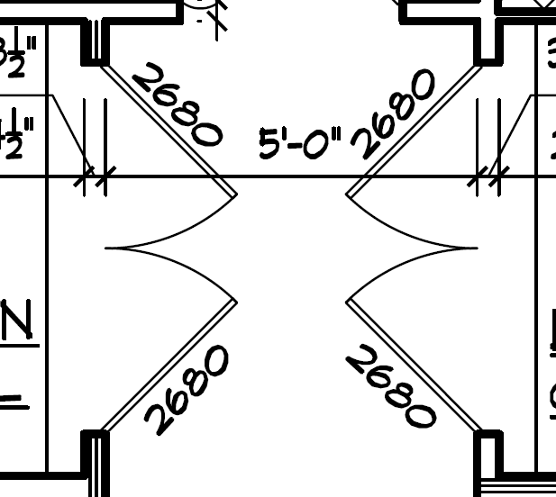
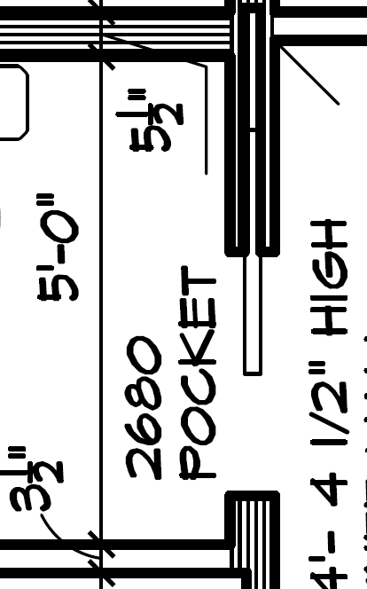
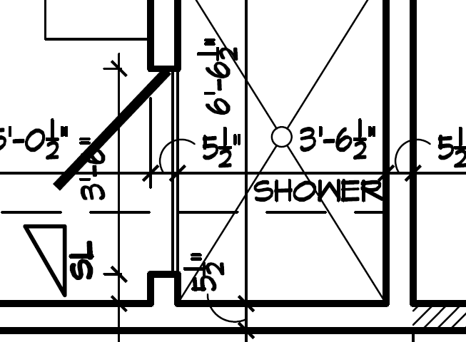
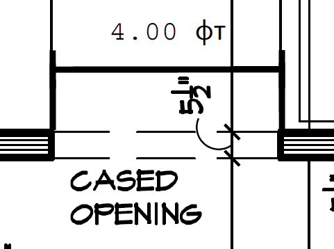
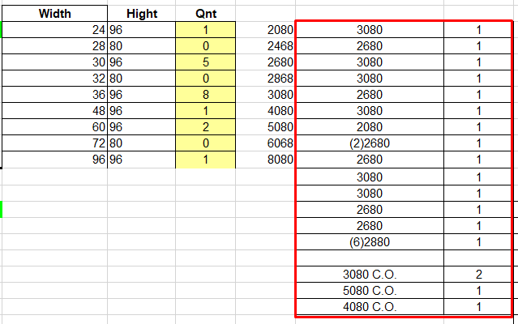
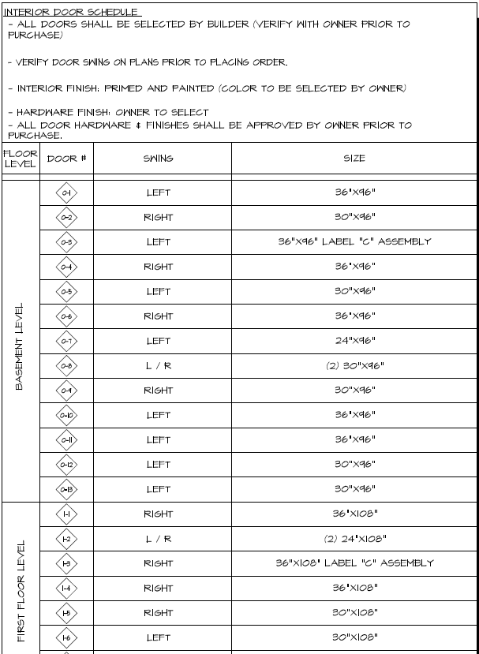

# Door and Window Trim (список дверей и наличники)

<figure markdown>
  
  <figcaption markdown="span">Baseboard и door casing на одной стене: base считаем периметром, casing формулой от списка дверей. Фото: gemteck1, CC BY 2.0, [источник](https://www.flickr.com/photos/65303620@N00/712932547)</figcaption>
</figure>

## Что это

Список interior doors и cased openings по этажам с обозначением размера и
типа, из которого формулой считается casing. Door schedule главнее плана:
если он есть, заполняй из него. Формула casing и jamb на странице
[Casing](casing.md), окна изнутри (casing, stool, apron) только когда они
есть в finish schedule или details.

## Где искать на чертежах

| Лист | Что взять |
| --- | --- |
| Door schedule (`dr sch`) | Размер, тип (pocket, slider, bi-fold), материал, `F.R.`, `S.C.` |
| Планы этажей | Символ открытой двери (считать по нему, не по стене), cased openings `C.O.` |
| Finish schedule, interior elevations | Casing, stool, apron у окон; профиль trim |
| Notes | Производитель или special product: оставить в ноте, не сводить к размеру |

## Как мерить в OurPlanCore

Двери считаются Count точками по символу открытой двери, по итему на
размер и тип (`2680`, `(2)2680`, `4080 C.O.`), отдельно на каждый этаж.
Shower glass doors не входят. Unit entry doors с fire rating отмечай в
имени (`2680 F.R.`), hardware numbers не нужны.

## Обозначения размеров

| Пример | Значение | Как записать |
| --- | --- | --- |
| `2680` | 2'-6" x 8'-0" | обычная single interior door |
| `(2)2680` | две двери 2'-6" x 8'-0" | double door, pair marker виден |
| `2680 Pocket` | pocket door | слово `Pocket` остаётся |
| `(2)3080 Slider` | две створки 3'-0" x 8'-0" | quantity и `Slider` остаются |
| `(2)2680 Bi-Fold` | closet bi-fold | `Bi-Fold`, не сводить к slider |
| `9068 Bi-Fold` | широкий bi-fold 9'-0" x 8'-0" | один opening, створки не считаем отдельно |
| `2680 Metal F.R. S.C.` | metal, fire-rated, self-closing | garage и mechanical; `F.R.` и `S.C.` остаются |
| `4080 C.O.` | cased opening 4'-0" x 8'-0" | вводить как cased opening, не как door |

`F.R.` у двери значит fire-rated (дверь, рама и hardware как сборка).
Не путать с `FRT`: это fire-retardant-treated пиломатериал каркаса.

## Как назвать в дереве и строка DFL

| Имя в дереве | Строка DFL | Unit | Правило |
| --- | --- | --- | --- |
| `openings/1/2680` | `Int. Doors 2680` | pcs | по этажам, из schedule |
| `openings/1/(2)2680` | `Int. Doors (2)2680` | pcs | double как pair |
| `openings/1/4080 C.O.` | `Cased Openings 4080` | pcs | отдельно от дверей |
| | `Casing for Int. Doors` | LFT | формула от списка, см. [Casing](casing.md) |
| | `Interior Doors&Trims` | | заголовок блока с нотой о профиле |

Ввод в Excel:

1. Все двери и cased openings вводятся по этажам до формул casing.
2. Размеры переписываются в дюймах во вспомогательную таблицу: `2'-0" x
   6'-8"` становится `24 x 80`.
3. Mark и quantity копируются в helper table справа, из неё идут формулы
   casing; повторяющиеся двери считаются формулой, а не ручным набором.
4. Перед выводом выдели ячейки количества и сравни сумму в строке
   состояния с числом дверей на планах.

## Частые ошибки

- Двери посчитаны по стене или по ноте рядом, а не по символу двери.
- Створки bi-fold посчитаны как отдельные двери.
- Shower glass doors введены как interior doors.
- `Pocket`, `Slider`, `F.R. S.C.` потеряны при переносе в Excel.
- Cased opening введён как дверь.
- Все ошибки по Excel: [Excel DFL и ноты](../../start/common-mistakes.md#excel).

## Пример

```text
Takeoffs/Main/openings/1/2680          Count   18
Takeoffs/Main/openings/1/(2)2680       Count   3
Takeoffs/Main/openings/1/4080 C.O.     Count   2

Int. Doors 2680              18  pcs   A601
Int. Doors (2)2680           3   pcs   A601
Int. Doors 2680 Pocket       2   pcs   A601
Cased Openings 4080          2   pcs   A601
Casing for Int. Doors        1x3-1/2   ...  LFT   =(2*8+2.5)*2*18+...
```

<details class="kb-figures kb-figures--rows">
  <summary>Показать 8 архивных карточек с иллюстрациями</summary>
  <figure class="kb-figure-row">
    <figcaption class="kb-figure-row__text">
      <div class="kb-figure-row__title">Считать по символу открытой двери</div>
      <div class="kb-figure-row__rule">Считай настоящий swing, а не ноту у стены.</div>
    </figcaption>
    <a class="kb-figure-row__image" href="../../../assets/images/trims/int-trims-26.png" target="_blank" rel="noopener"></a>
  </figure>
  <figure class="kb-figure-row">
    <figcaption class="kb-figure-row__text">
      <div class="kb-figure-row__title">Size notation 2680</div>
      <div class="kb-figure-row__rule"><code>2680</code> = 2'-6" x 8'-0". Держи обозначение одинаковым до переноса в Excel.</div>
    </figcaption>
    <a class="kb-figure-row__image" href="../../../assets/images/trims/int-trims-27.png" target="_blank" rel="noopener"></a>
  </figure>
  <figure class="kb-figure-row">
    <figcaption class="kb-figure-row__text">
      <div class="kb-figure-row__title">Double doors</div>
      <div class="kb-figure-row__rule">Пиши <code>(2)2680</code>, pair marker виден.</div>
    </figcaption>
    <a class="kb-figure-row__image" href="../../../assets/images/trims/int-trims-28.png" target="_blank" rel="noopener"></a>
  </figure>
  <figure class="kb-figure-row">
    <figcaption class="kb-figure-row__text">
      <div class="kb-figure-row__title">Pocket и Slider</div>
      <div class="kb-figure-row__rule"><code>2680 Pocket</code>, <code>(2)3080 Slider</code>: тип остаётся в обозначении.</div>
    </figcaption>
    <a class="kb-figure-row__image" href="../../../assets/images/trims/int-trims-29.png" target="_blank" rel="noopener"></a>
  </figure>
  <figure class="kb-figure-row">
    <figcaption class="kb-figure-row__text">
      <div class="kb-figure-row__title">Shower glass doors</div>
      <div class="kb-figure-row__rule">Не вводи как interior doors: это shower scope.</div>
    </figcaption>
    <a class="kb-figure-row__image" href="../../../assets/images/trims/int-trims-31.png" target="_blank" rel="noopener"></a>
  </figure>
  <figure class="kb-figure-row">
    <figcaption class="kb-figure-row__text">
      <div class="kb-figure-row__title">Cased opening</div>
      <div class="kb-figure-row__rule"><code>C.O.</code> это проём без двери, вводится отдельно.</div>
    </figcaption>
    <a class="kb-figure-row__image" href="../../../assets/images/trims/int-trims-34.png" target="_blank" rel="noopener"></a>
  </figure>
  <figure class="kb-figure-row">
    <figcaption class="kb-figure-row__text">
      <div class="kb-figure-row__title">Ввод по этажам и helper table</div>
      <div class="kb-figure-row__rule">Двери и C.O. по этажам; mark и quantity в helper table для формул casing.</div>
    </figcaption>
    <a class="kb-figure-row__image" href="../../../assets/images/trims/int-trims-37.png" target="_blank" rel="noopener"></a>
  </figure>
  <figure class="kb-figure-row">
    <figcaption class="kb-figure-row__text">
      <div class="kb-figure-row__title">Есть door schedule</div>
      <div class="kb-figure-row__rule">Сначала заполняй из schedule, план вторичен.</div>
    </figcaption>
    <a class="kb-figure-row__image" href="../../../assets/images/trims/int-trims-43.png" target="_blank" rel="noopener"></a>
  </figure>
</details>

## См. также

- [Casing](casing.md), [Base](base.md), [Room Schedule](room-schedule.md), [Interior Trims](overview.md)
- [Windows and Doors](../vertical/openings/windows-doors.md), [Standard notes](../../reference/standard-notes.md)
