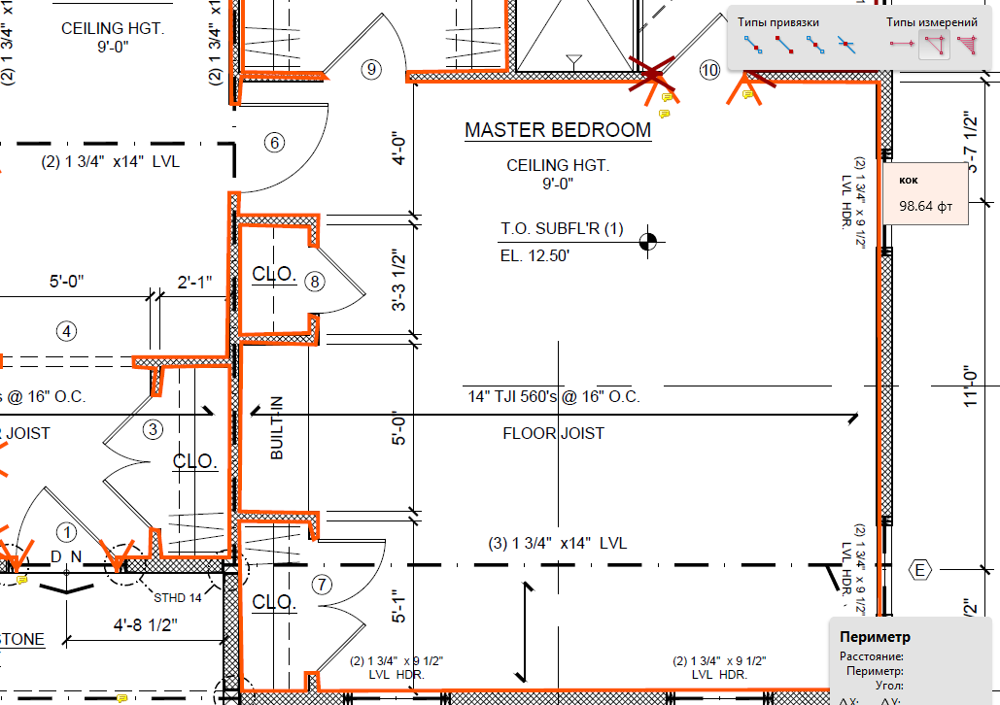

# Interior Trims

Interior Trims is a separate scope: baseboard, door and window casing, crown.
Not exterior trims, not drywall and not framing. This section is needed when the job
includes finish trim per the room schedule, door schedule or finish plans. In a
frame scope interior trim is not counted.

<figure markdown>
  
  <figcaption markdown="span">An old measuring frame: the room perimeter as a line along the walls (`Perimeter`, 98,64 ft), one line per room. Baseboard and crown are LFT along such a perimeter; breaks (kitchen cabinets, garage, stair) must be intentional and visible in the formula.</figcaption>
</figure>

## What is included and in what order

-   :material-table:{ .lg .middle } **Room Schedule**

    ---

    How to read the room finish schedule: the Base column, `Wd` or tile material,
    unfinished rooms.

    [Room Schedule](room-schedule.md)

-   :material-border-bottom:{ .lg .middle } **Base**

    ---

    Baseboard along the room perimeter: where it goes and where it does not (kitchen cabinets,
    garage, tile base).

    [Base](base.md)

-   :material-border-top:{ .lg .middle } **Crown**

    ---

    Crown along the perimeter: no closets, sloped ceilings, garage.

    [Crown](crown.md)

-   :material-door:{ .lg .middle } **Door and Window Trim**

    ---

    The list of doors and cased openings per floor, designations `2680`, `C.O.`,
    `F.R. S.C.`, Excel entry.

    [Door and Window Trim](door-window-trim.md)

-   :material-rectangle-outline:{ .lg .middle } **Casing**

    ---

    Interior door and window casing: formula from the opening list, both faces and waste.

    [Casing](casing.md)

## Workflow

1. Prepare the sheets: floor plans, room finish schedule, door schedule,
   interior elevations. In OurPlanCore these are the `fin` and `in el` sheets in the
   `units` folder, plans with the W point.
2. Read the room schedule: which base (`Wd`, tile, rubber, `TBD`), where
   crown goes, which rooms are unfinished.
3. Trace the perimeters with a Line: `Baseboard` and `Crowns` continuous from the entry
   door, with intentional breaks. Unit base separately from corridors and lobby.
4. Make the list of doors and cased openings per floor, then the casing
   with a formula from the list.
5. Trim not specified: `TBD Base`, `TBD Casing`, `TBD Crowns` in B and a note, not
   a guessed product.

## Key rules

- Garage, mechanical, crawl space, unfinished storage: no `Baseboard` and
  no `Crowns`.
- Exclude tile base when the takeoff is for wood base.
- Common areas (corridors, lobbies) separately from units: different trim.
- `Crowns` are counted when the trim scope is active and crown is shown.
- Door casing is filled in after the interior door list; casing of exterior
  doors and windows after the exterior openings.

## Tree name and DFL row

| Tree name | DFL row | Unit | Rule |
| --- | --- | --- | --- |
| `trims/baseboard 1st` | `Baseboard` | LFT | perimeter of finished rooms: a sum with visible addends in G, `=CEILING(G*1.1,10)` |
| `trims/crown 1st` | `Crowns` | LFT | only rooms with crown per the schedule, `=CEILING(G*1.1,10)` |
| `openings` list | `Int. Doors`, `Cased Openings` | unit | per floor, size code in B |
| | `Casing for Int. Doors` | LFT | `=CEILING(2*SUM(perimeters)/12*1.1,10)`: door perimeters, both faces, 1.1 waste |

## Common mistakes

- Base run through kitchen cabinets and the garage.
- Crown counted in closets and rooms with a sloped ceiling.
- Tile base counted as wood base.
- Doors counted by the wall, not by the open door symbol.
- All Excel mistakes: [Excel DFL and notes](../../start/common-mistakes.md#excel).

## See also

- [Room Schedule](room-schedule.md), [Base](base.md), [Crown](crown.md), [Door and Window Trim](door-window-trim.md), [Casing](casing.md)
- [Exterior Trims](../exterior-trims/overview.md), [Windows and Doors](../vertical/openings/windows-doors.md)
- [Standard notes](../../reference/standard-notes.md), [Takeoff item labels](../../reference/takeoff-items.md)
