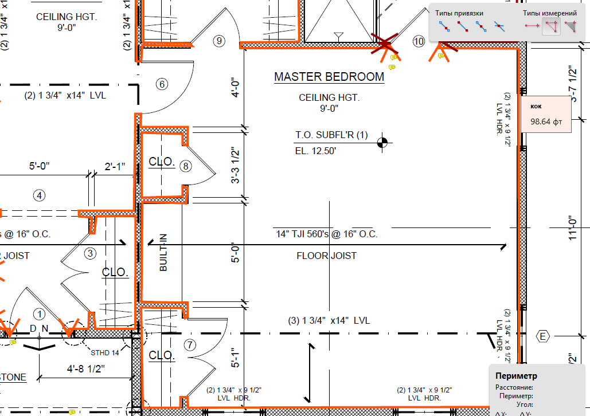

# Interior Trims (внутренняя отделка)

Interior Trims это отдельный scope: baseboard, casing дверей и окон, crown.
Не exterior trims, не drywall и не каркас. Раздел нужен, когда в задании
есть finish trim по room schedule, door schedule или finish plans. Во
frame-scope внутренняя отделка не считается.

<figure markdown>
  
  <figcaption markdown="span">Baseboard и crown это LFT по периметру комнат. Разрывы (шкафы кухни, garage, лестница) должны быть намеренными и видимыми в формуле.</figcaption>
</figure>

## Что входит и в каком порядке

-   :material-table:{ .lg .middle } **Room Schedule**

    ---

    Как читать room finish schedule: колонка Base, материал `Wd` или tile,
    комнаты без отделки.

    [Room Schedule](room-schedule.md)

-   :material-border-bottom:{ .lg .middle } **Base**

    ---

    Baseboard по периметру комнат: где есть, где нет (кухонные шкафы,
    garage, tile base).

    [Base](base.md)

-   :material-border-top:{ .lg .middle } **Crown**

    ---

    Crown по периметру: без closets, sloped ceilings, garage.

    [Crown](crown.md)

-   :material-door:{ .lg .middle } **Door and Window Trim**

    ---

    Список дверей и cased openings по этажам, обозначения `2680`, `C.O.`,
    `F.R. S.C.`, ввод в Excel.

    [Door and Window Trim](door-window-trim.md)

-   :material-rectangle-outline:{ .lg .middle } **Casing**

    ---

    Наличники дверей и окон изнутри: формула от списка проёмов, jamb.

    [Casing](casing.md)

## Порядок работы

1. Подготовь листы: планы этажей, room finish schedule, door schedule,
   interior elevations. В OurPlanCore это листы `fin` и `in el` в папке
   `units`, планы с точкой W.
2. Прочитай room schedule: какой base (`Wd`, tile, rubber, `TBD`), где
   crown, какие комнаты без отделки.
3. Обведи периметры Line: `Baseboard` и `Crowns` непрерывно от входной
   двери, с намеренными разрывами. Unit base отдельно от corridors и lobby.
4. Составь список дверей и cased openings по этажам, потом casing
   формулой от списка.
5. Trim не указан: пиши `not specified`, а не угадывай продукт.

## Основные правила

- Garage, mechanical, crawl space, unfinished storage: нет `Baseboard` и
  нет `Crowns`.
- Tile base исключай, когда takeoff нужен по wood base.
- Common areas (corridors, lobbies) отдельно от units: другой trim.
- `Crowns` считаются, когда trim-scope активен и crown показан.
- Casing дверей заполняется после списка interior doors; casing наружных
  дверей и окон после exterior openings.

## Как назвать в дереве и строка DFL

| Имя в дереве | Строка DFL | Unit | Правило |
| --- | --- | --- | --- |
| `trims/baseboard 1st` | `Baseboard` | LFT | периметр комнат с отделкой, формула с видимыми слагаемыми |
| `trims/crown 1st` | `Crowns` | LFT | только комнаты с crown по schedule |
| `openings`-список | `Int. Doors`, `Cased Openings` | pcs | по этажам, с обозначением размера |
| | `Casing for Int. Doors` | LFT | формула от списка дверей |

## Частые ошибки

- Base проведён через кухонные шкафы и garage.
- Crown посчитан в closets и комнатах со sloped ceiling.
- Tile base посчитан как wood base.
- Двери посчитаны по стене, а не по символу открытой двери.
- Все ошибки по Excel: [Excel DFL и ноты](../../start/common-mistakes.md#excel).

## См. также

- [Room Schedule](room-schedule.md), [Base](base.md), [Crown](crown.md), [Door and Window Trim](door-window-trim.md), [Casing](casing.md)
- [Exterior Trims](../exterior-trims/overview.md), [Windows and Doors](../vertical/openings/windows-doors.md)
- [Standard notes](../../reference/standard-notes.md), [Takeoff item labels](../../reference/takeoff-items.md)
