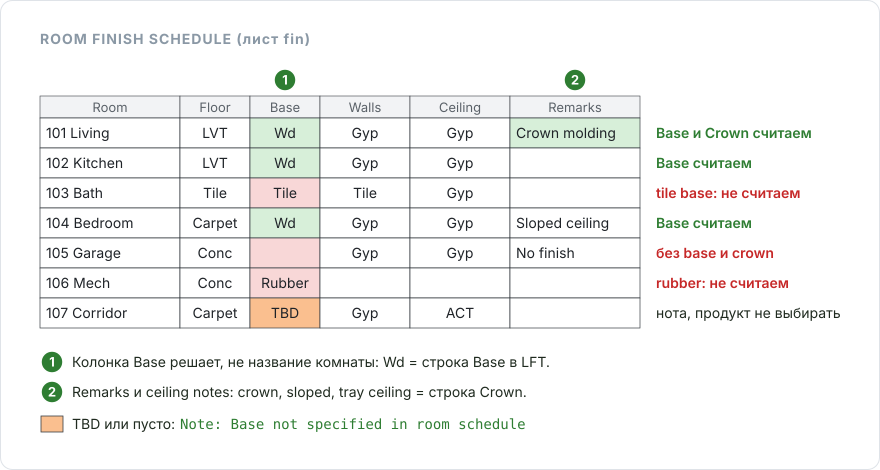

# Room Schedule

<figure markdown>
  
  <figcaption markdown="span">Room finish schedule columns: Floor, Base, Walls, Ceiling, Remarks. Wood base only with `Wd`; exclude tile base; the garage has no base and no crown.</figcaption>
</figure>

<!-- TODO-SCREEN: room-finish-schedule-crop.png (anonymized crop of a real room finish schedule with the Base column) -->

## What it is

The room finish schedule is the table on the `fin` sheets (or A6xx, A7xx): for
each room, the floor, base, wall and ceiling material plus remarks. It
tells you where to count [Base](base.md) and [Crown](crown.md) and in what
material. The door schedule (`dr sch`) gives the door list for
[Door and Window Trim](door-window-trim.md).

## Where to find it on the plans

| Sheet | What to take |
| --- | --- |
| Room finish schedule (`fin`) | `Base` column: `Wd`, `Tile`, `Rubber`, `TBD`; `Remarks` column: crown, wainscot |
| Door schedule (`dr sch`) | Door size, type, fire rating |
| Finish plans and interior elevations (`in el`) | Where the finish is shown graphically |
| Notes for common areas | Corridors, lobby, bathrooms, units: differences |

## How to read it

1. Find the `Base` column and go by it, not by the room name: a bathroom may
   have wood base and a kitchen tile.
2. List the unfinished rooms (garage, mechanical, storage): they get neither
   base nor crown.
3. Check `Remarks` and the ceiling notes: crown, sloped ceiling, tray ceiling.
4. Material `TBD` or blank: the note `Note: Base not specified in room
   schedule`, do not pick a product.
5. Count common areas and units with different materials in separate rows.

## Questions before counting

- Bathrooms with tile base or wood?
- Corridors and lobbies: a different base or casing?
- Crown everywhere, only in common areas, or in specific rooms?
- Are door and window trims specified or not?

## Common mistakes

- Base taken by the room name, not by the `Base` column.
- Unfinished rooms included in the perimeter.
- `TBD` replaced with a made-up product.
- All Excel mistakes: [Excel DFL and notes](../../start/common-mistakes.md#excel).

## See also

- [Interior Trims](overview.md), [Base](base.md), [Crown](crown.md), [Casing](casing.md), [Door and Window Trim](door-window-trim.md)
