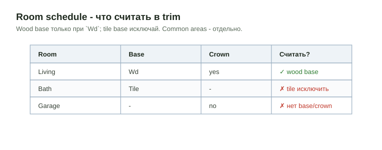

# Room Schedule (как читать таблицу отделки)

<figure markdown>
  
  <figcaption markdown="span">Колонки room finish schedule: Floor, Base, Walls, Ceiling, Remarks. Wood base только при `Wd`; tile base исключаем; garage без base и crown.</figcaption>
</figure>

<!-- TODO-SCREEN: room-finish-schedule-crop.png (обезличенный crop реальной room finish schedule с колонкой Base) -->

## Что это

Room finish schedule это таблица на листах `fin` (или A6xx, A7xx): по
каждой комнате материал пола, плинтуса, стен, потолка и remarks. Из неё
берётся, где считать [Base](base.md) и [Crown](crown.md) и из какого
материала. Door schedule (`dr sch`) даёт список дверей для
[Door and Window Trim](door-window-trim.md).

## Где искать на чертежах

| Лист | Что взять |
| --- | --- |
| Room finish schedule (`fin`) | Колонка `Base`: `Wd`, `Tile`, `Rubber`, `TBD`; колонка `Remarks`: crown, wainscot |
| Door schedule (`dr sch`) | Размер, тип, fire rating дверей |
| Finish plans и interior elevations (`in el`) | Где отделка показана графически |
| Notes для common areas | Corridors, lobby, bathrooms, units: отличия |

## Как читать

1. Найди колонку `Base` и смотри её, а не название комнаты: bathroom может
   иметь wood base, а kitchen tile.
2. Выпиши комнаты без отделки (garage, mechanical, storage): там нет ни
   base, ни crown.
3. Проверь `Remarks` и ceiling notes: crown, sloped ceiling, tray ceiling.
4. Материал `TBD` или пусто: нота `Note: Base not specified in room
   schedule`, продукт не выбирать.
5. Common areas и units с разным материалом считай отдельными строками.

## Вопросы перед подсчётом

- Bathrooms с tile base или wood?
- Corridors и lobbies: другой base или casing?
- Crown везде, только в common areas или в конкретных комнатах?
- Door и window trims указаны или нет?

## Частые ошибки

- Base взят по названию комнаты, а не по колонке `Base`.
- Комнаты без отделки включены в периметр.
- `TBD` заменён на выдуманный продукт.
- Все ошибки по Excel: [Excel DFL и ноты](../../start/common-mistakes.md#excel).

## См. также

- [Interior Trims](overview.md), [Base](base.md), [Crown](crown.md), [Casing](casing.md), [Door and Window Trim](door-window-trim.md)
