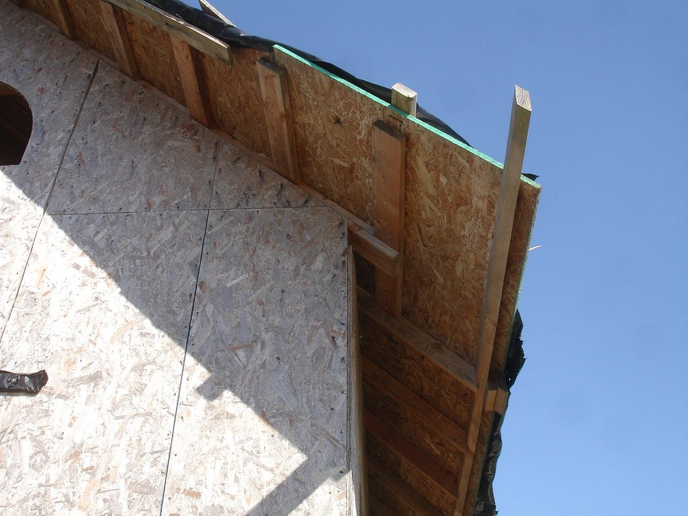
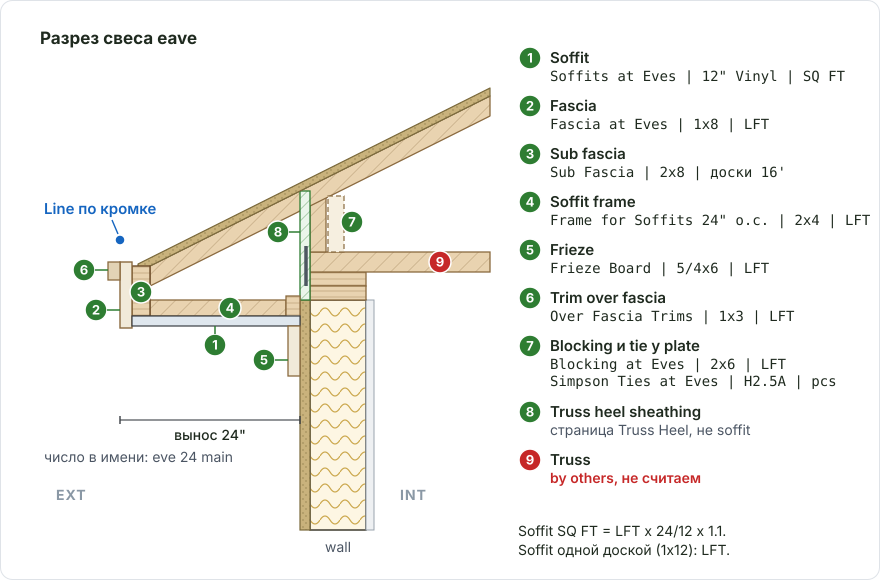

# Eve / Eave

<figure markdown>
  
  <figcaption markdown="span">Roof corner at the framing stage: on the left the sloped rake edge along the gable, on the right the horizontal eave with blocking between the truss tails. Eave and rake are different lines and different takeoffs. Photo: ssukotash, CC BY 2.0, <a href="https://www.flickr.com/photos/20775821@N03/6071724150">source</a>.</figcaption>
</figure>

## What it is

The eave (`eve` in the tree) is the lower horizontal edge of the roof along the wall, an overhang with
soffit underneath and fascia on the end. The rake is the sloped edge on the gable
([Rake](rake.md)), a return is the box at the corner where the eave turns into the rake
([Returns](returns.md)). The vertical strip at the truss heel above the wall is
[Truss Heel](../vertical/sheathing/truss-heel.md), not part of the eave. From one
eave line the export gets the soffit (SQ FT), fascia and sub fascia (LFT) and the overhang
framing.

## Where to find it on the plans

| Sheet | What to take |
| --- | --- |
| Roof plan (`a105 rf`) | Eave lines around the perimeter, overhang, main vs porch and canopy |
| Sections, soffit detail (`sec`, `d`) | Overhang width, sub fascia `2x6`/`2x8`, frame for soffit `2x4`/`2x6`, soffit material |
| Elevations (`el`) | Fascia, frieze, material changes by elevation |
| RCP | Soffit under canopy and porch (its own branch, not eave) |
| Finish schedule / specs | Vinyl vented, beadboard, fiber cement, exterior gypsum |

## How to measure in OurPlanCore

1. Line tool along the outer edge of the eave on the roof plan. LFT unit.
   All runs: every side of the building, every bump-out.
2. Name: `eve <overhang in inches> <zone>`: `eve 24 main`, `eve 12 porch`,
   `eve 18 upperporch no frame`. Take the overhang from a section or detail, not from the
   line weight on the plan. The `eves rakes/eves` folder is created from the name automatically; do not
   change `eves` to `eaves`.
3. Different overhangs and zones = different takeoffs. Mark runs with no overhang framing in
   the name (`no frame`).
4. Canopy and porch are not part of the eave: they have their own takeoffs and their own block. The main
   mistake is counting them twice.
5. Soffit SQ FT = length x width only when the width is constant. A complex porte-cochere
   or porch soffit is traced separately with an Area, without counting it a second time by
   length.

## Takeoff name and DFL row

| Takeoff name | DFL row | Material | Unit | Formula |
| --- | --- | --- | --- | --- |
| `eves rakes/eves/eve 24 main` | `Soffits at Eves` | `12" Vinyl vented` / beadboard / `5/8" Ext Gyp` | `SQ FT` or `LFT` | `LFT x 24/12` |
| same line | `Fascia at Eves` | `1x8` / alum wrapped | `LFT` | `LFT x 1.1` |
| same line | `Sub Fascia` | `2x8` | `LFT` | in the roof block |
| same line | `Frame for Soffits 24" o.c.` | `2x4` or `2x6` per detail | `LFT` | per detail |
| same line | `Blocking at Eves`, `Simpson Ties at Eves` | `2x6`, `H2.5A` | `LFT`, `pcs` | [Roof Sheathing](../horizontal/roof-framing/roof-sheathing.md) |
| `eves rakes/eves/eve 12 porch` | the same rows in the porch block | per porch detail | | separate from main |

Excel export: XL ribbon, E/R button; the macro reads the overhang number in the name
as the width in inches. Vinyl soffit is entered as a material in SQ FT, not
as a framing row. If 30% or more of the soffit is beadboard, count the whole soffit as
beadboard and write a Note that this is a local rule.

## Common mistakes

- Canopy and porch counted again inside the eave or rake.
- Not all eave runs traced (271 LFT instead of 310).
- Rake and returns merged into the eave although the rows are different.
- Truss heel hidden in the soffit SQ FT.
- `Soffit Eve Vinyl` entered as framing instead of as material SQ FT.
- `2x4` frame for soffit filled in automatically although the detail calls for `2x6`.
- For a roof of `AJS Rafters` with an open overhang, a simple rake counted instead of rafters by hand.

All roof mistakes: [common-mistakes](../../start/common-mistakes.md#roof).

## Example

```text
Takeoffs/Main/eves rakes/eves/
  eve 24 main          Line  310 LFT
  eve 12 porch         Line   38 LFT
Takeoffs/Main/eves rakes/rakes/
  rake 12 main         Line   96 LFT
  returns 12           Line    8 LFT

Soffits at Eves      12" Vinyl vented    620   SQ FT   310 x 2'
Fascia at Eves       1x8 alum wrapped    341   LFT
```

<figure markdown>
  
  <figcaption markdown="span">One eave line gives several rows: soffit by area, fascia and sub fascia by length, overhang framing per detail.</figcaption>
</figure>

## See also

- [Rake](rake.md), [Returns](returns.md), [Truss Heel](../vertical/sheathing/truss-heel.md)
- [Soffit and Fascia](../exterior-trims/soffit-fascia.md) - materials and LFT vs SQ FT
- [Roof Sheathing](../horizontal/roof-framing/roof-sheathing.md), [Canopy](../horizontal/roof-framing/canopy.md), [Porch SQFT](../sqfts/porch.md)
