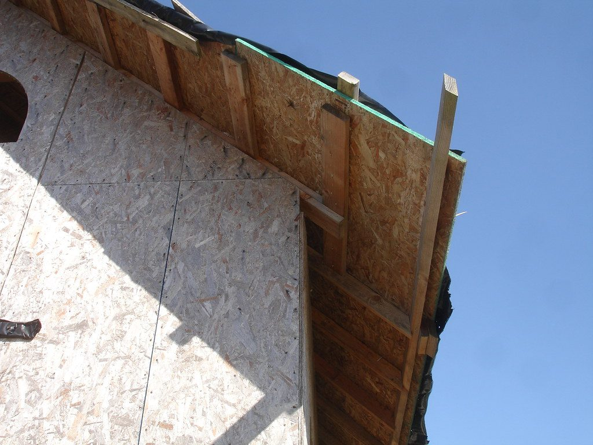
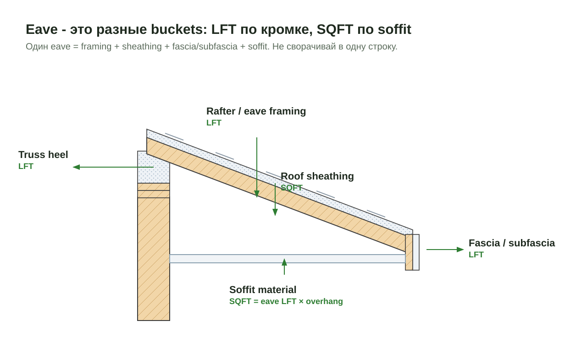

# Eve / Eave (карниз)

<figure markdown>
  
  <figcaption markdown="span">Угол кровли в стадии каркаса: слева наклонная кромка rake по фронтону, справа горизонтальный eave с blocking между хвостами ферм. Eave и rake - разные линии и разные позиции. Фото: ssukotash, CC BY 2.0, <a href="https://www.flickr.com/photos/20775821@N03/6071724150">источник</a>.</figcaption>
</figure>

## Что это

Eave (в дереве `eve`) - нижний горизонтальный край крыши вдоль стены, свес с
soffit снизу и fascia по торцу. Rake - наклонная кромка на фронтоне
([Rake](rake.md)), return - коробка в углу, где eave заворачивает к rake
([Returns](returns.md)). Вертикальная полоса у пятки фермы над стеной - это
[Truss Heel](../vertical/sheathing/truss-heel.md), не часть карниза. Из одной
линии eave экспорт получает soffit (SQ FT), fascia и sub fascia (LFT) и каркас
свеса.

## Где искать на чертежах

| Лист | Что взять |
| --- | --- |
| Roof plan (`a105 rf`) | Линии eave по периметру, вынос свеса, main против porch и canopy |
| Sections, soffit detail (`sec`, `d`) | Ширина свеса, sub fascia `2x6`/`2x8`, frame for soffit `2x4`/`2x6`, материал soffit |
| Elevations (`el`) | Fascia, frieze, смена материала по фасадам |
| RCP | Soffit под canopy и porch (своя ветка, не eave) |
| Finish schedule / specs | Vinyl vented, beadboard, fiber cement, exterior gypsum |

## Как мерить в OurPlanCore

1. Инструмент Line по наружной кромке eave на плане кровли. Единица LFT.
   Все участки: каждая сторона дома, каждый выступ.
2. Имя: `eve <вынос в дюймах> <зона>`: `eve 24 main`, `eve 12 porch`,
   `eve 18 upperporch no frame`. Вынос берём из section или detail, не по
   толщине линии на плане. Папка `eves rakes/eves` создаётся по имени сама; не
   исправляй `eves` на `eaves`.
3. Разные выносы и зоны = разные позиции. Участки без каркаса свеса помечай в
   имени (`no frame`).
4. Canopy и porch в eave не входят: у них свои позиции и свой блок. Главная
   ошибка - посчитать их дважды.
5. Soffit SQ FT = длина x ширина только при постоянной ширине. Сложный soffit
   porte-cochere или porch обводится Area отдельно, без второго счёта
   длиной.

## Как назвать в дереве и строка DFL

| Имя в дереве | Строка DFL | Материал | Unit | Формула |
| --- | --- | --- | --- | --- |
| `eves rakes/eves/eve 24 main` | `Soffits at Eves` | `12" Vinyl vented` / beadboard / `5/8" Ext Gyp` | `SQ FT` или `LFT` | `LFT x 24/12` |
| та же линия | `Fascia at Eves` | `1x8` / alum wrapped | `LFT` | `LFT x 1.1` |
| та же линия | `Sub Fascia` | `2x8` | `LFT` | в блоке кровли |
| та же линия | `Frame for Soffits 24" o.c.` | `2x4` или `2x6` по детали | `LFT` | по детали |
| та же линия | `Blocking at Eves`, `Simpson Ties at Eves` | `2x6`, `H2.5A` | `LFT`, `pcs` | [Roof Sheathing](../horizontal/roof-framing/roof-sheathing.md) |
| `eves rakes/eves/eve 12 porch` | те же строки в блоке porch | по детали porch | | отдельно от main |

Экспорт в Excel: полоса XL, кнопка E/R; число выноса в имени читается
макросом как ширина в дюймах. Vinyl soffit вводится как материал в SQ FT, не
как строка каркаса. Если 30% и больше soffit = beadboard, весь soffit считаем
beadboard и пишем Note, что это local rule.

## Частые ошибки

- Canopy и porch посчитаны ещё раз внутри eave или rake.
- Не все участки eave обведены (271 LFT вместо 310).
- Rake и returns слиты в eave, хотя строки разные.
- Truss heel спрятан в soffit SQ FT.
- `Soffit Eve Vinyl` введён как каркас, а не как SQ FT материала.
- Frame for soffit `2x4` подставлен автоматически, хотя деталь даёт `2x6`.
- Для кровли из `AJS Rafters` с открытым свесом посчитан простой rake вместо rafters вручную.

Все ошибки по кровле: [common-mistakes](../../start/common-mistakes.md#roof).

## Пример

```text
Takeoffs/Main/eves rakes/eves/
  eve 24 main          Line  310 LFT
  eve 12 porch         Line   38 LFT
Takeoffs/Main/eves rakes/rakes/
  rake 12 main         Line   96 LFT
  returns 12           Line    8 LFT

Soffits at Eves      12" Vinyl vented    620   SQ FT   310 x 2'
Fascia at Eves       1x8 alum wrapped    341   LFT
```

<figure markdown>
  
  <figcaption markdown="span">Одна линия eave даёт несколько строк: soffit по площади, fascia и sub fascia по длине, каркас свеса по детали.</figcaption>
</figure>

## См. также

- [Rake](rake.md), [Returns](returns.md), [Truss Heel](../vertical/sheathing/truss-heel.md)
- [Soffit and Fascia](../exterior-trims/soffit-fascia.md) - материалы и LFT против SQ FT
- [Roof Sheathing](../horizontal/roof-framing/roof-sheathing.md), [Canopy](../horizontal/roof-framing/canopy.md), [Porch SQFT](../sqfts/porch.md)
