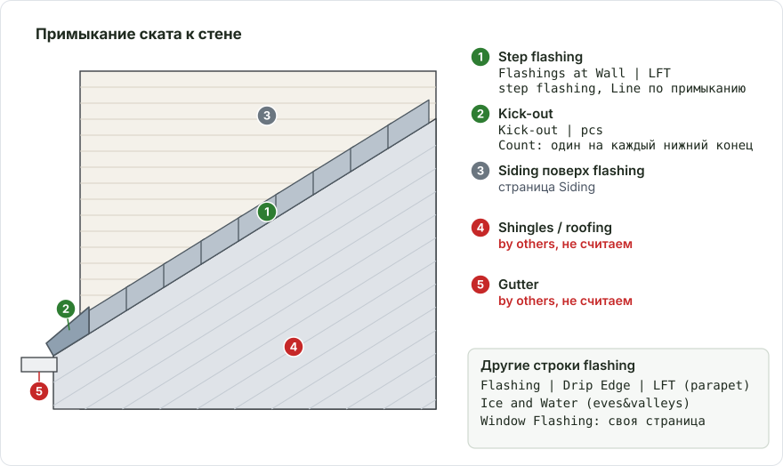
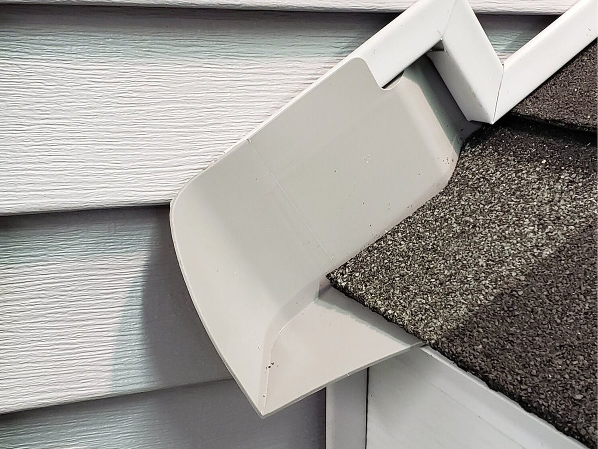

# Flashing (roof, walls, deck)

<figure markdown>
  
  <figcaption markdown="span">Roof-to-wall intersection: step flashing stepped under the siding, kick-out at the bottom. Step flashing is counted in LFT along the intersection, kick-outs by the piece.</figcaption>
</figure>

<figure markdown>
  
  <figcaption markdown="span">Bottom of a roof-to-wall intersection: the last step of the step flashing turns into a kick-out that sends the water over the siding into the gutter. Step flashing is counted in LFT along the intersection line, one kick-out for each lower end of such a line. Photo: finehomebuilding.com, [source](https://www.finehomebuilding.com/2022/12/12/kickout-flashing-for-seamless-siding-and-trim), found via Pinterest.</figcaption>
</figure>

## What it is

Flashing is metal or tape at joints where water can get under the material:
roof edges (drip edge, rake edge), valleys, roof-to-wall intersections
(step, kick-out), parapets (cap, coping, drip edge), horizontal wall joints
(band, water table), terrace or balcony-to-wall connections. Flashing
around windows and doors is a separate page,
[Window Flashing](../vertical/openings/window-flashing.md): it has different rows
and is split by wall type.

## Where to find it on the plans

| Sheet | What to take |
| --- | --- |
| Architectural sections and details (`sec`, `d`) | Rake, eave, parapet, cap flashing, step and kick-out; they are not on the structural sheets |
| Wall sections | Band flashing, water table, flashing over a build-out |
| Roof plan (`a105 rf`) | Roof-to-wall intersections, chimneys, valleys |
| Deck / balcony details | Flashing at the terrace wall, at the membrane and sleepers |
| Parapet details | Coping or drip edge on top |
| Job scope | Whether roofing products are included (`+ roof`) |

## How to measure in OurPlanCore

1. Not every row needs its own line. Drip Edge at the eaves reads the length of the
   `eve` lines, Rake Edge the length of the `rake` lines, the parapet Drip Edge the
   length of `parapets/prpt ...`, the terrace wall flashing the block size. Do not
   measure these lengths a second time.
2. Valleys and roof-to-wall intersections (step flashing): Line tool along the
   joint, folder `roof misc` (where `ridge` also lives). Name = location:
   `valley`, `roof to wall`. LFT unit.
3. Kick-outs are a Count of points: one point for each lower end of a
   roof-to-wall intersection.
4. Parapet: coping goes into the parapet Drip Edge row, there is no separate
   coping row.
5. Roof, wall and deck flashing are counted independently of opening flashing: they are
   different rows.

The roof `Flashing` rows (Drip Edge, Rake Edge, Valley Flashing,
Roof-to-Wall) are written only when roofing products are in scope. The parapet
Drip Edge and the terrace `Flashings at Wall` live in their own blocks and do not
depend on that scope.

## Takeoff name and DFL row

The row label is always `Flashing`, the kind goes in B. The unit is `LFT` everywhere:
length x 1.1, rounded up to 10.

| Where the length comes from | DFL row | B | Unit | Formula C |
| --- | --- | --- | --- | --- |
| `eves rakes/eves/eve ...` lines | `Flashing` | `Drip Edge` | `LFT` | `=CEILING(eaves LFT*1.1,10)` |
| `eves rakes/rakes/rake ...` lines | `Flashing` | `Rake Edge` | `LFT` | `=CEILING(rakes LFT*1.1,10)` |
| `roof misc/valley` | `Flashing` | `Valley Flashing` | `LFT` | `=CEILING(valleys LFT*1.1,10)` |
| `roof misc/roof to wall` | `Flashing` | `Roof-to-Wall` | `LFT` | `=CEILING(G*1.1,10)` |
| Count at the lower ends of the intersections | `Flashing` | `Kick-out` | `pcs` | number of points |
| eaves and valleys | `Ice and Water (eves&valleys)` | `3x50' rolls` | `rolls` | `=CEILING((eaves LFT + valleys LFT)/50,1)` |
| `parapets/prpt 3.4 3 2 par` | `Flashing` in the Parapet Walls block | `Drip Edge` | `LFT` | G x 1.1: under 50 round up to 2, from 50 round up to 10 |
| terrace block size | `Flashings at Wall` | `Copper` | `LFT` | length of the side at the wall x units, no waste |
| window heads, bands, watertable | `Head Trim Flashing` in the Exterior Trims block | `Drip Edge` | `LFT` | G x 1.1, same rounding |

`Flashings at Wall` is only for a terrace with a membrane; an open wood
balcony in Frame scope has no flashing row.

## Common mistakes

- Kick-outs and flashing at roof-to-wall intersections forgotten.
- Length written without 1.1, or the material written in `pcs` instead of `LFT`.
- Parapet coping written as a separate row next to Drip Edge, or the parapet drip
  edge repeated in the roof eave rows.
- Flashing looked for only on the structural sheets.
- Roof flashing mixed into the Window Flashing rows.
- Roof `Flashing` rows inserted although roofing products are not in scope.

All roof mistakes: [common-mistakes](../../start/common-mistakes.md#roof).

## Example

```text
Takeoffs/Main/eves rakes/      eves 318 LFT, rakes 96 LFT
Takeoffs/Main/roof misc/       valley 42 LFT, roof to wall 64 LFT
Takeoffs/Main/parapets/        prpt 186 LFT

Flashing                       Drip Edge         350   LFT   318 x 1.1 = 349.8
Flashing                       Rake Edge         110   LFT    96 x 1.1 = 105.6
Flashing                       Valley Flashing    50   LFT    42 x 1.1 = 46.2
Flashing                       Roof-to-Wall       80   LFT    64 x 1.1 = 70.4    7/A502
Flashing                       Kick-out            4   pcs    4 lower ends
Ice and Water (eves&valleys)   3x50' rolls         8   rolls  (318 + 42) / 50 = 7.2

Parapet Walls:
Flashing                       Drip Edge         210   LFT   186 x 1.1 = 204.6   5/A501
```

## See also

- [Window Flashing](../vertical/openings/window-flashing.md), [Exterior Wall Materials](../vertical/sheathing/exterior-materials.md)
- [Parapet](../vertical/walls/parapet.md), [Eve / Eave](eve.md), [Rake](rake.md)
