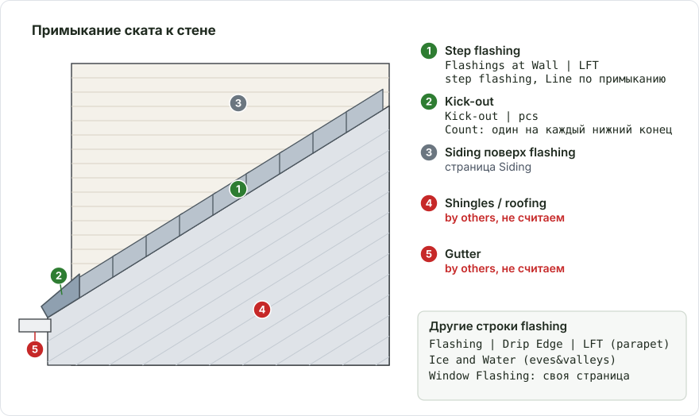
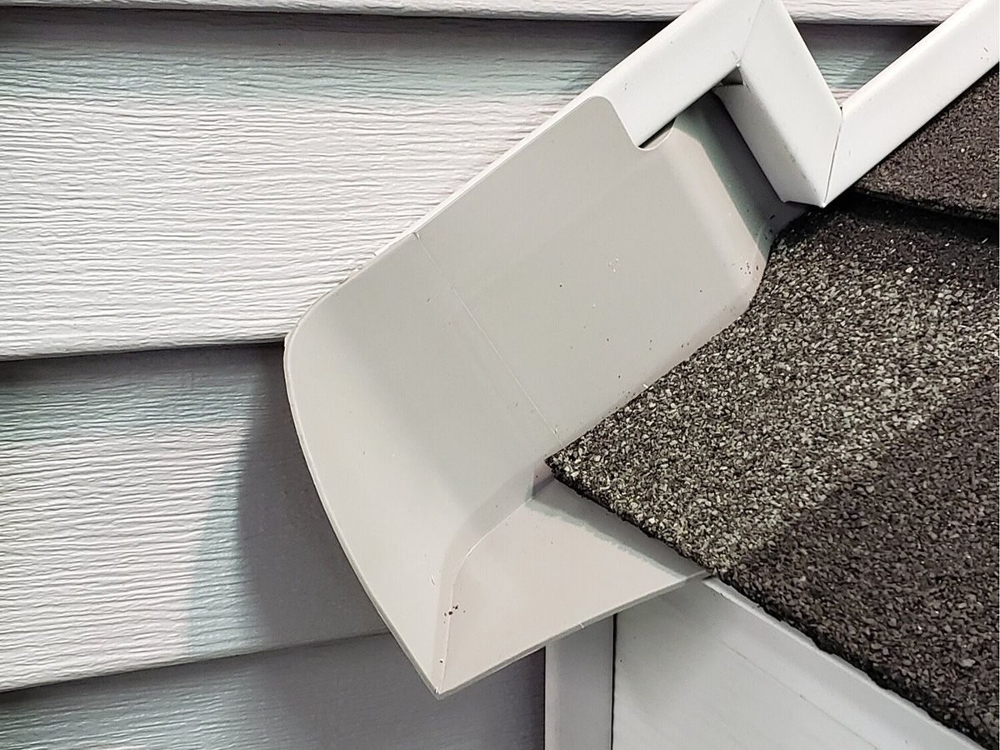

# Flashing (кровля, стены, deck)

<figure markdown>
  
  <figcaption markdown="span">Примыкание ската к стене: step flashing ступеньками под siding, kick-out внизу. Step считаем LFT по примыканию, kick-out штуками.</figcaption>
</figure>

<figure markdown>
  
  <figcaption markdown="span">Низ примыкания ската к стене: последняя ступень step flashing переходит в kick-out, который выводит воду поверх siding в водосток. Step flashing считаем LFT по линии примыкания, kick-out - одна штука на каждый нижний конец такой линии. Фото: finehomebuilding.com, [источник](https://www.finehomebuilding.com/2022/12/12/kickout-flashing-for-seamless-siding-and-trim), найдено через Pinterest.</figcaption>
</figure>

## Что это

Flashing - металл или лента на стыках, где вода может зайти под материал:
кромки крыши (drip edge, rake edge), ендовы (valley), примыкание ската к
стене (step, kick-out), парапет (cap, coping, drip edge), горизонтальные швы
стены (band, water table), примыкание террасы или балкона к стене. Flashing
вокруг окон и дверей - отдельная страница
[Window Flashing](../vertical/openings/window-flashing.md): там другие строки
и разделение по типу стены.

## Где искать на чертежах

| Лист | Что взять |
| --- | --- |
| Architectural sections и details (`sec`, `d`) | Rake, eave, parapet, cap flashing, step и kick-out; на structural их нет |
| Wall sections | Band flashing, water table, flashing над build-out |
| Roof plan (`a105 rf`) | Примыкания к стенам, дымоходы, valleys |
| Deck / balcony details | Flashing у стены террасы, у membrane и sleepers |
| Parapet details | Coping или drip edge по верху |
| Scope задания | Входят ли кровельные материалы (`+ roof`) |

## Как мерить в OurPlanCore

1. Своя линия нужна не всем строкам. Drip Edge по карнизу берёт длину линий
   `eve`, Rake Edge - длину линий `rake`, Drip Edge парапета - длину
   `parapets/prpt ...`, flashing у стены террасы - размер блока. Второй раз
   эти длины не меряем.
2. Valleys и примыкание ската к стене (roof-to-wall, step flashing): инструмент
   Line по длине стыка, папка `roof misc` (там же лежит `ridge`). Имя = место:
   `valley`, `roof to wall`. Единица LFT.
3. Kick-out - Count по точкам: одна точка на каждый нижний конец примыкания
   ската к стене.
4. Парапет: coping входит в строку Drip Edge парапета, отдельной строки
   coping нет.
5. Roof, wall и deck flashing считаются независимо от flashing проёмов: это
   разные строки.

Кровельные строки `Flashing` (Drip Edge, Rake Edge, Valley Flashing,
Roof-to-Wall) пишем только когда кровельные материалы в scope. Drip Edge
парапета и `Flashings at Wall` террасы живут в своих блоках и от этого scope
не зависят.

## Как назвать в дереве и строка DFL

Подпись строки одна - `Flashing`, вид пишется в B. Единица везде `LFT`:
длина x 1.1, вверх до 10.

| Откуда длина | Строка DFL | B | Unit | Формула C |
| --- | --- | --- | --- | --- |
| линии `eves rakes/eves/eve ...` | `Flashing` | `Drip Edge` | `LFT` | `=ОКРВВЕРХ(LFT eaves*1.1;10)` |
| линии `eves rakes/rakes/rake ...` | `Flashing` | `Rake Edge` | `LFT` | `=ОКРВВЕРХ(LFT rakes*1.1;10)` |
| `roof misc/valley` | `Flashing` | `Valley Flashing` | `LFT` | `=ОКРВВЕРХ(LFT valleys*1.1;10)` |
| `roof misc/roof to wall` | `Flashing` | `Roof-to-Wall` | `LFT` | `=ОКРВВЕРХ(G*1.1;10)` |
| Count по нижним концам примыканий | `Flashing` | `Kick-out` | `pcs` | число точек |
| eaves и valleys | `Ice and Water (eves&valleys)` | `3x50' rolls` | `rolls` | `=ОКРВВЕРХ((LFT eaves + LFT valleys)/50;1)` |
| `parapets/prpt 3.4 3 2 par` | `Flashing` в блоке Parapet Walls | `Drip Edge` | `LFT` | G x 1.1: до 50 вверх до 2, от 50 вверх до 10 |
| размер блока террасы | `Flashings at Wall` | `Copper` | `LFT` | длина стороны у стены x units, без запаса |
| heads окон, bands, watertable | `Head Trim Flashing` в блоке Exterior Trims | `Drip Edge` | `LFT` | G x 1.1, то же округление |

`Flashings at Wall` - только у террасы с membrane; у открытого деревянного
балкона в scope Frame строки flashing нет.

## Частые ошибки

- Kick-out и flashing на примыканиях roof-to-wall забыты.
- Длина записана без 1.1 или материал записан в `pcs` вместо `LFT`.
- Coping парапета записан отдельной строкой рядом с Drip Edge, или drip edge
  парапета повторён в кровельных строках карниза.
- Flashing искали только на structural листах.
- Roof flashing смешан со строками Window Flashing.
- Кровельные строки `Flashing` вставлены, хотя кровельные материалы не в scope.

Все ошибки по кровле: [common-mistakes](../../start/common-mistakes.md#roof).

## Пример

```text
Takeoffs/Main/eves rakes/      eves 318 LFT, rakes 96 LFT
Takeoffs/Main/roof misc/       valley 42 LFT, roof to wall 64 LFT
Takeoffs/Main/parapets/        prpt 186 LFT

Flashing                       Drip Edge         350   LFT   318 x 1.1 = 349.8
Flashing                       Rake Edge         110   LFT    96 x 1.1 = 105.6
Flashing                       Valley Flashing    50   LFT    42 x 1.1 = 46.2
Flashing                       Roof-to-Wall       80   LFT    64 x 1.1 = 70.4    7/A502
Flashing                       Kick-out            4   pcs    4 нижних конца
Ice and Water (eves&valleys)   3x50' rolls         8   rolls  (318 + 42) / 50 = 7.2

Parapet Walls:
Flashing                       Drip Edge         210   LFT   186 x 1.1 = 204.6   5/A501
```

## См. также

- [Window Flashing](../vertical/openings/window-flashing.md), [Exterior Wall Materials](../vertical/sheathing/exterior-materials.md)
- [Parapet](../vertical/walls/parapet.md), [Eve / Eave](eve.md), [Rake](rake.md)
