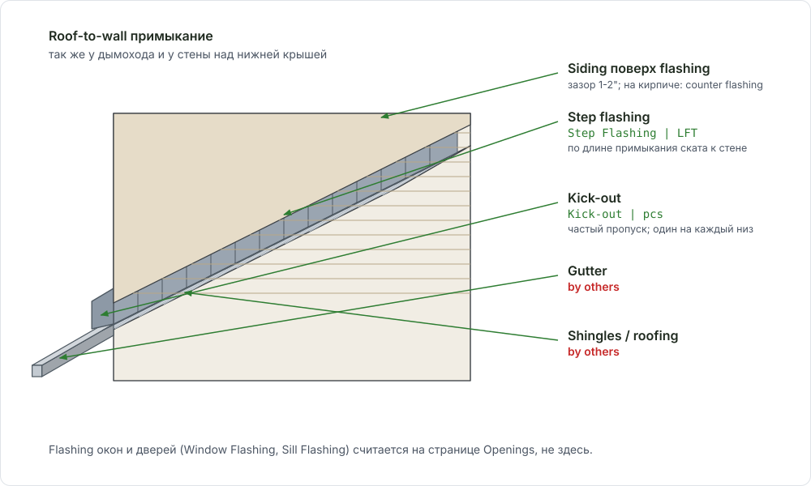

# Flashing (кровля, стены, deck)

<figure markdown>
  
  <figcaption markdown="span">Примыкание ската к стене: step flashing ступеньками под siding, kick-out внизу. Step считаем LFT по примыканию, kick-out штуками.</figcaption>
</figure>

<!-- TODO-PHOTO: step flashing at roof-to-wall with kick-out diverter, close-up on new construction -->

## Что это

Flashing - металл или лента на стыках, где вода может зайти под материал:
примыкание ската к стене (step, kick-out), парапет (cap, coping, drip edge),
горизонтальные швы стены (band, water table), примыкание deck или балкона к
стене. Flashing вокруг окон и дверей - отдельная страница
[Window Flashing](../vertical/openings/window-flashing.md): там другие строки
и разделение по типу стены.

## Где искать на чертежах

| Лист | Что взять |
| --- | --- |
| Architectural sections и details (`sec`, `d`) | Rake, eave, parapet, cap flashing, step и kick-out; на structural их нет |
| Wall sections | Band flashing, water table, flashing над build-out |
| Roof plan (`a105 rf`) | Примыкания к стенам, дымоходы, valleys под metal |
| Deck / balcony details | Flashing по ledger и под decking |
| Parapet details | Coping или drip edge по верху |

## Как мерить в OurPlanCore

1. Инструмент Line по длине стыка: примыкание ската к стене, верх парапета,
   ledger балкона. Единица LFT. Kick-out - Count по точкам.
2. Имя = продукт и место: `step flashing`, `drip edge prpt`, `ledger flashing
   blcny`. Папка по принятому дереву job (`roof misc` или `trims`).
3. Парапет: длина верха парапета из `parapets/prpt ...`; coping отдельной
   строкой или в Drip Edge по детали.
4. Roof, wall и deck flashing считаются независимо от flashing проёмов: это
   разные строки.

!!! warning "Уточняется"
    Единой ветки для flashing в дереве нет; подтверждённые имена позиций
    есть только для окон (Window Flashing). Держи flashing в одной папке job.

## Как назвать в дереве и строка DFL

| Имя в дереве | Строка DFL | Материал | Unit |
| --- | --- | --- | --- |
| `roof misc/step flashing` | `Flashings at Wall` | step flashing, kick-out `pcs` | `LFT`, `pcs` |
| `parapets/prpt 3.4 3 2 par` | `Flashing` | `Drip Edge` / coping | `LFT` |
| `sqfts/rf mtl 4` (valleys) | `Ice and Water (eves&valleys)` | по spec | `SQ FT` / `LFT` |
| `framing/blcny/details/ledger flashing` | `Head Trim Flashing` / `Flashing(s)` | по детали | `LFT` |

## Частые ошибки

- Kick-out и step flashing на примыканиях roof-to-wall забыты.
- Flashing парапета и coping посчитаны дважды (строка Flashing и Drip Edge).
- Flashing искали только на structural листах.
- Roof flashing смешан со строками Window Flashing.

Все ошибки по кровле: [common-mistakes](../../start/common-mistakes.md#roof).

## Пример

```text
Flashing             Drip Edge            186   LFT   parapet top, 5/A501
Flashings at Wall    Step flashing         64   LFT   roof to wall, 7/A502
Kick-out             pcs                    4   pcs
```

## См. также

- [Window Flashing](../vertical/openings/window-flashing.md), [Exterior Wall Materials](../vertical/sheathing/exterior-materials.md)
- [Parapet](../vertical/walls/parapet.md), [Eve / Eave](eve.md), [Rake](rake.md)
