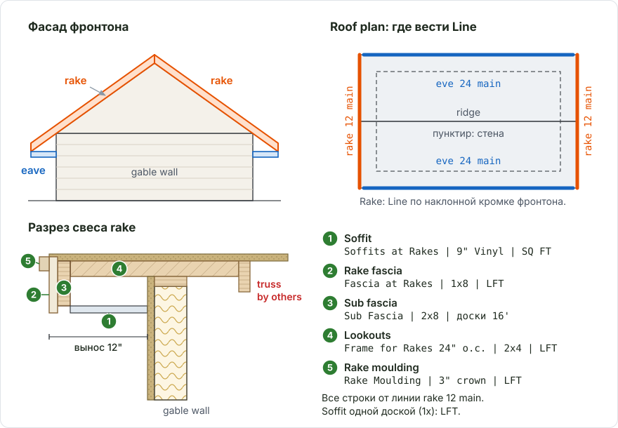

# Rake

<figure markdown>
  
  <figcaption markdown="span">The rake is the sloped roof edge along the gable slope; the eave is the horizontal bottom edge. Two different lines, two different folders.</figcaption>
</figure>

## What it is

The rake is the sloped roof edge on the gable side, where the roof overhangs the
gable. It differs from the eave in direction (along the slope, not horizontal),
framing (lookouts/outriggers instead of truss tails) and its set of rows. The canon for
the whole eave, including units and soffit, is on the [Eve / Eave](eve.md) page.

## Where to find it on the plans

| Sheet | What to take |
| --- | --- |
| Roof plan (`a105 rf`) | Sloped edges at the gables, overhang |
| Elevations (`el`) | Rake fascia, barge board, trim, FRT on exposed wood |
| Details (`d`) | Lookouts `2x4`/`2x6`, frame for rakes, sub fascia |

## How to measure in OurPlanCore

1. Line tool along the sloped edge on the roof plan. LFT unit.
2. Name `rake <overhang in inches> <zone>`: `rake 12 main`, `rake 24 main`.
   The `eves rakes/rakes` folder is created from the name automatically.
3. The length on the plan is the plan length. Decide once whether you need the true sloped
   length (via the pitch); do not apply the pitch a second time.
4. Canopy and porch are not part of the rake. Returns are their own takeoff ([Returns](returns.md)).
5. A roof of `AJS Rafters` with an open overhang: count the rafters by hand as
   framing, not as a simple `rake`.

## Takeoff name and DFL row

| Takeoff name | DFL row | Material | Unit |
| --- | --- | --- | --- |
| `eves rakes/rakes/rake 12 main` | `Soffits at Rakes` | `9" Vinyl` / beadboard | `LFT` or `SQ FT` |
| same line | `Fascia at Rakes` | `1x8` / alum wrapped | `LFT` |
| same line | `Frame for Rakes 24" o.c.` | `2x4` per detail | `LFT` |
| same line | `Sub Fascia` | `2x8` | `LFT` |

## Common mistakes

- Rake merged with the eave into one line.
- Pitch applied both in the takeoff and in the formula.
- Canopy or porch counted again in the rake.
- FRT on an exposed rake not checked against the exterior wall rules.

All roof mistakes: [common-mistakes](../../start/common-mistakes.md#roof).

## Example

```text
Takeoffs/Main/eves rakes/rakes/
  rake 12 main     Line  96 LFT
Takeoffs/Grge/eves rakes/rakes/
  rake 24 main     Line  44 LFT
```

## See also

- [Eve / Eave](eve.md), [Returns](returns.md), [Gable Sheathing](../vertical/sheathing/gable.md)
- [Soffit and Fascia](../exterior-trims/soffit-fascia.md), [Roof Sheathing](../horizontal/roof-framing/roof-sheathing.md)
