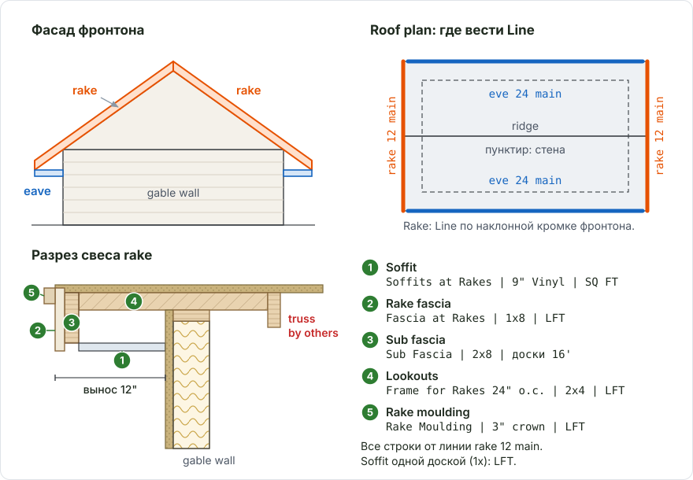

# Rake (наклонная кромка фронтона)

<figure markdown>
  
  <figcaption markdown="span">Rake - наклонная кромка крыши по скату фронтона; eave - горизонтальный низ. Две разные линии, две разные папки.</figcaption>
</figure>

## Что это

Rake - наклонный край крыши на gable-стороне, где кровля свисает над
фронтоном. От eave отличается направлением (по скату, не горизонтально),
каркасом (lookouts/outriggers вместо хвостов ферм) и набором строк. Канон
карниза целиком, включая единицы и soffit, на странице [Eve / Eave](eve.md).

## Где искать на чертежах

| Лист | Что взять |
| --- | --- |
| Elevations (`el`) | Длина rake в истинную величину (мерим здесь), rake fascia, barge board, trim, FRT на открытом дереве |
| Roof plan (`a105 rf`) | Где есть rakes, вынос свеса |
| Details (`d`) | Lookouts или outlookers (сечение и шаг), frame for rakes, sub fascia, blocking |

## Как мерить в OurPlanCore

1. Инструмент Line по наклонной кромке на фасаде (elevation), где скат виден
   в истинную величину. Единица LFT. На плане кровли rake не мерим: плановая
   линия короче настоящей кромки, уклон теряется.
2. Имя `rake <вынос в дюймах> <зона>`: `rake 12 main`, `rake 24 main`.
   Число - вынос свеса с section или detail, не уклон и не длина. Папка
   `eves rakes/rakes` создаётся по имени сама.
3. Длина с фасада уже наклонная: коэффициент уклона не применяется ни в
   замере, ни в формуле. Только если фасада с этим фронтоном нет, плановую
   длину один раз умножают на коэффициент common rafter (4:12 = 1.054,
   6:12 = 1.118, 8:12 = 1.202, 12:12 = 1.414; таблица на странице
   [Hip](../horizontal/roof-framing/hip.md)).
4. Если на фасаде уже обведены площади gable, веди rake по верхней грани
   этих площадей: быстрее и без пропусков.
5. Rake у porch и canopy - свои позиции (`rake 8 porch`), в `main` они не
   входят. Returns - тоже своя позиция ([Returns](returns.md)).
6. Кровля из `AJS Rafters` с открытым свесом: rafters считаем вручную как
   каркас, а не простой `rake`.

## Как назвать в дереве и строка DFL

LFT ниже - длина линии rake, вынос - число из её имени в дюймах.

| Имя в дереве | Строка DFL | Материал | Unit (D) | Формула C |
| --- | --- | --- | --- | --- |
| `eves rakes/rakes/rake 12 main` | `Soffits at Rakes` | `12" Vinyl` / `T&G beadboard` | `SQ FT` | `=ЧЁТН(LFT*вынос/12*1.1)` |
| та же линия, soffit из одной доски на всю ширину | `Soffits at Rakes` | `1x12` | `LFT` | `=ЧЁТН(LFT*1.1)` |
| та же линия | `Fascia at Rakes` | `1x8`, по детали `1x6` | `LFT` | `=ЧЁТН(LFT*1.1)` |
| та же линия | `Frame for Rakes 24" o.c.` | `2x6`, по детали `2x4` или `2x8` | `16` | `=ОКРВВЕРХ(G/D;1)`, G = LFT x вынос / шаг + LFT |
| та же линия | `Sub Fascia` | `2x6` по детали | `16` | `=ОКРВВЕРХ(G/D;1)`, G = LFT |
| та же линия, только когда деталь рисует blocking | `Blocking for Rakes 48" o.c.` | `2x6` | `16` | `=ОКРВВЕРХ(G*12/H*2/D;1)`, H = шаг |

- `Frame for Rakes`, `Sub Fascia` и `Blocking for Rakes` - каркас: в D длина
  доски 16', в C число досок, запаса 1.1 нет (округление вверх до целой
  доски). В G у `Frame for Rakes` сидят lookouts (LFT x вынос / шаг) и ledger
  вдоль стены (LFT). Шаг 24" по умолчанию, 16" когда так в детали.
- `Soffits at Rakes` и `Fascia at Rakes` - отделка: только когда trims в scope.
  Soffit в `LFT` только когда он из одной доски или одной полосы на всю
  ширину; правило и дефолт материала: [Eve / Eave](eve.md).
- Aluminum или prefab rake by others: строк каркаса и отделки нет, остаётся нота.

## Частые ошибки

- Rake слит с eave в одну линию.
- Rake обведён на плане кровли вместо фасада: длина короче настоящей.
- К длине с фасада ещё раз применён коэффициент уклона.
- В имени стоит уклон или длина вместо выноса (`rake 12` это вынос 12").
- Sub Fascia и Frame for Rakes записаны в `LFT` с запасом 1.1 вместо досок по 16'.
- FRT на открытом rake не проверен по правилам наружной стены.

Все ошибки по кровле: [common-mistakes](../../start/common-mistakes.md#roof).

## Пример

```text
Takeoffs/Main/eves rakes/rakes/
  rake 12 main     Line  96 LFT   (по фасадам)
Takeoffs/Grge/eves rakes/rakes/
  rake 24 main     Line  44 LFT

Main, вынос 12":
Soffits at Rakes           12" Vinyl    106   SQ FT   96 x 12/12 x 1.1 = 105.6
Fascia at Rakes            1x8          106   LFT     96 x 1.1 = 105.6
Frame for Rakes 24" o.c.   2x6            9   16      G = 96 x 12/24 + 96 = 144; 144 / 16 = 9
Sub Fascia                 2x6            6   16      G = 96; 96 / 16 = 6
```

## См. также

- [Eve / Eave](eve.md), [Returns](returns.md), [Gable Sheathing](../vertical/sheathing/gable.md)
- [Soffit and Fascia](../exterior-trims/soffit-fascia.md), [Roof Sheathing](../horizontal/roof-framing/roof-sheathing.md)
