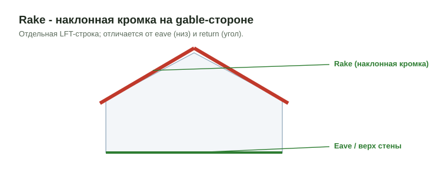

# Rake (наклонная кромка фронтона)

<figure markdown>
  
  <figcaption markdown="span">Rake - наклонная кромка крыши по скату фронтона; eave - горизонтальный низ. Две разные линии, две разные папки.</figcaption>
</figure>

## Что это

Rake - наклонный край крыши на gable-стороне, где кровля свисает над
фронтоном. От eave отличается направлением (по скату, не горизонтально),
каркасом (lookouts/outriggers вместо хвостов ферм) и набором строк. Канон
карниза целиком, включая единицы и soffit, на странице [Eve / Eave](eve.md).

## Где искать на чертежах

| Лист | Что взять |
| --- | --- |
| Roof plan (`a105 rf`) | Наклонные кромки на фронтонах, вынос |
| Elevations (`el`) | Rake fascia, barge board, trim, FRT на открытом дереве |
| Details (`d`) | Lookouts `2x4`/`2x6`, frame for rakes, sub fascia |

## Как мерить в OurPlanCore

1. Инструмент Line по наклонной кромке на плане кровли. Единица LFT.
2. Имя `rake <вынос в дюймах> <зона>`: `rake 12 main`, `rake 24 main`.
   Папка `eves rakes/rakes` создаётся по имени сама.
3. Длина на плане - плановая. Решай один раз, нужна ли истинная наклонная
   длина (через уклон); второй раз уклон не применяй.
4. Canopy и porch не входят в rake. Returns - своя позиция ([Returns](returns.md)).
5. Кровля из `AJS Rafters` с открытым свесом: rafters считаем вручную как
   каркас, а не простой `rake`.

## Как назвать в дереве и строка DFL

| Имя в дереве | Строка DFL | Материал | Unit |
| --- | --- | --- | --- |
| `eves rakes/rakes/rake 12 main` | `Soffits at Rakes` | `9" Vinyl` / beadboard | `LFT` или `SQ FT` |
| та же линия | `Fascia at Rakes` | `1x8` / alum wrapped | `LFT` |
| та же линия | `Frame for Rakes 24" o.c.` | `2x4` по детали | `LFT` |
| та же линия | `Sub Fascia` | `2x8` | `LFT` |

## Частые ошибки

- Rake слит с eave в одну линию.
- Уклон применён и в замере, и в формуле.
- Canopy или porch посчитаны в rake повторно.
- FRT на открытом rake не проверен по правилам наружной стены.

Все ошибки по кровле: [common-mistakes](../../start/common-mistakes.md#roof).

## Пример

```text
Takeoffs/Main/eves rakes/rakes/
  rake 12 main     Line  96 LFT
Takeoffs/Grge/eves rakes/rakes/
  rake 24 main     Line  44 LFT
```

## См. также

- [Eve / Eave](eve.md), [Returns](returns.md), [Gable Sheathing](../vertical/sheathing/gable.md)
- [Soffit and Fascia](../exterior-trims/soffit-fascia.md), [Roof Sheathing](../horizontal/roof-framing/roof-sheathing.md)
