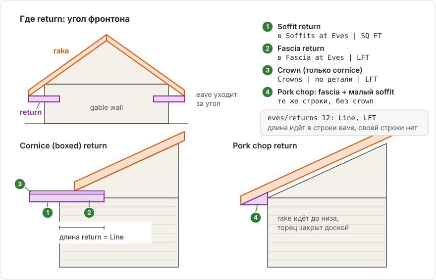
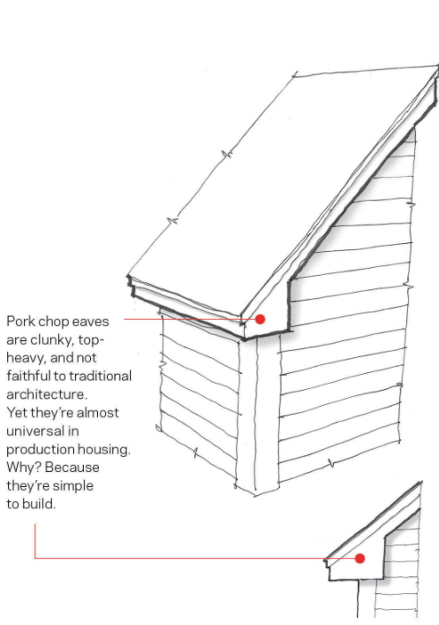
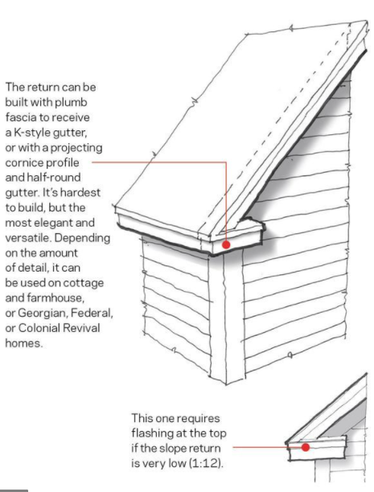

# Returns

<figure markdown>
  
  <figcaption markdown="span">A return is the short piece of eave that turns onto the gable and dies into the rake. A separate takeoff, a separate set of trim.</figcaption>
</figure>

## What it is

A return (eave return, cornice return) is the box at the gable corner where the
horizontal eave turns into the sloped rake. Two kinds: a proper
cornice return (soffit + fascia + crown) and a pork-chop (a simple triangular
stub, but it still has fascia and a small soffit). In the tree a return is its
own line, part of neither `eve` nor `rake`. In the DFL it has one framing row of
its own (`Rafter Frame for returns`), while soffit, fascia and crown get no rows of
their own: the return length is added to the eave rows.

<div class="kb-gallery">
  <a class="kb-gallery__item" href="../../../assets/images/trims/ext-pork-chop.png">
    
    <div class="kb-gallery__caption">Pork-chop return: a triangle, we count fascia and soffit</div>
  </a>
  <a class="kb-gallery__item" href="../../../assets/images/trims/ext-eave-return.png">
    
    <div class="kb-gallery__caption">Cornice return: soffit, fascia and crown, the length goes into the eave rows</div>
  </a>
</div>

## Where to find it on the plans

| Sheet | What to take |
| --- | --- |
| Elevations (`el`) | Whether there are returns, how many corners, type |
| Architectural details (`d`) | Pork-chop or cornice; return length, trim |
| Roof plan (`a105 rf`) | Where the eave meets the rake |

Returns are not shown on the structural sheets: open the elevations and details.

## How to measure in OurPlanCore

1. Line tool along the short return piece along the gable wall, on the
   roof plan or elevation. LFT unit, not pieces.
2. Name `returns <overhang in inches>`: `returns 12`. The number is the overhang of the
   eave that turns the corner (for `eve 12 main` it is `returns 12`), not the return length.
   The name starts with exactly the word `returns`.
3. Folder `eves rakes/eves`, next to the line of its eave: in the DFL returns are
   added to the eave, not to the rake.
4. One return = one segment; the number of corners shows in the number of segments.

## Takeoff name and DFL row

Below, eave LFT and returns LFT are the line lengths and the overhang is the number from the name in inches.

| Takeoff name | DFL row | Material | Unit (D) | Formula C |
| --- | --- | --- | --- | --- |
| `eves rakes/eves/returns 12` | `Rafter Frame for returns` | `2x6`, E `assumed` or the detail | `16` | `=CEILING(G/12*1.4*0.75/D,1)`, G = returns LFT x overhang |
| same line | goes into `Soffits at Eves` | eave material | `SQ FT` | `=EVEN((eave LFT + returns LFT)*overhang/12*1.1)` |
| same line | goes into `Fascia at Eves` | `1x8` | `LFT` | `=EVEN((eave LFT + returns LFT)*1.1)` |
| cornice return, when the detail shows a crown | goes into `Crowns` | per detail | `LFT` | `=EVEN((eave LFT + returns LFT)*1.1)` |

- Returns have no soffit, fascia or crown rows of their own, and they are never
  counted in pieces (`pcs`).
- `Rafter Frame for returns` is framing: the short rafters of the return, 16' boards
  in D, the number of boards in C. No returns takeoff: no row.
- Soffit is in `LFT` instead of `SQ FT` only when it is one board across the full width:
  [Eve / Eave](eve.md).
- Pork-chop: fascia and the small soffit are counted the same way, there is no crown.

## Common mistakes

- Returns dissolved into the overall eave line or filed in the `rakes` folder.
- The name carries the return length instead of the eave overhang.
- Returns counted in pieces or as separate soffit and fascia rows.
- Type not determined (pork-chop vs cornice): crown added or lost.
- FRT for exposed wood not checked.

All roof mistakes: [common-mistakes](../../start/common-mistakes.md#roof).

## Example

```text
Takeoffs/Main/eves rakes/eves/
  eve 12 main     Line  180 LFT
  returns 12      Line    8 LFT   (4 corners at 2')

Rafter Frame for returns   2x6                  1   16      G = 8 x 12 = 96; 96/12 x 1.4 x 0.75 = 8.4; 8.4 / 16, round up
Soffits at Eves            12" Vinyl vented   208   SQ FT   (180 + 8) x 12/12 x 1.1 = 206.8
Fascia at Eves             1x8                208   LFT     (180 + 8) x 1.1 = 206.8
```

## See also

- [Eve / Eave](eve.md), [Rake](rake.md)
- [Soffit and Fascia, Returns section](../exterior-trims/soffit-fascia.md)
