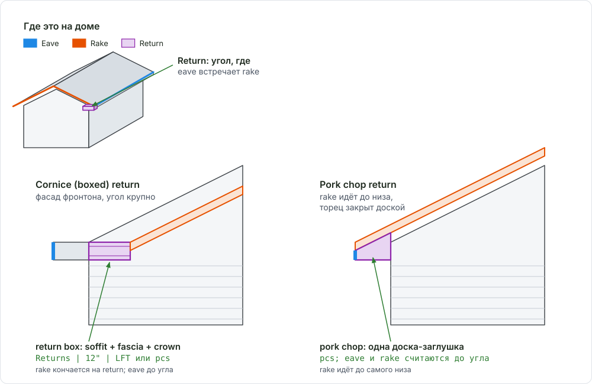
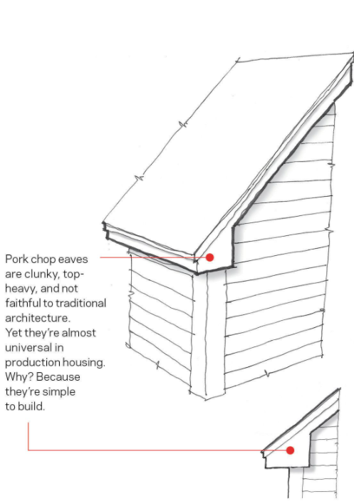
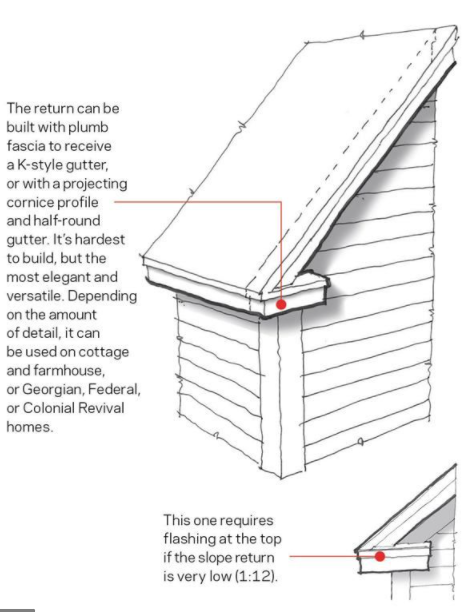

# Returns (возврат карниза в углу)

<figure markdown>
  
  <figcaption markdown="span">Return - короткий отрезок карниза, которым eave заворачивает на фронтон и упирается в rake. Отдельная позиция, отдельный набор trim.</figcaption>
</figure>

## Что это

Return (eave return, cornice return) - коробка в углу фронтона, где
горизонтальный карниз заворачивает к наклонному rake. Два вида: proper
cornice return (soffit + fascia + crown) и pork-chop (простой треугольный
обрубок, но fascia и маленький soffit у него тоже есть). Return не входит ни
в eave, ни в rake: другой каркас и другой набор строк.

<div class="kb-gallery">
  <a class="kb-gallery__item" href="../../assets/images/trims/ext-pork-chop.png">
    
    <div class="kb-gallery__caption">Pork-chop return: треугольник, fascia и soffit считаем</div>
  </a>
  <a class="kb-gallery__item" href="../../assets/images/trims/ext-eave-return.png">
    
    <div class="kb-gallery__caption">Cornice return: soffit, fascia, crown отдельным набором</div>
  </a>
</div>

## Где искать на чертежах

| Лист | Что взять |
| --- | --- |
| Elevations (`el`) | Есть ли returns, сколько углов, тип |
| Architectural details (`d`) | Pork-chop или cornice; длина возврата, trim |
| Roof plan (`a105 rf`) | Где eave встречается с rake |

На structural returns не показывают: открывай фасады и детали.

## Как мерить в OurPlanCore

1. Инструмент Line по короткому отрезку возврата вдоль стены фронтона, на
   плане кровли или фасаде. Единица LFT.
2. Имя `returns <вынос в дюймах>`: `returns 12`. Папка `eves rakes/rakes`
   или `eves` по принятому дереву job; имя с `returns` маршрутизируется
   как rake.
3. Один return = один отрезок; число углов видно по количеству замеров.

## Как назвать в дереве и строка DFL

| Имя в дереве | Строка DFL | Материал | Unit |
| --- | --- | --- | --- |
| `eves rakes/rakes/returns 12` | `Rafter Frame for returns` | `2x4` по детали | `LFT` |
| та же линия | `Soffits at Eves` (часть) / `Fascia` | по детали | `SQ FT` / `LFT` |
| cornice | `Crown` по returns | по детали | `LFT` |

## Частые ошибки

- Returns растворены в общей линии eave.
- Тип не определён (pork-chop против cornice): разный trim и SQ FT.
- FRT для открытого дерева не проверен.

Все ошибки по кровле: [common-mistakes](../../start/common-mistakes.md#roof).

## Пример

```text
Takeoffs/Main/eves rakes/rakes/
  returns 12      Line  8 LFT   (4 угла по 2')
```

## См. также

- [Eve / Eave](eve.md), [Rake](rake.md)
- [Soffit and Fascia, раздел Returns](../exterior-trims/soffit-fascia.md)
