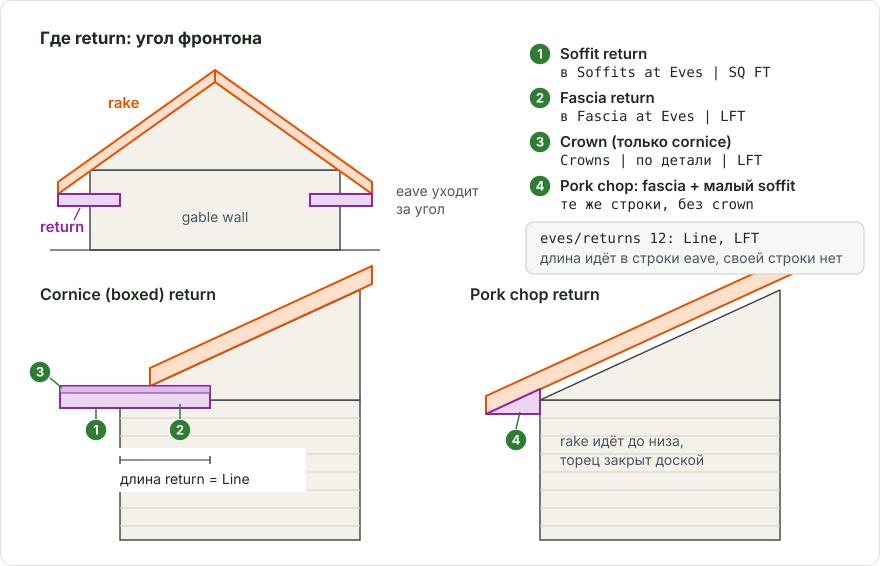
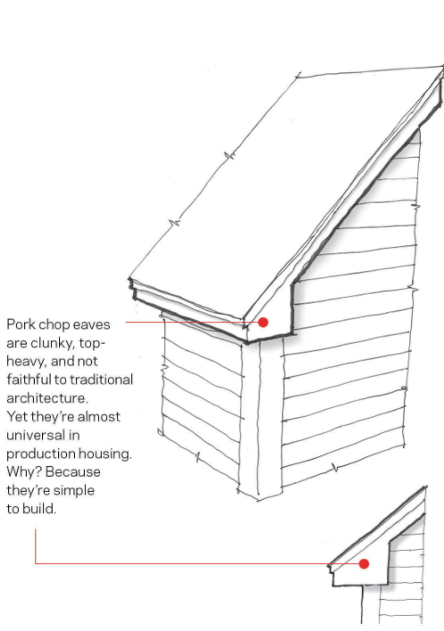
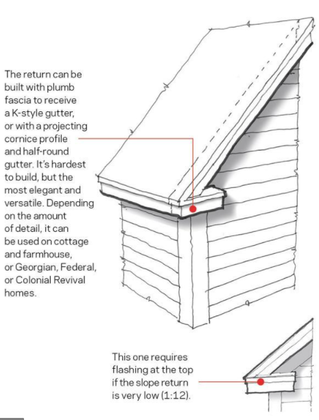

# Returns (возврат карниза в углу)

<figure markdown>
  
  <figcaption markdown="span">Return - короткий отрезок карниза, которым eave заворачивает на фронтон и упирается в rake. Отдельная позиция, отдельный набор trim.</figcaption>
</figure>

## Что это

Return (eave return, cornice return) - коробка в углу фронтона, где
горизонтальный карниз заворачивает к наклонному rake. Два вида: proper
cornice return (soffit + fascia + crown) и pork-chop (простой треугольный
обрубок, но fascia и маленький soffit у него тоже есть). В дереве return -
своя линия, не часть `eve` и не часть `rake`. В DFL у него одна своя строка
каркаса (`Rafter Frame for returns`), а soffit, fascia и crown своих строк не
имеют: длина returns прибавляется к строкам карниза.

<div class="kb-gallery">
  <a class="kb-gallery__item" href="../../../assets/images/trims/ext-pork-chop.png">
    
    <div class="kb-gallery__caption">Pork-chop return: треугольник, fascia и soffit считаем</div>
  </a>
  <a class="kb-gallery__item" href="../../../assets/images/trims/ext-eave-return.png">
    
    <div class="kb-gallery__caption">Cornice return: soffit, fascia и crown, длина идёт в строки карниза</div>
  </a>
</div>

## Где искать на чертежах

| Лист | Что взять |
| --- | --- |
| Elevations (`el`) | Есть ли returns, сколько углов, тип |
| Architectural details (`d`) | Pork-chop или cornice; длина возврата, trim |
| Roof plan (`a105 rf`) | Где eave встречается с rake |

На structural returns не показывают: открывай фасады и детали.

## Как мерить в OurPlanCore

1. Инструмент Line по короткому отрезку возврата вдоль стены фронтона, на
   плане кровли или фасаде. Единица LFT, не штуки.
2. Имя `returns <вынос в дюймах>`: `returns 12`. Число - вынос того карниза,
   который заворачивает (у `eve 12 main` это `returns 12`), не длина возврата.
   Имя начинается ровно со слова `returns`.
3. Папка `eves rakes/eves`, рядом с линией своего карниза: в DFL returns
   прибавляются к eave, не к rake.
4. Один return = один отрезок; число углов видно по количеству отрезков.

## Как назвать в дереве и строка DFL

LFT eave и LFT returns ниже - длины линий, вынос - число из имени в дюймах.

| Имя в дереве | Строка DFL | Материал | Unit (D) | Формула C |
| --- | --- | --- | --- | --- |
| `eves rakes/eves/returns 12` | `Rafter Frame for returns` | `2x6`, в E `assumed` или деталь | `16` | `=ОКРВВЕРХ(G/12*1.4*0.75/D;1)`, G = LFT returns x вынос |
| та же линия | входит в `Soffits at Eves` | материал карниза | `SQ FT` | `=ЧЁТН((LFT eave + LFT returns)*вынос/12*1.1)` |
| та же линия | входит в `Fascia at Eves` | `1x8` | `LFT` | `=ЧЁТН((LFT eave + LFT returns)*1.1)` |
| cornice return, когда деталь показывает crown | входит в `Crowns` | по детали | `LFT` | `=ЧЁТН((LFT eave + LFT returns)*1.1)` |

- Своих строк soffit, fascia и crown у returns нет, штуками (`pcs`) returns не
  считаются.
- `Rafter Frame for returns` - каркас: короткие rafters возврата, доски по 16'
  в D, число досок в C. Нет замера returns: строки нет.
- Soffit в `LFT` вместо `SQ FT` только когда он из одной доски на всю ширину:
  [Eve / Eave](eve.md).
- Pork-chop: fascia и малый soffit считаются так же, crown нет.

## Частые ошибки

- Returns растворены в общей линии eave или лежат в папке `rakes`.
- В имени стоит длина возврата вместо выноса карниза.
- Returns посчитаны штуками или отдельными строками soffit и fascia.
- Тип не определён (pork-chop против cornice): crown добавлен или потерян.
- FRT для открытого дерева не проверен.

Все ошибки по кровле: [common-mistakes](../../start/common-mistakes.md#roof).

## Пример

```text
Takeoffs/Main/eves rakes/eves/
  eve 12 main     Line  180 LFT
  returns 12      Line    8 LFT   (4 угла по 2')

Rafter Frame for returns   2x6                  1   16      G = 8 x 12 = 96; 96/12 x 1.4 x 0.75 = 8.4; 8.4 / 16, вверх
Soffits at Eves            12" Vinyl vented   208   SQ FT   (180 + 8) x 12/12 x 1.1 = 206.8
Fascia at Eves             1x8                208   LFT     (180 + 8) x 1.1 = 206.8
```

## См. также

- [Eve / Eave](eve.md), [Rake](rake.md)
- [Soffit and Fascia, раздел Returns](../exterior-trims/soffit-fascia.md)
