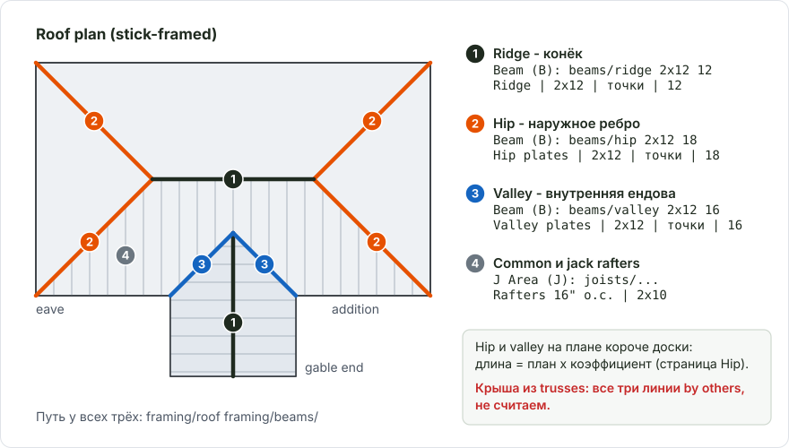

# Ridge / Valley / Hip

<figure markdown>
  
  <figcaption markdown="span">Ridge is the top line, hip is the outside sloped edge, valley is the inside one. On the roof plan these are three different line types.</figcaption>
</figure>

## What it is

- **Ridge**: the horizontal line where two slopes meet at the top.
- **Hip**: the sloped outside edge, the slopes meet at a convex corner.
- **Valley**: the sloped inside edge, the slopes meet at a concave corner.

This is an overview: it helps you pick the right page. How to measure and how to
write each element is on its own page; the rules are not repeated here.

| Element | Page | When it is ours |
| --- | --- | --- |
| Ridge board, ridge beam | [Ridge](../horizontal/roof-framing/ridge.md) | stick roof; ridge beam per the mark on the plan |
| Hip rafter | [Hip](../horizontal/roof-framing/hip.md) | stick roof with a hip |
| Valley rafter, valley beam | [Valley](../horizontal/roof-framing/valley.md) | stick roof; an overframe has sleepers instead |
| Sleepers under an overframe | [Overframes](../horizontal/roof-framing/overframes.md) | when the addition is framed on top of the lower roof |
| Metal valley flashing | [Flashing](flashing.md) | only when roofing products are in scope |

On a truss roof the ridge, hip and valley are part of the trusses by others: there are
no `Ridge`, `Hip plates` or `Valley plates` rows, and we count only what the plans show
apart from the trusses (overframe sleepers, flashing if in scope).

## Where to find it on the plans

| Sheet | What to take |
| --- | --- |
| Roof framing plan (S) | Trusses or rafters; size and mark of the ridge beam, hip and valley rafters, LVL/PSL |
| Arch roof plan (`a105 rf`) | Ridge, hip, valley lines; slope pitches; overframes |
| Sections, elevations | True sloped length of the hip and valley |
| Details (`d`) | Ridge beam bearing, posts under the ridge, valley sleepers, metal valley |

## How to measure in OurPlanCore

All three elements are measured the same way: the Beam tool on the roof framing
sheet, takeoff in `framing/roof framing/beams/`, one point = one member, the
length in the name. Not a Line, not the `details` folder, and not `sqfts`.

1. Ridge: the length is horizontal, no pitch factor is needed. Length and
   support rules: [Ridge](../horizontal/roof-framing/ridge.md).
2. Hip and valley: the line on the plan is shorter than the real board. Take the length
   from a section or multiply the plan length by the hip and valley factor. Factor table
   and steps: [Hip](../horizontal/roof-framing/hip.md),
   [Valley](../horizontal/roof-framing/valley.md).
3. The pitch is applied once: either the length from a section, or plan x factor.

## Takeoff name and DFL row

| Takeoff name | DFL row | C | D |
| --- | --- | --- | --- |
| `framing/roof framing/beams/ridge 2x12 12` | `Ridge` | number of boards | stock length in feet |
| `framing/roof framing/beams/RB1 (2) 1 3/4 x 11 7/8 LVL 20` | `Ridge (2)` | points x 2 | stock length |
| `framing/roof framing/beams/hip 2x12 18` | `Hip plates` | number of boards | even stock length |
| `framing/roof framing/beams/valley 2x12 16` | `Valley plates` | number of boards | even stock length |
| valley beam with a mark on the plan | `Valley Beam (2)` | points x 2 | even stock length |

`(2)` at the end of the label is the number of plies in one place: one point in the
tree, points x 2 in C. The material in B and the sheet or mark in E follow the element pages.

## Common mistakes

- Hip and valley rafters taken as common rafters: they are longer and bigger.
- Ridge, hip or valley counted on a truss roof although the trusses are by others.
- Hip or valley traced as a Line in `details` instead of a Beam in `beams`.
- Pitch applied twice (length from a section plus the factor) or not applied at all.
- Framing and roof trim along the same lines merged into one row.

All roof mistakes: [common-mistakes](../../start/common-mistakes.md#roof).

## See also

- [Ridge](../horizontal/roof-framing/ridge.md), [Hip](../horizontal/roof-framing/hip.md), [Valley](../horizontal/roof-framing/valley.md)
- [Overframes](../horizontal/roof-framing/overframes.md), [Flashing](flashing.md)
