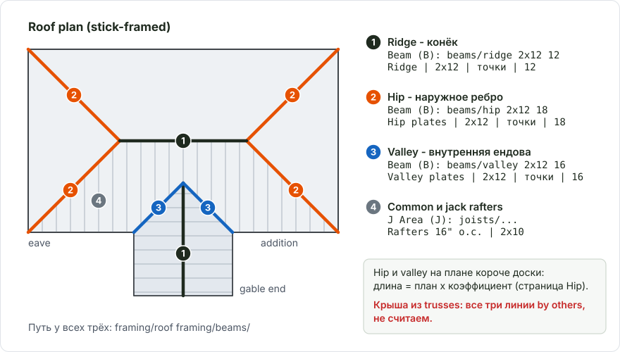

# Ridge / Valley / Hip (линии пересечения скатов)

<figure markdown>
  
  <figcaption markdown="span">Ridge - верхний конёк, hip - наружное наклонное ребро, valley - внутренняя ендова. На плане кровли это три разных типа линий.</figcaption>
</figure>

## Что это

- **Ridge** - горизонтальный конёк, стык двух скатов вверху.
- **Hip** - наклонное наружное ребро, скаты сходятся выпуклым углом.
- **Valley** - наклонная внутренняя ендова, скаты сходятся вогнутым углом.

Это обзор: он помогает выбрать страницу. Как мерить и как записывать каждый
элемент, написано на его странице, здесь правила не повторяются.

| Элемент | Страница | Когда наш |
| --- | --- | --- |
| Ridge board, ridge beam | [Ridge](../horizontal/roof-framing/ridge.md) | stick-кровля; ridge beam по марке на плане |
| Hip rafter | [Hip](../horizontal/roof-framing/hip.md) | stick-кровля с вальмой |
| Valley rafter, valley beam | [Valley](../horizontal/roof-framing/valley.md) | stick-кровля; у overframe вместо него sleepers |
| Sleepers под overframe | [Overframes](../horizontal/roof-framing/overframes.md) | когда пристройка собрана поверх нижней крыши |
| Metal valley flashing | [Flashing](flashing.md) | только когда кровельные материалы в scope |

У кровли из ферм ridge, hip и valley - часть ферм by others: строк `Ridge`,
`Hip plates` и `Valley plates` нет, считаем только то, что чертёж показывает
отдельно от ферм (sleepers overframe, flashing в scope).

## Где искать на чертежах

| Лист | Что взять |
| --- | --- |
| Roof framing plan (S) | Trusses или rafters; сечение и марка ridge beam, hip и valley rafters, LVL/PSL |
| Arch roof plan (`a105 rf`) | Линии ridge, hip, valley; уклоны скатов; overframe |
| Sections, elevations | Наклонная длина hip и valley в истинную величину |
| Details (`d`) | Опирание ridge beam, posts под ridge, valley sleepers, metal valley |

## Как мерить в OurPlanCore

Все три элемента меряются одним способом: инструмент Beam на листе roof
framing, позиция в `framing/roof framing/beams/`, одна точка = один элемент,
длина в имени. Не Line, не папка `details` и не `sqfts`.

1. Ridge: длина горизонтальная, коэффициент уклона не нужен. Правила длины и
   опор: [Ridge](../horizontal/roof-framing/ridge.md).
2. Hip и valley: линия на плане короче настоящей доски. Длину берут с разреза
   или умножают плановую на коэффициент hip и valley. Таблица коэффициентов и
   порядок: [Hip](../horizontal/roof-framing/hip.md),
   [Valley](../horizontal/roof-framing/valley.md).
3. Уклон учитывается один раз: либо длина с разреза, либо план x коэффициент.

## Как назвать в дереве и строка DFL

| Имя в дереве | Строка DFL | C | D |
| --- | --- | --- | --- |
| `framing/roof framing/beams/ridge 2x12 12` | `Ridge` | число досок | заказная длина в футах |
| `framing/roof framing/beams/RB1 (2) 1 3/4 x 11 7/8 LVL 20` | `Ridge (2)` | точки x 2 | заказная длина |
| `framing/roof framing/beams/hip 2x12 18` | `Hip plates` | число досок | чётная заказная длина |
| `framing/roof framing/beams/valley 2x12 16` | `Valley plates` | число досок | чётная заказная длина |
| valley beam с маркой на плане | `Valley Beam (2)` | точки x 2 | чётная заказная длина |

`(2)` в конце подписи - число слоёв в одном месте: одна точка в дереве, в C
точки x 2. Материал в B и лист или марка в E - по страницам элементов.

## Частые ошибки

- Hip и valley rafters взяты как common rafters: они длиннее и крупнее.
- Ridge, hip или valley посчитаны у truss-кровли, хотя фермы by others.
- Hip или valley обведены Line в `details` вместо Beam в `beams`.
- Уклон применён дважды (длина с разреза и ещё коэффициент) или не применён.
- Каркас и кровельный trim по тем же линиям слиты в одну строку.

Все ошибки по кровле: [common-mistakes](../../start/common-mistakes.md#roof).

## См. также

- [Ridge](../horizontal/roof-framing/ridge.md), [Hip](../horizontal/roof-framing/hip.md), [Valley](../horizontal/roof-framing/valley.md)
- [Overframes](../horizontal/roof-framing/overframes.md), [Flashing](flashing.md)
