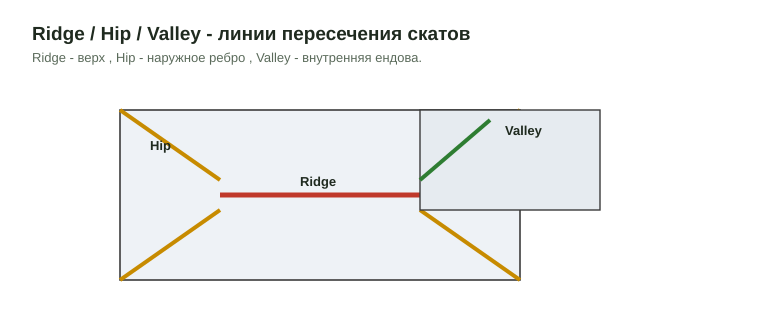

# Ridge / Valley / Hip (линии пересечения скатов)

<figure markdown>
  
  <figcaption markdown="span">Ridge - верхний конёк, hip - наружное наклонное ребро, valley - внутренняя ендова. На плане кровли это три разных типа линий.</figcaption>
</figure>

## Что это

- **Ridge** - горизонтальный конёк, стык двух скатов вверху.
- **Hip** - наклонное наружное ребро, скаты сходятся выпуклым углом.
- **Valley** - наклонная внутренняя ендова, скаты сходятся вогнутым углом.

Для кровли из ферм все три линии - часть ферм by others, считаем только
то, что показано loose: ridge board между gable trusses, valley sleepers
overframe, flashing. Для stick-кровли ridge beam, hip и valley rafters -
наш каркас. Подробно по каждому элементу: [Ridge](../horizontal/roof-framing/ridge.md),
[Hip](../horizontal/roof-framing/hip.md), [Valley](../horizontal/roof-framing/valley.md).

## Где искать на чертежах

| Лист | Что взять |
| --- | --- |
| Roof framing plan (S) | Trusses или rafters; сечение ridge beam, hip и valley rafters, LVL/PSL |
| Arch roof plan (`a105 rf`) | Линии ridge, hip, valley; длины; overframe |
| Details (`d`) | Ridge beam опирание, posts под ridge, valley sleepers, metal valley |

## Как мерить в OurPlanCore

1. Ridge beam: инструмент Beam по пролёту между опорами, позиция в
   `framing/roof framing/beams/<сечение> <длина>` (например `(2) 1 3/4 x 11 7/8 LVL 22`);
   инструмент сам округляет длину.
2. Hip и valley rafters: Line по линии ребра на плане, в
   `framing/roof framing/details/<сечение> hip` или по принятой ветке job;
   длина по плану, уклон один раз в формуле.
3. Ridge board между фермами и sleepers overframe: Line в `details`.
4. Metal valley flashing: [Flashing](flashing.md), если в scope.

!!! warning "Уточняется"
    Единая ветка для hip и valley rafters в дереве не зафиксирована; на
    каждом job держи их в одной папке roof framing, не в `sqfts`.

## Как назвать в дереве и строка DFL

| Имя в дереве | Строка DFL | Материал | Unit |
| --- | --- | --- | --- |
| `framing/roof framing/beams/(2) 1 3/4 x 11 7/8 LVL 22` | `Ridge (2)` | LVL | `pcs` + длина |
| `framing/roof framing/details/2x12 hip` | `Hip plates` / rafter по шаблону | `2x12` | `LFT` |
| `framing/roof framing/details/2x12 valley` | `Ridge / Valley / Hip` | `2x12` | `LFT` |

## Частые ошибки

- Hip и valley rafters взяты как common rafters: они длиннее и крупнее.
- Ridge beam из труss-кровли посчитан как наш, хотя фермы by others.
- Уклон применён дважды (в замере и в формуле).
- Каркас и кровельный trim по тем же линиям слиты в одну строку.

Все ошибки по кровле: [common-mistakes](../../start/common-mistakes.md#roof).

## См. также

- [Ridge](../horizontal/roof-framing/ridge.md), [Hip](../horizontal/roof-framing/hip.md), [Valley](../horizontal/roof-framing/valley.md)
- [Overframes](../horizontal/roof-framing/overframes.md), [Flashing](flashing.md)
