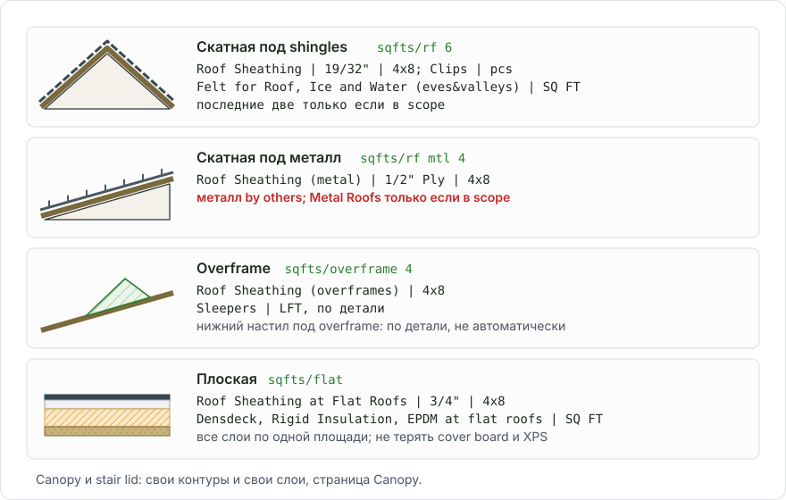

# Roof Types

<figure markdown>
  
  <figcaption markdown="span">Flat roof: membrane, cover board, rigid insulation, deck. All layers over the same area, each on its own row.</figcaption>
</figure>

## What it is

The roof type sets which area materials go into the DFL on top of the framing:
pitched under shingles, pitched under metal, flat under a membrane, canopy and
small roofs. The framing (trusses, rafters) is covered on the Roof Framing pages,
the deck on [Roof Sheathing](../horizontal/roof-framing/roof-sheathing.md).
This page is about not losing a layer that only this type has.

## Where to find it on the plans

| Sheet | What to take |
| --- | --- |
| Arch roof plan (`a105 rf`) | Zones by type: shingles, metal, flat, canopy; pitches |
| Roof assemblies (`ft`), specs | Flat roof layers: cover board, rigid, tapered, XPS, EPDM; alternates |
| Sections (`sec`) | Canopy and stair lid: second deck layer, tapered, DensGlass underneath |
| Structural notes | Deck for each type: `19/32"`, `1/2" Ply` under metal, `3/4"` flat |

## Types and their rows

| Type | Takeoff name | What it brings into the DFL | Unit |
| --- | --- | --- | --- |
| Pitched under shingles | `sqfts/rf 6` | `Roof Sheathing`, `Clips`, `Felt for Roof`, `Ice and Water (eves&valleys)` if in scope | `4x8`, `pcs`, `SQ FT` |
| Pitched under metal | `sqfts/rf mtl 4` | `Roof Sheathing (metal)` `1/2" Ply`; the metal itself is by others, `Metal Roofs` only if in scope | `4x8` |
| Overframe | `sqfts/overframe 4` | `Roof Sheathing (overframes)`, sleepers per detail | `4x8`, `LFT` |
| Flat | `sqfts/flat`, `sqfts/ply flat` | `Roof Sheathing at Flat Roofs` `3/4"`, `Densdeck` / cover board, `Rigid Insulation`, XPS, `EPDM at flat roofs` | `4x8`, `SQ FT` |
| Canopy, upper porch | `sqfts/flat canopy` or per the canopy block | `3/4" T&G`, tapered insulation, `5/8" Ext Gyp` or DensGlass underneath (two soffit rows) | `4x8`, `SQ FT` |
| Stair lid, mech screen | its own Area | two deck layers (`1/2" Ply` + `3/4" OSB`), kickers per detail | `4x8` |

Each type has its own outline and its own pitch; the pitch of the neighboring roof is not inherited.
Alternates (shingles and standing seam on the same plan): state in a Note what
was counted, or count both as alternates.

## Common mistakes

- On a flat roof, Densdeck / cover board and the second XPS layer over the same area missed.
- Canopy counted as a piece of the main roof, without tapered insulation and without the gypsum underneath.
- Piggyback trusses without sleepers.
- Metal by others, but the ply under it not counted.
- Shingles and metal on the same plan, one chosen without a Note.

All roof mistakes: [common-mistakes](../../start/common-mistakes.md#roof).

## Example

```text
Takeoffs/Main/sqfts/
  rf 6          Area  5880 SF   (main, shingles)
  rf mtl 4      Area   410 SF   (porch roof, standing seam)
  flat          Area   960 SF   (flat section, EPDM)
Takeoffs/Grge/sqfts/
  rf 4          Area  1420 SF
```

## See also

- [Roof SQFT](../sqfts/roof.md), [Roof Sheathing](../horizontal/roof-framing/roof-sheathing.md), [H-clips](../horizontal/roof-framing/h-clips.md)
- [Overframes](../horizontal/roof-framing/overframes.md), [Canopy](../horizontal/roof-framing/canopy.md), [Ridge / Valley / Hip](ridgevalleyhip.md)
