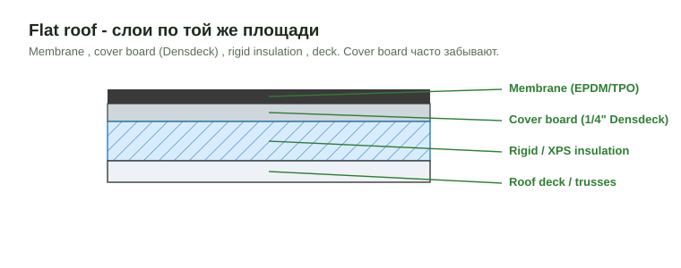

# Roof Types (тип кровли и её слои)

<figure markdown>
  
  <figcaption markdown="span">Flat roof: membrane, cover board, rigid insulation, настил. Все слои по одной площади, каждый своей строкой.</figcaption>
</figure>

## Что это

Тип кровли задаёт, какие площадные материалы идут в DFL поверх каркаса:
скатная под shingles, скатная под металл, плоская под мембрану, canopy и
мелкие кровли. Каркас (фермы, rafters) описан на страницах Roof Framing,
настил - на [Roof Sheathing](../horizontal/roof-framing/roof-sheathing.md).
Здесь - как не потерять слой, который есть только у этого типа.

## Где искать на чертежах

| Лист | Что взять |
| --- | --- |
| Arch roof plan (`a105 rf`) | Зоны по типам: shingles, metal, flat, canopy; уклоны |
| Roof assemblies (`ft`), specs | Слои flat roof: cover board, rigid, tapered, XPS, EPDM; alternates |
| Sections (`sec`) | Canopy и stair lid: второй слой настила, tapered, DensGlass снизу |
| Structural notes | Настил под каждый тип: `19/32"`, `1/2" Ply` под металл, `3/4"` flat |

## Типы и их строки

| Тип | Имя в дереве | Что тянет в DFL | Unit |
| --- | --- | --- | --- |
| Скатная под shingles | `sqfts/rf 6` | `Roof Sheathing`, `Clips`, `Felt for Roof`, `Ice and Water (eves&valleys)` если в scope | `4x8`, `pcs`, `SQ FT` |
| Скатная под металл | `sqfts/rf mtl 4` | `Roof Sheathing (metal)` `1/2" Ply`; сам металл by others, `Metal Roofs` только в scope | `4x8` |
| Overframe | `sqfts/overframe 4` | `Roof Sheathing (overframes)`, sleepers по детали | `4x8`, `LFT` |
| Плоская | `sqfts/flat`, `sqfts/ply flat` | `Roof Sheathing at Flat Roofs` `3/4"`, `Densdeck` / cover board, `Rigid Insulation`, XPS, `EPDM at flat roofs` | `4x8`, `SQ FT` |
| Canopy, upper porch | `sqfts/flat canopy` или по блоку canopy | `3/4" T&G`, tapered insulation, `5/8" Ext Gyp` или DensGlass снизу (две строки soffit) | `4x8`, `SQ FT` |
| Stair lid, mech screen | своя Area | два слоя настила (`1/2" Ply` + `3/4" OSB`), kickers по детали | `4x8` |

Каждый тип - свой контур и свой уклон; уклон соседней крыши не наследуется.
Alternates (shingles и standing seam на одном плане): уточни в Note, что
посчитано, или считай оба как alternate.

## Частые ошибки

- На flat roof пропущены Densdeck / cover board и второй слой XPS той же площади.
- Canopy посчитан как кусок main roof без tapered и без нижнего гипса.
- Piggyback trusses без sleepers.
- Металл by others, но ply под него не посчитан.
- Shingles и metal на одном плане, выбран один без Note.

Все ошибки по кровле: [common-mistakes](../../start/common-mistakes.md#roof).

## Пример

```text
Takeoffs/Main/sqfts/
  rf 6          Area  5880 SF   (main, shingles)
  rf mtl 4      Area   410 SF   (porch roof, standing seam)
  flat          Area   960 SF   (flat section, EPDM)
Takeoffs/Grge/sqfts/
  rf 4          Area  1420 SF
```

## См. также

- [Roof SQFT](../sqfts/roof.md), [Roof Sheathing](../horizontal/roof-framing/roof-sheathing.md), [H-clips](../horizontal/roof-framing/h-clips.md)
- [Overframes](../horizontal/roof-framing/overframes.md), [Canopy](../horizontal/roof-framing/canopy.md), [Ridge / Valley / Hip](ridgevalleyhip.md)
