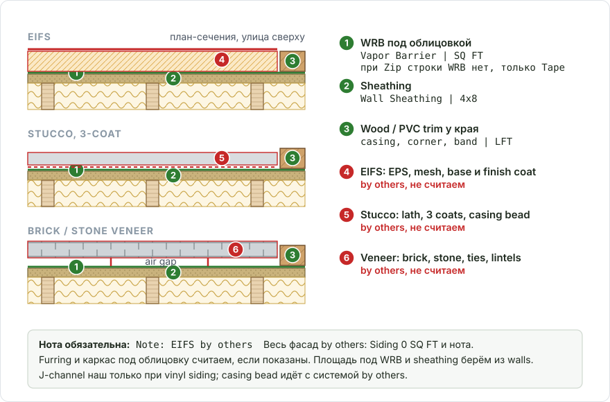
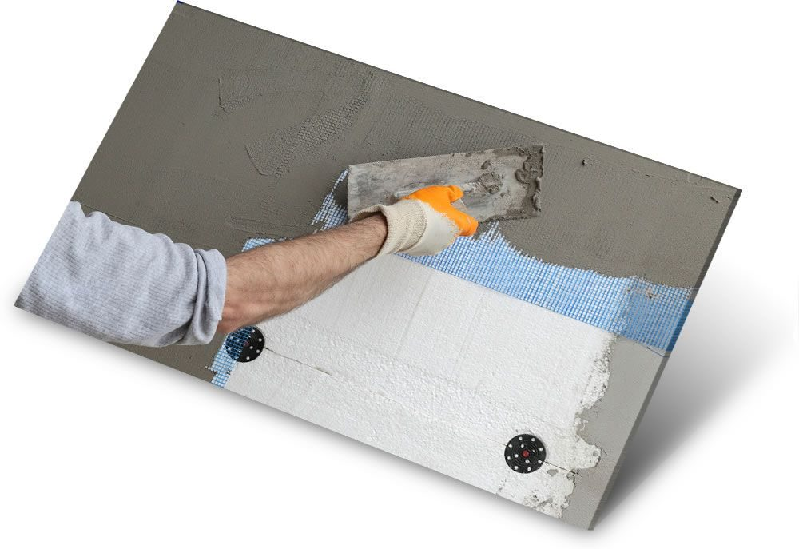
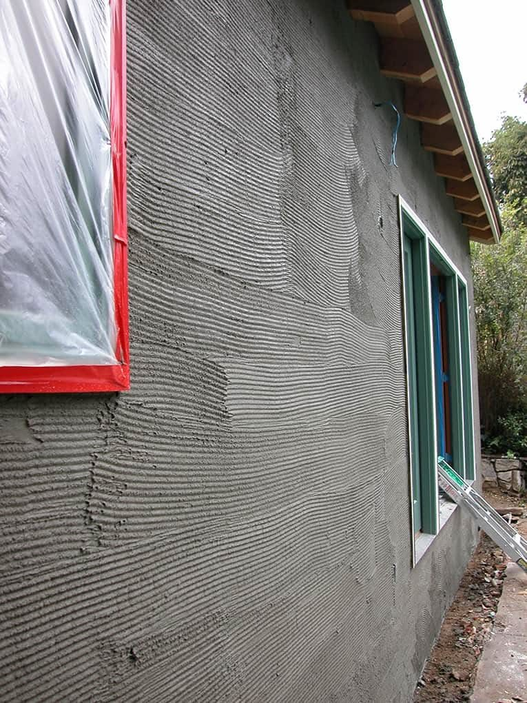
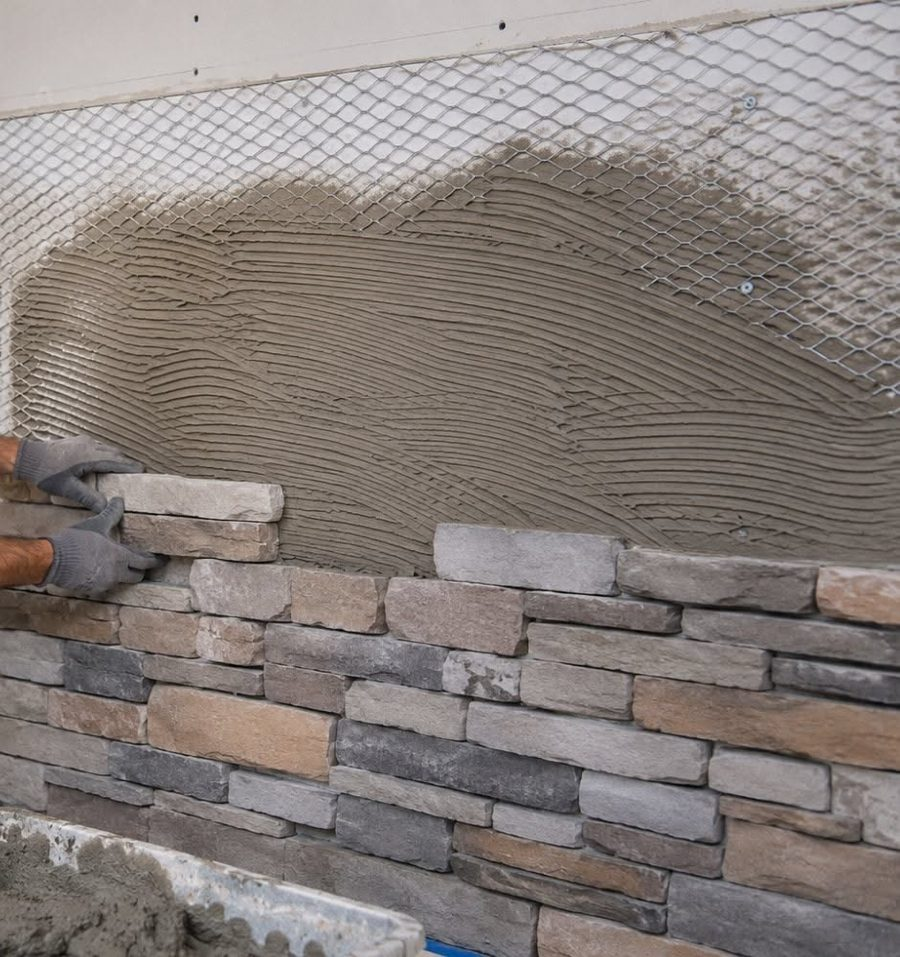

# EIFS / Stucco / Veneer

<figure markdown>
  
  <figcaption markdown="span">Finish systems by others. WRB, sheathing, furring and wood/PVC trim around them are ours. J-channel is ours only with vinyl siding.</figcaption>
</figure>

<figure markdown>
  { width="520" }
  <figcaption markdown="span">EIFS in progress: EPS boards on washer-head fasteners, fiberglass mesh on top, embedded in the base coat. All of it is by others; our rows are the sheathing and WRB under the boards and the trim at the edges. Photo: estimatingedge.com, [source](https://www.estimatingedge.com/construction/eifs/), found via Pinterest.</figcaption>
</figure>
<figure markdown>
  { width="420" }
  <figcaption markdown="span">Three-coat stucco: the first coat (scratch coat) with grooves over metal lath, windows taped off. Stucco is by others; our scope under it is sheathing, WRB and wood trim at the openings. Photo: hometips.com, [source](https://www.hometips.com/buying-guides/walls-siding-stucco.html), found via Pinterest.</figcaption>
</figure>
<figure markdown>
  { width="420" }
  <figcaption markdown="span">Adhered stone veneer: metal lath visible at the top, scratch coat below, stone set in mortar on it. The whole package is by others; under it are our sheathing and WRB, wood trim at the edges. Photo: mountainviewstone.net, [source](https://mountainviewstone.net/blogs/carved-in-stone/can-you-install-stone-veneer-over-drywall), found via Pinterest.</figcaption>
</figure>

## What it is

EIFS, stucco, stone veneer and brick veneer are also exterior wall cladding, but
they are separate trades. In our scope (wood, EWP, vinyl, fiber cement and trim)
the finish itself is not counted. We count what is under it and around it: WRB, sheathing,
furring, wood/PVC trim, soffit, fascia.

## How to recognize it on the plans

=== "EIFS"

    Exterior Insulation and Finish System, "synthetic stucco":
    adhesive, insulation board (EPS), base coat with fiberglass mesh, finish
    coat. Notes `EIFS`, `Synthetic Stucco`, `Dryvit`, `Sto`, `Senergy`,
    `1" / 2" EIFS`; in section, insulation board and thin layers with mesh; on the
    elevation, smooth fields with reveals and expansion joints. By others (EIFS sub).

=== "Stucco"

    Cement plaster, usually 3-coat (scratch, brown, finish) over metal
    lath and WRB. Notes `Stucco`, `3-coat stucco`, `Cement plaster`,
    `Portland`; in section, lath and three coats, weep screed at the bottom. By others
    (plaster trade).

=== "Stone veneer"

    Cladding stone, manufactured or natural, adhered on a scratch coat
    or anchored. Notes `Stone Veneer`, `Cultured Stone`, `Manufactured
    Stone`; stone hatch on the elevation; in section, WRB, lath, scratch coat,
    stone. By others (mason).

=== "Brick veneer"

    Brick cladding with an air gap, brick ties to the frame, weep
    holes, lintels and shelf angles. Notes `Brick Veneer`, `Brick`, brick
    hatch; in section, air gap, ties, weeps. By others (mason).

## What we count next to it

| Element | Count it? |
| --- | --- |
| WRB under the cladding (per spec) | yes, check the scope |
| Sheathing (CDX, OSB, Zip) | yes, its own scope |
| Furring and framing for the cladding | yes, if shown |
| Wood / PVC trim, corner, band, soffit, fascia | yes |
| The EIFS, stucco, stone, brick itself | no |
| Lath, base coat, brick ties, shelf angle, casing bead | no, by others |

- A note is required: `Note: Stone Veneer by others`, `Note: Stucco by
  others`, `Note: EIFS by others`.
- The whole elevation is EIFS, stucco or stone: siding `0 SQ FT` plus a note, trim
  close to zero. Do not pad the quantity.
- EIFS and stucco accessories (casing bead, stop bead, track, expansion joint)
  come with the system by others. J-channel with vinyl siding is ours; canonical page:
  [Exclusions and J-Channel](../exterior-trims/exclusions.md).

## How to measure in OurPlanCore

No separate takeoff is needed for cladding by others. The wall area under it
is needed for WRB and sheathing: it comes from `walls` and the wall height, not from the
elevation. Trim around the cladding is counted as usual in `trims`.

## Common mistakes

- Stone or brick veneer counted as siding or as our masonry.
- WRB and sheathing under EIFS missed because "the wall is by others".
- EIFS casing bead written as our J-channel.
- The by-others note not added.
- All sheathing and WRB mistakes: [Sheathing](../../start/common-mistakes.md#sheathing).

## Example

```text
Note: Stone Veneer and EIFS are by others; WRB and sheathing counted
Siding          Per plans: EIFS by others     0      SQ FT
WRB             fluid-applied per spec        6 420  SQ FT   A3.0
Wall Sheathing  7/16" Zip                     215    4x8     8/S3.0
CornerBoards    5/4x6 PVC                     112    LFT     A201
```

## See also

- [Siding](overview.md), [Underlayment](underlayment.md), [Measuring](measure.md)
- [Exclusions and J-Channel](../exterior-trims/exclusions.md), [Casing, Corner & Band](../exterior-trims/casing-corner-band.md)
- [Wall Sheathing](../vertical/sheathing/wall-sheathing.md), [Standard notes](../../reference/standard-notes.md)
