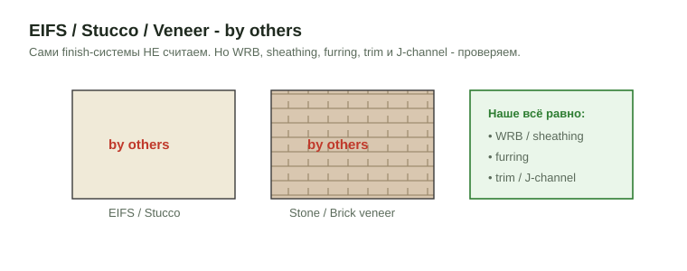
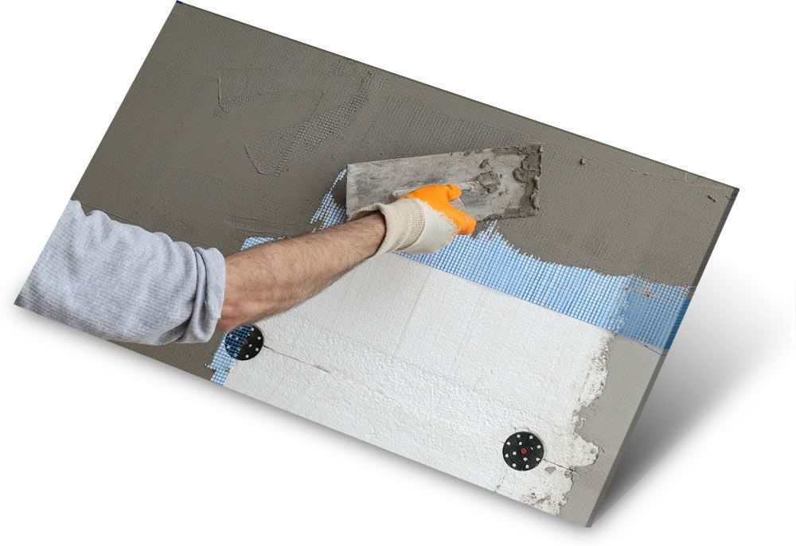
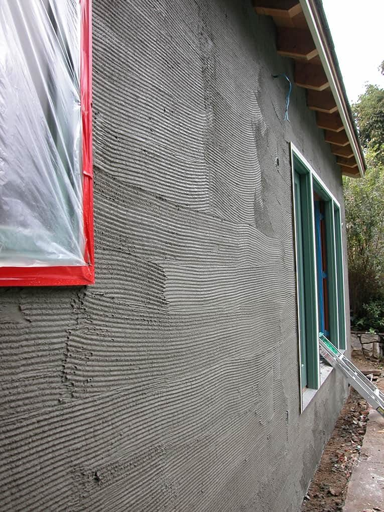
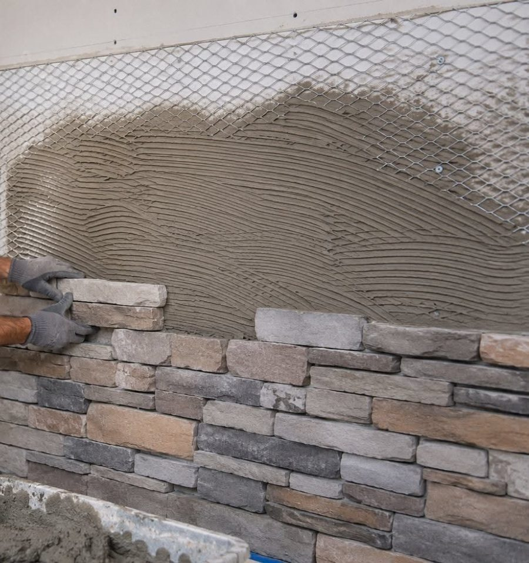

# EIFS / Stucco / Veneer (облицовка by others)

<figure markdown>
  
  <figcaption markdown="span">Finish-системы by others. WRB, sheathing, furring и wood/PVC trim вокруг них наши. J-channel наш только при vinyl siding.</figcaption>
</figure>

<figure markdown>
  { width="520" }
  <figcaption markdown="span">EIFS в работе: плиты EPS на тарельчатых дюбелях, поверх стеклосетка, которую втирают в base coat. Всё это by others; наши строки - sheathing и WRB под плитами и trim по краям. Фото: estimatingedge.com, [источник](https://www.estimatingedge.com/construction/eifs/), найдено через Pinterest.</figcaption>
</figure>
<figure markdown>
  { width="420" }
  <figcaption markdown="span">Three-coat stucco: первый слой (scratch coat) с бороздами поверх metal lath, окна заклеены. Stucco by others; наш scope под ним - sheathing, WRB и wood trim у проёмов. Фото: hometips.com, [источник](https://www.hometips.com/buying-guides/walls-siding-stucco.html), найдено через Pinterest.</figcaption>
</figure>
<figure markdown>
  { width="420" }
  <figcaption markdown="span">Adhered stone veneer: сверху видна metal lath, ниже scratch coat, на него на раствор кладут камень. Весь пакет by others; под ним наши sheathing и WRB, по краям wood trim. Фото: mountainviewstone.net, [источник](https://mountainviewstone.net/blogs/carved-in-stone/can-you-install-stone-veneer-over-drywall), найдено через Pinterest.</figcaption>
</figure>

## Что это

EIFS, stucco, stone veneer и brick veneer тоже наружная облицовка стен, но
это отдельные trades. В нашем scope (wood, EWP, vinyl, fiber cement и trim)
сам finish не считаем. Считаем то, что под ним и вокруг: WRB, sheathing,
furring, wood/PVC trim, soffit, fascia.

## Как распознать на чертежах

=== "EIFS"

    Exterior Insulation and Finish System, "синтетическая штукатурка":
    adhesive, insulation board (EPS), base coat с fiberglass mesh, finish
    coat. Notes `EIFS`, `Synthetic Stucco`, `Dryvit`, `Sto`, `Senergy`,
    `1" / 2" EIFS`; на разрезе insulation board и тонкие слои с mesh; на
    фасаде гладкие поля с reveals и expansion joints. By others (EIFS sub).

=== "Stucco"

    Цементная штукатурка, обычно 3-coat (scratch, brown, finish) по metal
    lath и WRB. Notes `Stucco`, `3-coat stucco`, `Cement plaster`,
    `Portland`; на разрезе lath и три слоя, weep screed по низу. By others
    (plaster trade).

=== "Stone veneer"

    Облицовочный камень, manufactured или natural, adhered на scratch coat
    или anchored. Notes `Stone Veneer`, `Cultured Stone`, `Manufactured
    Stone`; hatch камня на фасаде; на разрезе WRB, lath, scratch coat,
    stone. By others (mason).

=== "Brick veneer"

    Кирпичная облицовка с воздушным зазором, brick ties к каркасу, weep
    holes, lintels и shelf angles. Notes `Brick Veneer`, `Brick`, brick
    hatch; на разрезе air gap, ties, weeps. By others (mason).

## Что считаем рядом

| Элемент | Считаем? |
| --- | --- |
| WRB под облицовкой (по спецификации) | да, проверить scope |
| Sheathing (CDX, OSB, Zip) | да, свой scope |
| Furring и каркас под облицовку | да, если показан |
| Wood / PVC trim, corner, band, soffit, fascia | да |
| Сам EIFS, stucco, stone, brick | нет |
| Lath, base coat, brick ties, shelf angle, casing bead | нет, by others |

- Нота обязательна: `Note: Stone Veneer by others`, `Note: Stucco by
  others`, `Note: EIFS by others`.
- Весь фасад EIFS, stucco или stone: siding `0 SQ FT` плюс нота, trim
  почти нулевой. Не добивай количество.
- Accessory EIFS и stucco (casing bead, stop bead, track, expansion joint)
  идут с системой by others. J-channel при vinyl siding наш; канон:
  [Exclusions и J-Channel](../exterior-trims/exclusions.md).

## Как мерить в OurPlanCore

Отдельный takeoff на облицовку by others не нужен. Площадь стен под ней
нужна для WRB и sheathing: она берётся из `walls` и высоты стен, а не из
фасада. Trim вокруг облицовки считается как обычно в `trims`.

## Частые ошибки

- Stone или brick veneer посчитаны как siding или как наша кладка.
- WRB и sheathing под EIFS пропущены, потому что "стена by others".
- Casing bead EIFS записан как наш J-channel.
- Нота by others не поставлена.
- Все ошибки по обшивке и WRB: [Обшивка](../../start/common-mistakes.md#sheathing).

## Пример

```text
Note: Stone Veneer and EIFS are by others; WRB and sheathing counted
Siding          Per plans: EIFS by others     0      SQ FT
WRB             fluid-applied per spec        6 420  SQ FT   A3.0
Wall Sheathing  7/16" Zip                     215    4x8     8/S3.0
CornerBoards    5/4x6 PVC                     112    LFT     A201
```

## См. также

- [Siding](overview.md), [Underlayment](underlayment.md), [Измерение](measure.md)
- [Exclusions и J-Channel](../exterior-trims/exclusions.md), [Casing, Corner & Band](../exterior-trims/casing-corner-band.md)
- [Wall Sheathing](../vertical/sheathing/wall-sheathing.md), [Standard notes](../../reference/standard-notes.md)
