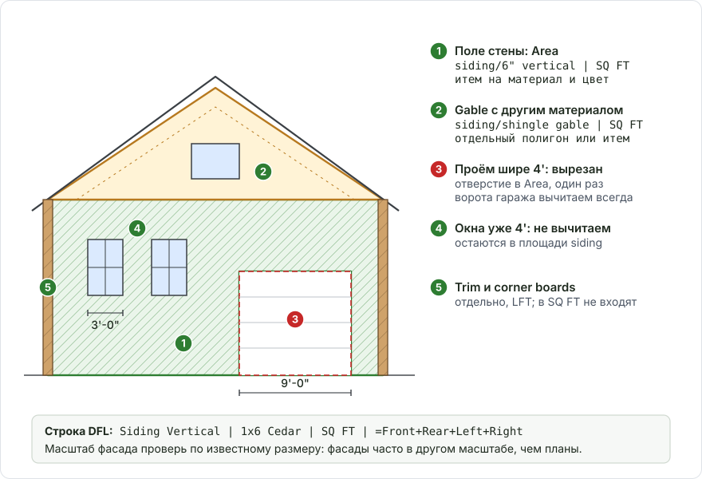

# Measuring siding

<figure markdown>
  
  <figcaption markdown="span">SQ FT by elevation: the wall field is an Area, gable and accent as separate areas, openings cut out at the frame once.</figcaption>
</figure>

<!-- TODO-SCREEN: measure-area-siding.png (Area on an elevation in OurPlanCore with an opening deducted, item siding/6" vertical) -->

## What it is

Siding is counted by area in `SQ FT` per elevation, wall by wall. Trim,
accessories and flashing are counted separately in `LFT` and `pcs`; they are not part of the
siding area.

## Where to find it on the plans

| Sheet | What to take |
| --- | --- |
| Elevations (`el`) | Area of each elevation, material by zone, gables, bays, dormers |
| Wall sections | Wall height up to the soffit, flare, furring |
| Plans and opening layout | Openings to deduct: windows, doors, overhead doors, storefronts; walls that no elevation shows |
| Notes | `by others`, `TBD`, product |

## How to measure in OurPlanCore

1. Open the elevation sheet. Elevations have no sheet dot, so the item is created
   in the `siding` root manually or by a name rule.
2. Area along the wall field of each elevation: one item per material and color
   (`6" vertical`, `panel grey`, `shingle gable`). One material on
   several elevations can be collected as several polygons in one item.
3. Gables, dormers, bays, return walls as separate polygons or items,
   especially with a different material.
4. Cut every window and every door out as a hole in the Area at the frame (inside
   the casing): siding runs under the casing, corner boards and bands and continues
   behind posts and columns. The wall sheathing rule "windows narrower than 4' are not
   deducted" does not apply to siding: in siding every opening is cut out, and the DFL
   gets the net area. Do not deduct the same opening twice.
5. A blank spot on an elevation that is really a section cut or an open balcony
   bay gets no siding. Walls that no elevation shows (courtyard, wall above a
   roof, dormer cheeks, sides of recesses) are counted from the plan: length
   x height, `assumed` in the name, material as on the adjacent wall.
6. Check the elevation scale against a known dimension (floor height, overhead door
   width): elevations are often at a different scale than the plans.
7. Move the net area into G of the DFL row as a sum with visible addends and
   update it after the takeoff is edited; the formula in C adds the waste.

## Tree name and DFL row

| Tree name | DFL row | Unit | Formula |
| --- | --- | --- | --- |
| `siding/6" vertical` | `Siding Vertical`, `1x6 Cedar` in B | SQ FT | `=CEILING(G*1.1,10)`; G holds the net area `=Front+Rear+Left+Right`; exposure in E |
| `siding/panel grey` | `Panels`, `Fiber Cement Panels` in B | SQ FT | same formula; separately by color, color or tag in E |
| `siding/shingle gable` | `Siding`, `Vinyl Shingles` in B | SQ FT | same formula; accent separately |
| | `Siding` (correction) | SQ FT | `-140` as a visible row, if a deduction is needed |
| | `Siding`, `TBD Siding` in B | SQ FT | G `0` plus the note `Note: Siding is not specified; verify` |

Siding has one waste factor for every type: 1.1. It is in the template formula
`=CEILING(G*1.1,10)` (a total under 50 rounds to 2), so G takes the net
area with no allowance. The exposure (`6" Exp.`) goes into E next to the sheet
or keynote; it does not change the quantity. Do not merge horizontal and vertical
siding of one product into one row.

## By others and TBD

- Siding by others: a row with `0` and the note `by others` or `by customer`.
- Material not specified: `TBD Siding` in B, G `0` and the note `Note: Siding is not
  specified; verify`; do not substitute a product.
- EIFS, stucco, stone, brick: not counted, but check the WRB, sheathing, furring and
  trim next to them: [EIFS / Stucco / Veneer](eifs-stucco-veneer.md).

## Common mistakes

- Area from the plan (perimeter x height) without deducting gables and without the different
  wall heights per elevation.
- An opening deducted twice or not at all (garage doors).
- Small windows not cut out by habit from wall sheathing: in siding every opening is cut out.
- G holds an area that already includes the allowance: the waste is counted twice.
- Elevation scale not checked.
- Area measured but not moved to Excel or not updated.
- All area and sheathing mistakes: [SQFT areas](../../start/common-mistakes.md#sqft), [Sheathing](../../start/common-mistakes.md#sheathing).

## Example

```text
Takeoffs/Main/siding/6" vertical     Area   4 polygons   3180 SQ FT
Takeoffs/Main/siding/shingle gable   Area   2 polygons    420 SQ FT

Siding Vertical   1x6 Cedar        3500  SQ FT   =CEILING(G*1.1,10)   G =1120+940+560+560   6" Exp. A201 A202
Siding            Cedar Shingles    470  SQ FT   =CEILING(G*1.1,10)   G =210+210            5-1/2" Exp. A201

Vertical: G = 3180; 3180 x 1.1 = 3498, rounded up to 10 = 3500
Shingles: G = 420; 420 x 1.1 = 462, rounded up to 10 = 470
```

## See also

- [Siding](overview.md), [Siding types](types.md), [Underlayment](underlayment.md), [EIFS / Stucco / Veneer](eifs-stucco-veneer.md)
- [Formulas and factors](../../reference/formulas.md), [Client rules](../../start/client-rules.md), [Trim macros](../exterior-trims/macros.md)
