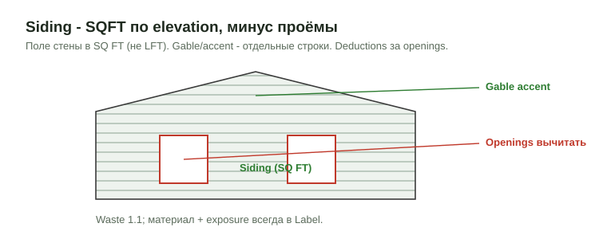

# Измерение siding (Area по фасадам)

<figure markdown>
  
  <figcaption markdown="span">SQ FT по фасаду: поле стены Area, gable и accent отдельными площадями, крупные проёмы вычтены один раз.</figcaption>
</figure>

<!-- TODO-SCREEN: measure-area-siding.png (Area по фасаду в OurPlanCore с вычетом проёма, итем siding/6" vertical) -->

## Что это

Siding считается площадью `SQ FT` по фасадам, стена за стеной. Trim,
accessories и flashing считаются отдельно в `LFT` и `pcs`, в площадь
siding они не входят.

## Где искать на чертежах

| Лист | Что взять |
| --- | --- |
| Elevations (`el`) | Площадь каждого фасада, материал по зонам, gables, bays, dormers |
| Wall sections | Высота стены до soffit, flare, furring |
| Планы и схема проёмов | Крупные проёмы для вычета (ворота, витражи) |
| Notes | `by others`, `TBD`, продукт |

## Как мерить в OurPlanCore

1. Открой лист фасада. У фасадов нет точки листа, поэтому итем создаётся
   в корне `siding` вручную или по правилу имени.
2. Area по полю стены каждого фасада: по итему на материал и цвет
   (`6" vertical`, `panel grey`, `shingle gable`). Один материал на
   нескольких фасадах можно собирать несколькими полигонами в одном итеме.
3. Gables, dormers, bays, return walls отдельными полигонами или итемами,
   особенно при другом материале.
4. Крупные проёмы вырезай отверстием в Area; окна меньше 4' не вычитаем,
   они уходят в waste. Один и тот же проём не вычитать дважды (siding и
   WRB берут вычет каждый от своей площади).
5. Масштаб фасада проверь по известному размеру (высота этажа, ширина
   ворот): фасады часто в другом масштабе, чем планы.
6. Перенеси площадь в DFL формулой с видимыми слагаемыми и обновляй после
   правок замера.

## Как назвать в дереве и строка DFL

| Имя в дереве | Строка DFL | Unit | Формула |
| --- | --- | --- | --- |
| `siding/6" vertical` | `Siding Vertical 1x6 Cedar` | SQ FT | `=Front+Rear+Left+Right` |
| `siding/panel grey` | `Siding Fiber Cement Panel grey` | SQ FT | отдельно по цвету |
| `siding/shingle gable` | `Siding Gable front Vinyl Shingles` | SQ FT | accent отдельно |
| | `Siding` (correction) | SQ FT | `-140` видимой строкой, если нужен вычет |
| | `Siding Per customer TBD` | SQ FT | `0` плюс нота |

Waste: lap умеренный, shingle и shake выше, диагональ и мелкие gables
больше обрезков. Фактор держи видимым множителем по
[Формулам и факторам](../../reference/formulas.md).

## By others и TBD

- Siding by others: строка с `0` и нота `by others` или `by customer`.
- Материал не указан: `Per customer TBD` или `verify material`, продукт
  не подставлять.
- EIFS, stucco, stone, brick: не считаем, но WRB, sheathing, furring и
  trim рядом проверяем: [EIFS / Stucco / Veneer](eifs-stucco-veneer.md).

## Частые ошибки

- Площадь по плану (периметр x высота) без вычета фронтонов и разной
  высоты стен по фасадам.
- Проём вычтен дважды или не вычтен вовсе (ворота гаража).
- Масштаб фасада не проверен.
- Площадь измерена, но в Excel не перенесена или не обновлена.
- Все ошибки по площадям и обшивке: [Площади SQFT](../../start/common-mistakes.md#sqft), [Обшивка](../../start/common-mistakes.md#sheathing).

## Пример

```text
Takeoffs/Main/siding/6" vertical     Area   4 polygons   3 180 SF
Takeoffs/Main/siding/shingle gable   Area   2 polygons     420 SF

Siding Vertical      1x6 Cedar              3 180  SQ FT   =1120+940+560+560   A201 A202
Siding Gable front   Cedar Shingles 5-1/2"    420  SQ FT   =210+210            A201
```

## См. также

- [Siding](overview.md), [Типы siding](types.md), [Underlayment](underlayment.md), [EIFS / Stucco / Veneer](eifs-stucco-veneer.md)
- [Формулы и факторы](../../reference/formulas.md), [Правила клиентов](../../start/client-rules.md), [Trim macros](../exterior-trims/macros.md)
