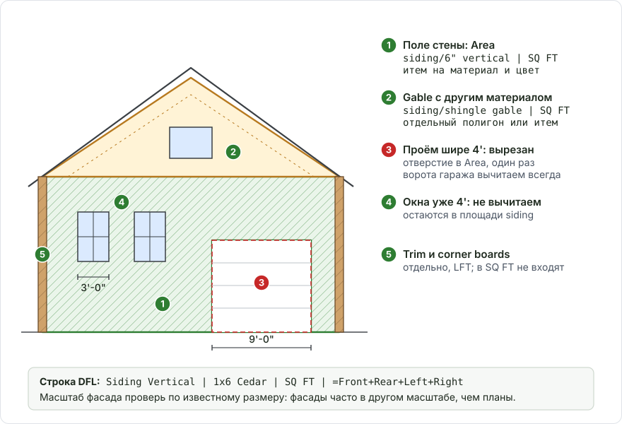

# Измерение siding (Area по фасадам)

<figure markdown>
  
  <figcaption markdown="span">SQ FT по фасаду: поле стены Area, gable и accent отдельными площадями, проёмы вырезаны по раме один раз.</figcaption>
</figure>

<!-- TODO-SCREEN: measure-area-siding.png (Area по фасаду в OurPlanCore с вычетом проёма, итем siding/6" vertical) -->

## Что это

Siding считается площадью `SQ FT` по фасадам, стена за стеной. Trim,
accessories и flashing считаются отдельно в `LFT` и `pcs`, в площадь
siding они не входят.

## Где искать на чертежах

| Лист | Что взять |
| --- | --- |
| Elevations (`el`) | Площадь каждого фасада, материал по зонам, gables, bays, dormers |
| Wall sections | Высота стены до soffit, flare, furring |
| Планы и схема проёмов | Проёмы для вычета: окна, двери, ворота, витражи; стены, которых нет на фасадах |
| Notes | `by others`, `TBD`, продукт |

## Как мерить в OurPlanCore

1. Открой лист фасада. У фасадов нет точки листа, поэтому итем создаётся
   в корне `siding` вручную или по правилу имени.
2. Area по полю стены каждого фасада: по итему на материал и цвет
   (`6" vertical`, `panel grey`, `shingle gable`). Один материал на
   нескольких фасадах можно собирать несколькими полигонами в одном итеме.
3. Gables, dormers, bays, return walls отдельными полигонами или итемами,
   особенно при другом материале.
4. Каждое окно и каждую дверь вырезай отверстием в Area по раме (внутри
   casing): siding заходит под casing, corner boards и band и идёт сплошным
   за постами и колоннами. Правило обшивки стен "окна уже 4' не вычитаем"
   на siding не действует: в siding вырезаются все проёмы, в DFL идёт
   чистая площадь. Один и тот же проём не вычитать дважды.
5. Пустое место на фасаде, которое на деле разрез или открытая ниша
   балкона, siding не получает. Стены, которых нет ни на одном фасаде
   (двор, стена над крышей, щёки dormer, бока ниш), считай по плану: длина
   x высота, в имени `assumed`, материал как у соседней стены.
6. Масштаб фасада проверь по известному размеру (высота этажа, ширина
   ворот): фасады часто в другом масштабе, чем планы.
7. Перенеси чистую площадь в G строки DFL суммой с видимыми слагаемыми и
   обновляй после правок замера; запас считает формула в C.

## Как назвать в дереве и строка DFL

| Имя в дереве | Строка DFL | Unit | Формула |
| --- | --- | --- | --- |
| `siding/6" vertical` | `Siding Vertical`, в B `1x6 Cedar` | SQ FT | `=CEILING(G*1.1,10)`; в G чистая площадь `=Front+Rear+Left+Right`; exposure в E |
| `siding/panel grey` | `Panels`, в B `Fiber Cement Panels` | SQ FT | та же формула; отдельно по цвету, цвет или тег в E |
| `siding/shingle gable` | `Siding`, в B `Vinyl Shingles` | SQ FT | та же формула; accent отдельно |
| | `Siding` (correction) | SQ FT | `-140` видимой строкой, если нужен вычет |
| | `Siding`, в B `TBD Siding` | SQ FT | G `0` плюс нота `Note: Siding is not specified; verify` |

Waste у siding один для любого типа: 1.1. Он стоит в формуле шаблона
`=CEILING(G*1.1,10)` (итог меньше 50 округляется до 2), поэтому в G пишется
чистая площадь без запаса. Exposure (`6" Exp.`) пишется в E рядом с листом
или keynote; на количество он не влияет. Горизонтальный и вертикальный
siding одного продукта в одну строку не сводить.

## By others и TBD

- Siding by others: строка с `0` и нота `by others` или `by customer`.
- Материал не указан: в B `TBD Siding`, G `0` и нота `Note: Siding is not
  specified; verify`; продукт не подставлять.
- EIFS, stucco, stone, brick: не считаем, но WRB, sheathing, furring и
  trim рядом проверяем: [EIFS / Stucco / Veneer](eifs-stucco-veneer.md).

## Частые ошибки

- Площадь по плану (периметр x высота) без вычета фронтонов и разной
  высоты стен по фасадам.
- Проём вычтен дважды или не вычтен вовсе (ворота гаража).
- Мелкие окна не вырезаны по привычке от обшивки стен: в siding вырезаются все проёмы.
- В G вписана площадь уже с запасом: waste посчитан дважды.
- Масштаб фасада не проверен.
- Площадь измерена, но в Excel не перенесена или не обновлена.
- Все ошибки по площадям и обшивке: [Площади SQFT](../../start/common-mistakes.md#sqft), [Обшивка](../../start/common-mistakes.md#sheathing).

## Пример

```text
Takeoffs/Main/siding/6" vertical     Area   4 polygons   3180 SQ FT
Takeoffs/Main/siding/shingle gable   Area   2 polygons    420 SQ FT

Siding Vertical   1x6 Cedar        3500  SQ FT   =CEILING(G*1.1,10)   G =1120+940+560+560   6" Exp. A201 A202
Siding            Cedar Shingles    470  SQ FT   =CEILING(G*1.1,10)   G =210+210            5-1/2" Exp. A201

Vertical: G = 3180; 3180 x 1.1 = 3498, вверх до 10 = 3500
Shingles: G = 420; 420 x 1.1 = 462, вверх до 10 = 470
```

## См. также

- [Siding](overview.md), [Типы siding](types.md), [Underlayment](underlayment.md), [EIFS / Stucco / Veneer](eifs-stucco-veneer.md)
- [Формулы и факторы](../../reference/formulas.md), [Правила клиентов](../../start/client-rules.md), [Trim macros](../exterior-trims/macros.md)
