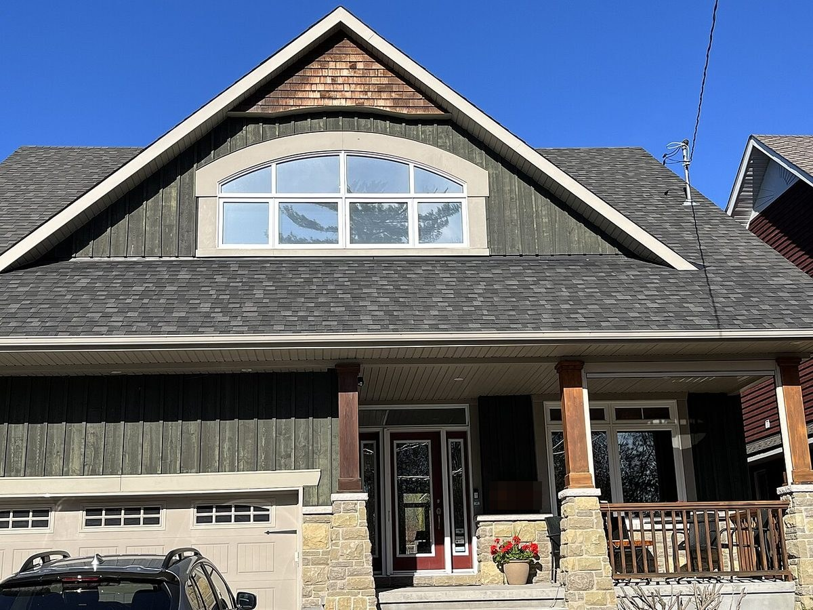

# Siding

Siding is the field of the exterior wall: lap and clapboard, shingle and shake, panel,
board and batten, vinyl, Hardi (fiber cement), cedar, composite. It is counted
by area in `SQ FT` per elevation. A separate scope: trim around the siding is
[Exterior Trims](../exterior-trims/overview.md), and EIFS, stucco, stone and
brick veneer are cladding by others.

<figure markdown>
  
  <figcaption markdown="span">One elevation, three rows: board and batten on the field, shingle accent in the gable, stone veneer at the bottom (by others). Porch columns and railing are separate takeoffs. Photo: Robert Neustadter, CC BY-SA 4.0, [source](https://commons.wikimedia.org/wiki/File:House_showing_board-and-batten_siding_and_shingle-style_ornamentation.jpg)</figcaption>
</figure>

## What is included and in what order

-   :material-format-list-group:{ .lg .middle } **Siding types**

    ---

    Lap, shingle, panel, board and batten, vinyl, Hardi, cedar, composite;
    exposure and material in the row.

    [Siding types](types.md)

-   :material-layers-outline:{ .lg .middle } **Underlayment**

    ---

    WRB per spec, Zip, furring and rainscreen, Cedar Breather,
    starter, J-channel, flashing.

    [Underlayment](underlayment.md)

-   :material-cancel:{ .lg .middle .kb-mk--amber } **EIFS / Stucco / Veneer**

    ---

    What it is, how to recognize it, why it is by others, what next to it stays ours.

    [EIFS / Stucco / Veneer](eifs-stucco-veneer.md)

-   :material-ruler-square:{ .lg .middle } **Measuring**

    ---

    Area by elevation in OurPlanCore, gables and accents separately, deductions,
    waste, by others.

    [Measuring](measure.md)

## Count it or not

| Cladding | Count it? | Why |
| --- | --- | --- |
| Lap, shingle, panel, board and batten (wood, vinyl, Hardi, composite) | yes | wall field, `SQ FT` |
| EIFS, stucco | no, except the WRB, sheathing, furring and trim next to it | finish system by others |
| Stone, brick veneer | no, except the WRB, sheathing, furring and trim next to it | masonry by others |
| Siding `by others` / `TBD` | `0` plus a note | client or another trade |

## Workflow

1. Read the notes on the elevations: siding material, exposure, where the accent is, where
   stone or EIFS is. Write the note into the DFL right away (`Note: Siding is Hardi; verify
   if Trims are Hardi or PVC`).
2. Open the wall sections: WRB per spec, furring, Cedar Breather.
3. Trace the areas by elevation, wall by wall; gables, dormers, bays and
   accents as separate items.
4. Deductions: every window and door is cut out at the frame once; the DFL gets
   the net area. The rule "windows narrower than 4' are not deducted" belongs to wall
   sheathing, not to siding.

## How to measure in OurPlanCore

The `siding` root in the building tree, an Area per item for each material and color:
`6" vertical`, `panel grey`, `shingle gable`. Elevation sheets (`el`) have no
point, so check that the item landed in `siding`. Details:
[Measuring](measure.md).

## DFL row

| A Description | B Size | C Qty | D Unit | E |
| --- | --- | --- | --- | --- |
| `Siding Horizontal` | `Hardi plank` | `=CEILING(G*1.1,10)` | SQ FT | `6" Exp. A201` |
| `Siding` | `Vinyl Shingles` | `=CEILING(G*1.1,10)` | SQ FT | `gable front A201` |
| `Siding Vertical` | `Boral TruExt 1x10 Shiplap` | `=CEILING(G*1.1,10)` | SQ FT | `A202` |
| `Siding` | `TBD Siding` | `0` | SQ FT | note `Note: Siding is not specified; verify` |

G holds the net area as a sum `=L+R+Front+Rear`; the 1.1 waste is in the C formula.
Material always in B, exposure in E; gable and accent separately, horizontal
and vertical separately; the unit is `SQ FT`, not `LFT`.

## Common mistakes

- B of the exterior barrier row says `Vapor Barrier` or Tyvek instead of the WRB per spec.
- Stone or EIFS counted as siding.
- The gable accent merged with the field of another material.
- The measured area not moved to Excel or not updated after edits.
- All sheathing and WRB mistakes: [Sheathing](../../start/common-mistakes.md#sheathing).

## See also

- [Siding types](types.md), [Underlayment](underlayment.md), [EIFS / Stucco / Veneer](eifs-stucco-veneer.md), [Measuring](measure.md)
- [Exterior Trims](../exterior-trims/overview.md), [Exclusions and J-Channel](../exterior-trims/exclusions.md), [Furring & Window Jambs](../exterior-trims/furring-and-jambs.md)
- [Wall Sheathing](../vertical/sheathing/wall-sheathing.md), [Material catalog](../../reference/material-catalog.md), [Standard notes](../../reference/standard-notes.md)
