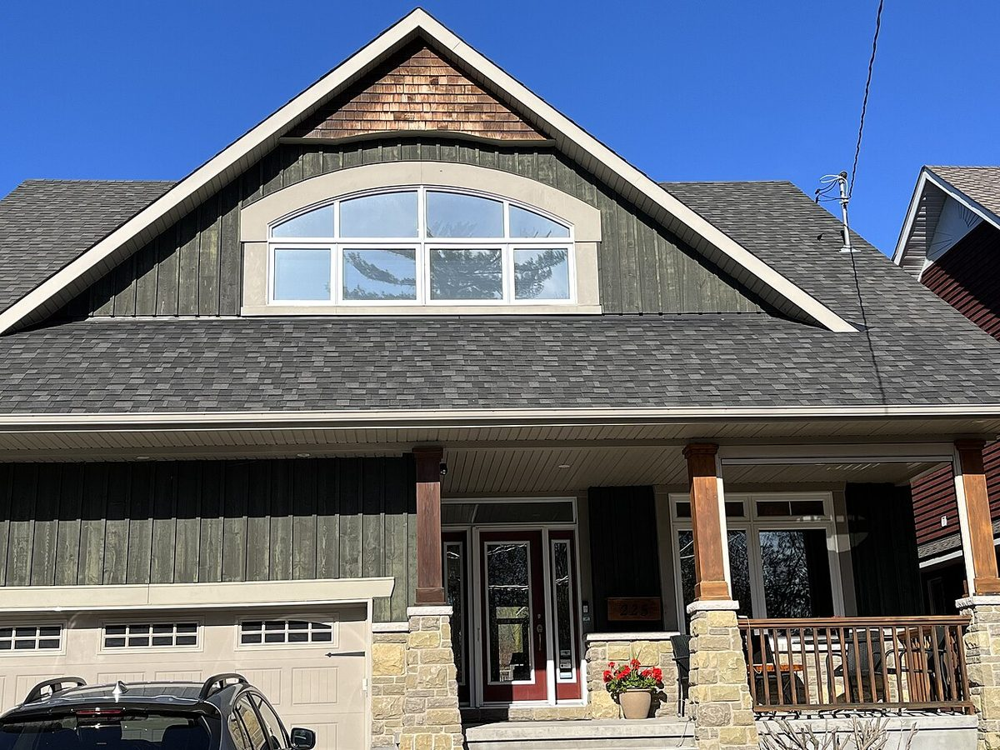

# Siding (наружная обшивка стен)

Siding это поле наружной стены: lap и clapboard, shingle и shake, panel,
board and batten, vinyl, Hardi (fiber cement), cedar, composite. Считается
площадью `SQ FT` по фасадам. Отдельный scope: trim вокруг siding это
[Exterior Trims](../exterior-trims/overview.md), а EIFS, stucco, stone и
brick veneer это облицовка by others.

<figure markdown>
  
  <figcaption markdown="span">Один фасад, три строки: board and batten по полю, shingle accent во фронтоне, stone veneer внизу (by others). Columns и перила porch это отдельные позиции. Фото: Robert Neustadter, CC BY-SA 4.0, [источник](https://commons.wikimedia.org/wiki/File:House_showing_board-and-batten_siding_and_shingle-style_ornamentation.jpg)</figcaption>
</figure>

## Что входит и в каком порядке

-   :material-format-list-group:{ .lg .middle } **Типы siding**

    ---

    Lap, shingle, panel, board and batten, vinyl, Hardi, cedar, composite;
    exposure и материал в строке.

    [Типы siding](types.md)

-   :material-layers-outline:{ .lg .middle } **Underlayment**

    ---

    WRB по спецификации, Zip, furring и rainscreen, Cedar Breather,
    starter, J-channel, flashing.

    [Underlayment](underlayment.md)

-   :material-cancel:{ .lg .middle .kb-mk--amber } **EIFS / Stucco / Veneer**

    ---

    Что это, как распознать, почему by others, что рядом остаётся нашим.

    [EIFS / Stucco / Veneer](eifs-stucco-veneer.md)

-   :material-ruler-square:{ .lg .middle } **Измерение**

    ---

    Area по фасадам в OurPlanCore, gables и accents отдельно, вычеты,
    waste, by others.

    [Измерение](measure.md)

## Считаем или нет

| Cladding | Считаем? | Почему |
| --- | --- | --- |
| Lap, shingle, panel, board and batten (wood, vinyl, Hardi, composite) | да | поле стены, `SQ FT` |
| EIFS, stucco | нет, кроме WRB, sheathing, furring и trim рядом | finish system by others |
| Stone, brick veneer | нет, кроме WRB, sheathing, furring и trim рядом | masonry by others |
| Siding `by others` / `TBD` | `0` плюс нота | заказчик или другой trade |

## Порядок работы

1. Прочитай ноты на фасадах: материал siding, exposure, где accent, где
   stone или EIFS. Сразу напиши ноту в DFL (`Note: Siding is Hardi; verify
   if Trims are Hardi or PVC`).
2. Открой wall sections: WRB по спецификации, furring, Cedar Breather.
3. Обведи площади по фасадам, стена за стеной; gables, dormers, bays и
   accent отдельными итемами.
4. Вычеты по правилу: крупные проёмы один раз, окна меньше 4' не вычитаем.

## Как мерить в OurPlanCore

Корень `siding` в дереве корпуса, Area по итему на материал и цвет:
`6" vertical`, `panel grey`, `shingle gable`. Листы фасадов (`el`) без
точки, поэтому проверяй, что итем попал в `siding`. Подробно:
[Измерение](measure.md).

## Строка в DFL

| A Description | B Size | C Qty | D Unit | E |
| --- | --- | --- | --- | --- |
| `Siding` | `Hardi plank 6" exp` | `=L+R+Front+Rear` | SQ FT | `A201` |
| `Siding Gable front` | `Vinyl Shingles` | `=...` | SQ FT | `A201` |
| `Siding 2` | `Boral TruExt 1x10 Shiplap` | `=...` | SQ FT | `A202` |
| `Siding` | `Per customer TBD` | `0` | SQ FT | нота |

Материал и exposure всегда в строке; gable и accent отдельно; единица
`SQ FT`, не `LFT`.

## Частые ошибки

- WRB назван `Vapor Barrier`, или Tyvek при fluid-applied по спецификации.
- Stone или EIFS посчитаны как siding.
- Accent во фронтоне слит с полем другого материала.
- Измеренная площадь не перенесена в Excel или не обновлена после правок.
- Все ошибки по обшивке и WRB: [Обшивка](../../start/common-mistakes.md#sheathing).

## См. также

- [Типы siding](types.md), [Underlayment](underlayment.md), [EIFS / Stucco / Veneer](eifs-stucco-veneer.md), [Измерение](measure.md)
- [Exterior Trims](../exterior-trims/overview.md), [Exclusions и J-Channel](../exterior-trims/exclusions.md), [Furring & Window Jambs](../exterior-trims/furring-and-jambs.md)
- [Wall Sheathing](../vertical/sheathing/wall-sheathing.md), [Material catalog](../../reference/material-catalog.md), [Standard notes](../../reference/standard-notes.md)
