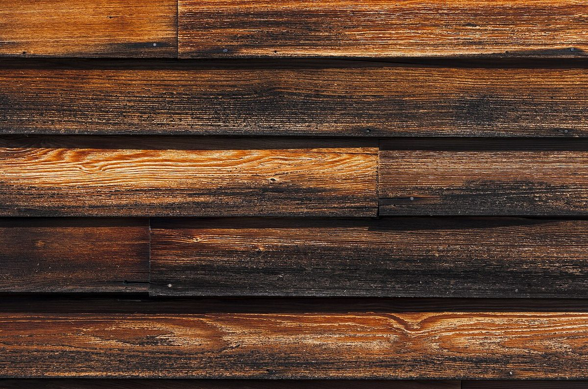
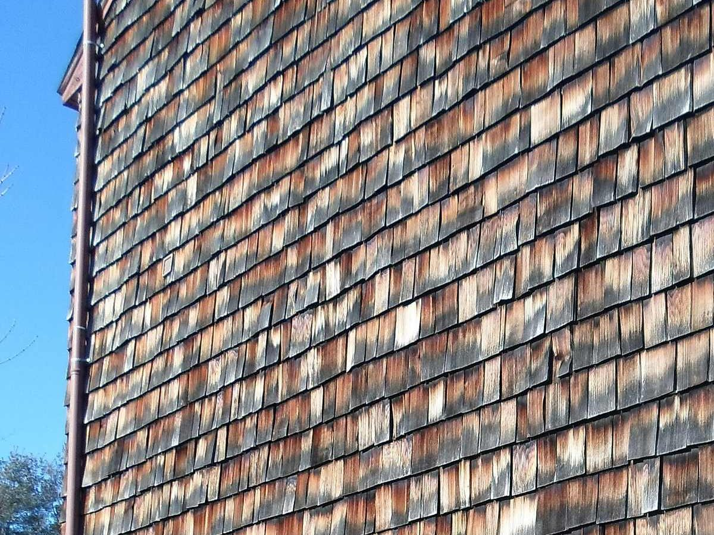
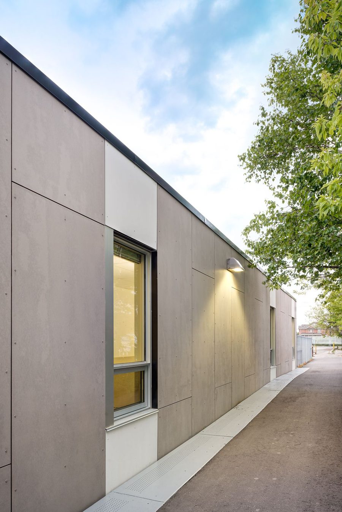

# Siding types

Material, profile and exposure (`6" exp`, `5-1/2" to weather`) are part of the
product: always in the DFL row. How to measure the area: [Measuring](measure.md).

## Lap / Clapboard

<figure markdown>
  
  <figcaption markdown="span">Lap siding: overlapping boards, the visible course width is the exposure. Count the SQ FT of the field, write the exposure in the row. Photo: Daniel Case, CC BY-SA 3.0, [source](https://commons.wikimedia.org/wiki/File:Stained_wooden_clapboard_siding.jpg)</figcaption>
</figure>

| Row example | Note |
| --- | --- |
| `Hardi plank 6" exp` | fiber cement, 6" exposure |
| `4" Ext Clapboard` | 4" exposure |
| `Vinyl clapboard` | Dutch lap, double 4", 4-1/2" |
| `Red Cedar clapboard` | cedar, `verify grade` |
| `Clapboard` | material not specified: `verify material` in the note |

Vinyl lap comes with starter strip, J-channel and corner posts; these are accessories
from [Underlayment](underlayment.md).

## Shingle / Shake

<figure markdown>
  
  <figcaption markdown="span">Cedar shake on the wall field. Waste is higher than for lap; on a solid substrate under the shakes Cedar Breather is needed. Photo: EgorovaSvetlana, CC BY-SA 4.0, [source](https://commons.wikimedia.org/wiki/File:Cedar_Wood_Shake_Siding_Steele_Hill_Resort_Sanbornton_Lakes_Region_New_England.jpg)</figcaption>
</figure>

| Row example | Note |
| --- | --- |
| `Cedar shingles "Perfection" 5-1/2" to weather` | 5-1/2" exposure |
| `Vinyl Shingles` | vinyl shake panel |
| `Vinyl Shingles` (gable) | gable accent, separate row |

A gable shingle accent is almost always a separate row from the field. A flare
(the wall flaring out under shingles) has its own blocking and trim:
[Porch / Deck / Balcony](../exterior-trims/porch-deck-balcony.md).

## Panel / Board and batten / Shiplap

<figure markdown>
  { width="360" }
  <figcaption markdown="span">Fiber cement panel siding: large sheets on exposed fasteners, joints on a grid. Count the SQ FT of the field plus LFT of joints for Z-flashing or battens and trim at the edges. Photo: engineeredassemblies.com, [source](http://www.engineeredassemblies.com/products/equitone-fibre-cement/), found via Pinterest.</figcaption>
</figure>

| Row example | Note |
| --- | --- |
| `Hardipanel siding` | fiber cement panel; Z-flashing at horizontal joints |
| `Boral TruExt 1x10 Shiplap` | composite shiplap, product in the row |
| `1/2" Panel` | panel at bays and gable |
| `Board & Batten` | board plus batten; battens in `LFT` if counted separately |
| `1x6 Vert. Cedar BDS.` | vertical cedar board |
| `Wainscotting` | accent panel |

Board and batten on the field, shingle in the gable and stone at the bottom on one
elevation: three rows, see the photo on the [overview page](overview.md).

## By material

| Material | What it changes in the takeoff |
| --- | --- |
| Vinyl | starter, J-channel, corners, undersill are accessories; `Vinyl J-channel` can be the casing |
| Fiber cement (Hardi) | plank, panel or shingle; note `verify if Trims are Hardi or PVC` |
| Cedar | clapboard, shingle, vertical; `verify grade`; Cedar Breather under shingle |
| Composite (Boral TruExt, LP SmartSide) | product in the row |
| Wood clapboard | grade and primed in the note (`primed vertical grain cedar`) |
| Aluminum, steel | rare; usually by others, check the scope |

## Orientation and neighboring rows

Keep `Siding Horizontal` (lap) and `Siding Vertical` (board and batten, `1x6 Vert.
Cedar`) separate if the template splits them. Next to the siding field there are often
`Post Wrap` (`1x10` / `1x12`) and `Fascia` (`1x8` / `1x12`); that is trim:
[Exterior Trims](../exterior-trims/casing-corner-band.md).

## Common mistakes

- Exposure and material dropped from the row.
- Field and gable accent in one row.
- Vinyl accessories not counted as trim.
- Cedar shingle without Cedar Breather on a solid substrate.
- Panel without Z-flashing at the joints.
- All sheathing mistakes: [Sheathing](../../start/common-mistakes.md#sheathing).

## See also

- [Siding](overview.md), [Underlayment](underlayment.md), [Measuring](measure.md), [EIFS / Stucco / Veneer](eifs-stucco-veneer.md)
- [Casing, Corner & Band](../exterior-trims/casing-corner-band.md), [Material catalog](../../reference/material-catalog.md)
