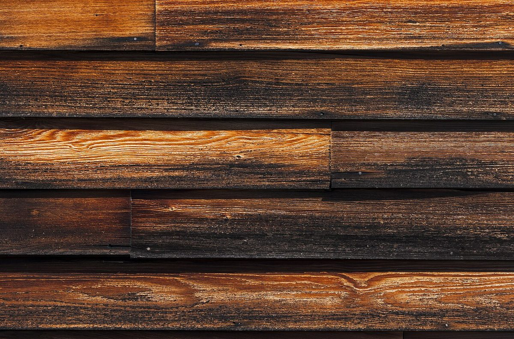
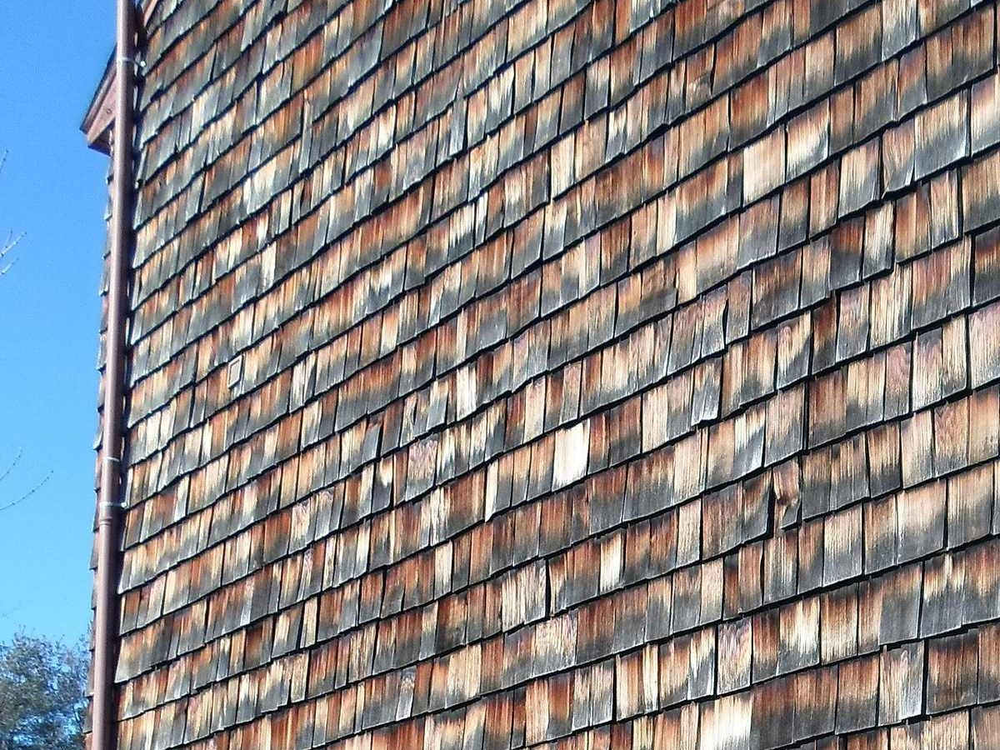
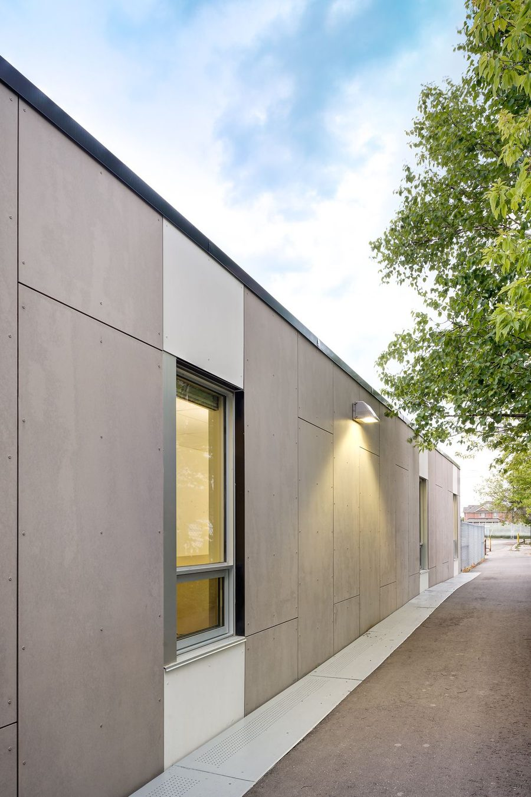

# Типы siding (lap, shingle, panel, board and batten)

Материал, профиль и exposure (`6" exp`, `5-1/2" to weather`) это часть
продукта: всегда в строке DFL. Как мерить площадь: [Измерение](measure.md).

## Lap / Clapboard

<figure markdown>
  
  <figcaption markdown="span">Lap siding: доски в нахлёст, видимая ширина ряда это exposure. Считаем SQ FT поля, exposure пишем в строке. Фото: Daniel Case, CC BY-SA 3.0, [источник](https://commons.wikimedia.org/wiki/File:Stained_wooden_clapboard_siding.jpg)</figcaption>
</figure>

| Пример строки | Заметка |
| --- | --- |
| `Hardi plank 6" exp` | fiber cement, exposure 6" |
| `4" Ext Clapboard` | exposure 4" |
| `Vinyl clapboard` | Dutch lap, double 4", 4-1/2" |
| `Red Cedar clapboard` | cedar, `verify grade` |
| `Clapboard` | материал не указан: `verify material` в ноте |

Vinyl lap идёт со starter strip, J-channel и corner posts, это accessories
из [Underlayment](underlayment.md).

## Shingle / Shake

<figure markdown>
  
  <figcaption markdown="span">Cedar shake по полю стены. Waste выше, чем у lap; на сплошном основании под дранкой нужен Cedar Breather. Фото: EgorovaSvetlana, CC BY-SA 4.0, [источник](https://commons.wikimedia.org/wiki/File:Cedar_Wood_Shake_Siding_Steele_Hill_Resort_Sanbornton_Lakes_Region_New_England.jpg)</figcaption>
</figure>

| Пример строки | Заметка |
| --- | --- |
| `Cedar shingles "Perfection" 5-1/2" to weather` | exposure 5-1/2" |
| `Vinyl Shingles` | vinyl shake panel |
| `Vinyl Shingles` (gable) | accent во фронтоне, отдельная строка |

Gable shingle accent почти всегда отдельная строка от поля. Flare
(расширение под shingle) со своим blocking и trim:
[Porch / Deck / Balcony](../exterior-trims/porch-deck-balcony.md).

## Panel / Board and batten / Shiplap

<figure markdown>
  { width="360" }
  <figcaption markdown="span">Panel siding из fiber cement: крупные листы на открытых креплениях, стыки по сетке. Считаем SQ FT поля плюс LFT стыков под Z-flashing или battens и trim по краям. Фото: engineeredassemblies.com, [источник](http://www.engineeredassemblies.com/products/equitone-fibre-cement/), найдено через Pinterest.</figcaption>
</figure>

| Пример строки | Заметка |
| --- | --- |
| `Hardipanel siding` | fiber cement panel; Z-flashing на горизонтальных стыках |
| `Boral TruExt 1x10 Shiplap` | composite shiplap, продукт в строке |
| `1/2" Panel` | панель на bays и gable |
| `Board & Batten` | доска плюс нащельник; battens `LFT`, если считаются отдельно |
| `1x6 Vert. Cedar BDS.` | вертикальная cedar доска |
| `Wainscotting` | панель-акцент |

Board and batten по полю, shingle во фронтоне и stone внизу на одном
фасаде: три строки, см. фото на [обзоре](overview.md).

## По материалу

| Материал | Что это меняет в takeoff |
| --- | --- |
| Vinyl | starter, J-channel, corners, undersill это accessories; `Vinyl J-channel` может быть casing |
| Fiber cement (Hardi) | plank, panel или shingle; нота `verify if Trims are Hardi or PVC` |
| Cedar | clapboard, shingle, vertical; `verify grade`; Cedar Breather под shingle |
| Composite (Boral TruExt, LP SmartSide) | продукт в строке |
| Wood clapboard | grade и primed в ноте (`primed vertical grain cedar`) |
| Aluminum, steel | редко; обычно by others, проверить scope |

## Ориентация и соседние строки

`Siding Horizontal` (lap) и `Siding Vertical` (board and batten, `1x6 Vert.
Cedar`) держи раздельно, если шаблон их делит. Рядом с полем siding часто
стоят `Post Wrap` (`1x10` / `1x12`) и `Fascia` (`1x8` / `1x12`), это trim:
[Exterior Trims](../exterior-trims/casing-corner-band.md).

## Частые ошибки

- Exposure и материал выброшены из строки.
- Поле и accent во фронтоне в одной строке.
- Vinyl accessories не учтены как trim.
- Cedar shingle без Cedar Breather на сплошном основании.
- Panel без Z-flashing на стыках.
- Все ошибки по обшивке: [Обшивка](../../start/common-mistakes.md#sheathing).

## См. также

- [Siding](overview.md), [Underlayment](underlayment.md), [Измерение](measure.md), [EIFS / Stucco / Veneer](eifs-stucco-veneer.md)
- [Casing, Corner & Band](../exterior-trims/casing-corner-band.md), [Material catalog](../../reference/material-catalog.md)
