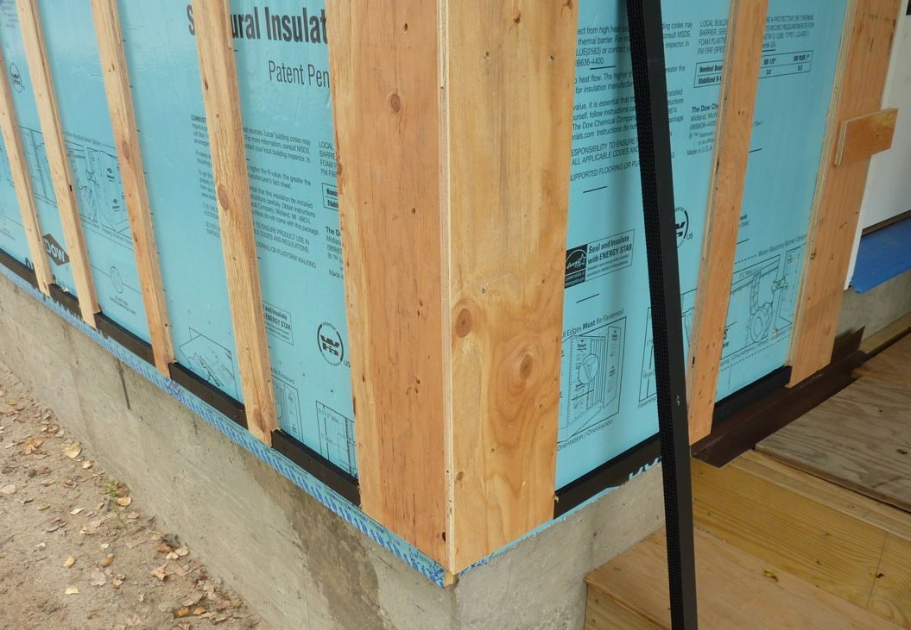
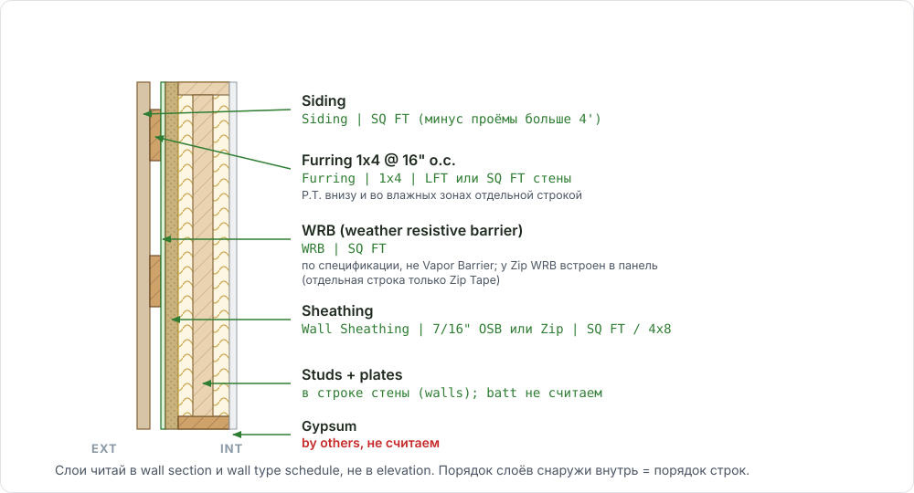

# Underlayment

<figure markdown>
  
  <figcaption markdown="span">House corner before siding: vertical furring strips (rainscreen) nailed over rigid foam insulation with taped seams, tape at the joint with the foundation at the bottom. Furring is counted in LFT by spacing over the wall area, WRB in SQ FT by the wall area. Photo: greenbuildingadvisor.com, [source](http://www.greenbuildingadvisor.com/blogs/dept/musings/all-about-rainscreens), found via Pinterest.</figcaption>
</figure>

## What it is

The layers between the siding and the frame that are not visible on the elevation: WRB (weather
resistive barrier), sheathing, furring or rainscreen, Cedar Breather,
starter, J-channel and corner posts, flashing. Look at the wall sections and wall
types, not only the elevations. Sheathing is counted in
[Wall Sheathing](../vertical/sheathing/wall-sheathing.md).

## Where to find it on the plans

| Sheet | What to take |
| --- | --- |
| Wall types (`wt`) and wall sections | Layer order: siding, furring, WRB, sheathing, studs |
| Spec division 07 and notes | WRB product: housewrap (Tyvek), fluid-applied, self-adhered, Zip |
| Window and joint details | Z-flashing, head flashing, kickout, step flashing |
| Elevations | Vinyl: where the starter, J-channel, corners go |

## Wall layers, outside to inside

1. Siding (the field, `SQ FT`), see [Siding types](types.md).
2. Furring or rainscreen `1x4` / `2x4`, P.T. or not (if shown).
3. WRB per spec, or Zip (WRB built into the sheathing).
4. Sheathing (CDX, OSB, Zip): its own scope.
5. Stud wall.

<figure markdown>
  
  <figcaption markdown="span">Siding, furring, WRB, sheathing, stud. The WRB is named per the spec; with Zip the barrier is already built into the panel.</figcaption>
</figure>

## WRB, not Vapor Barrier

| DFL row | Material | Unit | Rule |
| --- | --- | --- | --- |
| `WRB` | `Tyvek` or another housewrap | SQ FT | only if the spec names a housewrap |
| `WRB` | `fluid-applied` (product per spec) | SQ FT | do not write Tyvek |
| Zip system | `7/16" Zip` + `Zip Tape` | 4x8, rolls | no separate WRB needed, do not duplicate |

- The exterior barrier is called WRB, weather barrier or air barrier.
  `Vapor Barrier` is a different layer in a different place in the wall; do not name
  the row that way.
- WRB area equals the wall area with openings deducted once; windows under
  4' are not deducted. Exterior gypsum porch and canopy soffits also go into the
  WRB.
- The WRB spec cell in the DFL header (O4) is filled in when the job is created; the sheet
  reference goes without the word `per` (`A3.0`).

## Furring / Rainscreen

The strip between the WRB and the siding, often missed. `1x4` or `2x4`, P.T. or
not per the section; LFT by spacing, or SQ FT if solid. The full rule and
jambs: [Furring & Window Jambs](../exterior-trims/furring-and-jambs.md).

## Cedar Breather

A ventilated mat under cedar shingles or shakes on a solid substrate.
Counted in `SQ FT` of the shingle walls; check the details if the siding is
cedar shingle on solid sheathing.

## Vinyl accessories

| DFL row | Where | Unit |
| --- | --- | --- |
| `Starter strip` | bottom of the first course | LFT |
| `J-Channel` | around windows and doors, under the soffit, at corners, along the rake | LFT |
| `Corner posts` (outside, inside) | corners | LFT |
| `Undersill / finish trim` | under the window, at the top of the wall | LFT |

With vinyl, `Ext. Casing` is often the `Vinyl J-channel` itself: do not duplicate it with
`5/4` wood casing. Canonical page: [Exclusions and J-Channel](../exterior-trims/exclusions.md).

## Flashing in siding

| Flashing | Where | Unit |
| --- | --- | --- |
| Z-flashing | horizontal joints of panel siding | LFT |
| Head flashing / drip cap | over windows, doors, head trim | LFT |
| Kickout flashing | where the roof meets the wall | pcs |
| Step flashing | along the roof slope at the wall | LFT |
| Band / watertable flashing | under the horizontal band | LFT |

Flashing as a visible row; do not dissolve it into the siding SQ FT. Window flashing
in detail: [Window flashing](../vertical/openings/window-flashing.md).

## Common mistakes

- `Vapor Barrier` instead of WRB; Tyvek when the spec calls for fluid-applied.
- Zip and a separate housewrap counted together.
- Furring missed because it is not on the elevation.
- Openings not deducted from the WRB, or deducted twice.
- All sheathing mistakes: [Sheathing](../../start/common-mistakes.md#sheathing).

## Example

```text
WRB            fluid-applied (per spec 07 27 26)   8 420  SQ FT   =C<walls SF>-C<openings>   A3.0
Furring        1x4 P.T. @ 16" o.c.                 6 950  LFT     =CEILING(8420*12/16*1.1,10) 7/A401
Cedar Breather                                     1 240  SQ FT   gable shingle areas          A201
```

## See also

- [Siding](overview.md), [Siding types](types.md), [Measuring](measure.md), [EIFS / Stucco / Veneer](eifs-stucco-veneer.md)
- [Wall Sheathing](../vertical/sheathing/wall-sheathing.md), [Exterior Wall Materials](../vertical/sheathing/exterior-materials.md), [Furring & Window Jambs](../exterior-trims/furring-and-jambs.md)
- [Material catalog](../../reference/material-catalog.md)
