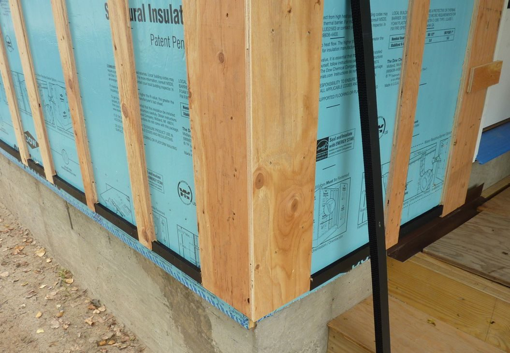
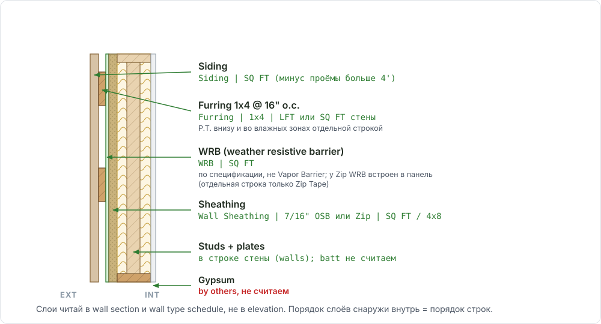

# Underlayment (что за siding: WRB, furring, accessories)

<figure markdown>
  
  <figcaption markdown="span">Угол дома до siding: поверх обшивки с функцией WRB прибиты вертикальные furring strips (rainscreen), внизу лента по стыку с фундаментом. Furring считается LFT по шагу на площадь стены, WRB - SQ FT по площади стены. Фото: greenbuildingadvisor.com, [источник](http://www.greenbuildingadvisor.com/blogs/dept/musings/all-about-rainscreens), найдено через Pinterest.</figcaption>
</figure>

## Что это

Слои между siding и каркасом, которые не видны на фасаде: WRB (weather
resistive barrier), sheathing, furring или rainscreen, Cedar Breather,
starter, J-channel и corner posts, flashing. Смотреть wall sections и wall
types, не только elevations. Sheathing считается в
[Wall Sheathing](../vertical/sheathing/wall-sheathing.md).

## Где искать на чертежах

| Лист | Что взять |
| --- | --- |
| Wall types (`wt`) и wall sections | Порядок слоёв: siding, furring, WRB, sheathing, studs |
| Spec division 07 и notes | Продукт WRB: housewrap (Tyvek), fluid-applied, self-adhered, Zip |
| Details окон и стыков | Z-flashing, head flashing, kickout, step flashing |
| Elevations | Vinyl: где starter, J-channel, corners |

## Слои стены снаружи внутрь

1. Siding (поле, `SQ FT`), см. [Типы siding](types.md).
2. Furring или rainscreen `1x4` / `2x4`, P.T. или нет (если показан).
3. WRB по спецификации, или Zip (WRB встроен в sheathing).
4. Sheathing (CDX, OSB, Zip): свой scope.
5. Stud wall.

<figure markdown>
  
  <figcaption markdown="span">Siding, furring, WRB, sheathing, stud. WRB называется по спецификации, у Zip барьер уже встроен в лист.</figcaption>
</figure>

## WRB, не Vapor Barrier

| Строка DFL | Материал | Unit | Правило |
| --- | --- | --- | --- |
| `WRB` | `Tyvek` или другой housewrap | SQ FT | только если спецификация называет housewrap |
| `WRB` | `fluid-applied` (продукт по spec) | SQ FT | Tyvek не писать |
| Zip system | `7/16" Zip` + `Zip Tape` | 4x8, rolls | отдельный WRB не нужен, не дублировать |

- Наружный барьер называется WRB, weather barrier или air barrier.
  `Vapor Barrier` это другой слой и другое место в стене; так строку не
  называть.
- Площадь WRB равна площади стен с вычетом проёмов один раз; окна меньше
  4' не вычитаются. Soffit porch и canopy из exterior gypsum тоже идут в
  WRB.
- Спек-ячейка WRB в шапке DFL (O4) заполняется при создании job, ссылка на
  лист без слова `per` (`A3.0`).

## Furring / Rainscreen

Рейка между WRB и siding, часто пропускается. `1x4` или `2x4`, P.T. или
нет по разрезу; LFT по шагу или SQ FT, если сплошной. Полное правило и
jambs: [Furring & Window Jambs](../exterior-trims/furring-and-jambs.md).

## Cedar Breather

Вентилируемая сетка под cedar shingle или shake на сплошном основании.
Считается `SQ FT` площади shingle-стен; проверь детали, если siding
cedar shingle на solid sheathing.

## Vinyl accessories

| Строка DFL | Где | Unit |
| --- | --- | --- |
| `Starter strip` | низ первого ряда | LFT |
| `J-Channel` | вокруг окон и дверей, под soffit, у corner, по rake | LFT |
| `Corner posts` (outside, inside) | углы | LFT |
| `Undersill / finish trim` | под окном, у верха стены | LFT |

При vinyl `Ext. Casing` нередко и есть `Vinyl J-channel`: не дублировать с
`5/4` wood casing. Канон: [Exclusions и J-Channel](../exterior-trims/exclusions.md).

## Flashing в siding

| Flashing | Где | Unit |
| --- | --- | --- |
| Z-flashing | горизонтальные стыки panel siding | LFT |
| Head flashing / drip cap | над окнами, дверями, head trim | LFT |
| Kickout flashing | крыша встречает стену | pcs |
| Step flashing | вдоль ската у стены | LFT |
| Band / watertable flashing | под горизонтальным поясом | LFT |

Flashing видимой строкой, не растворять в siding SQ FT. Оконный flashing
подробно: [Window flashing](../vertical/openings/window-flashing.md).

## Частые ошибки

- `Vapor Barrier` вместо WRB; Tyvek при fluid-applied.
- Zip и отдельный housewrap посчитаны вместе.
- Furring пропущен, потому что нет на фасаде.
- Проёмы не вычтены из WRB или вычтены дважды.
- Все ошибки по обшивке: [Обшивка](../../start/common-mistakes.md#sheathing).

## Пример

```text
WRB            fluid-applied (per spec 07 27 26)   8 420  SQ FT   =C<walls SF>-C<openings>   A3.0
Furring        1x4 P.T. @ 16" o.c.                 6 950  LFT     =CEILING(8420*12/16*1.1,10) 7/A401
Cedar Breather                                     1 240  SQ FT   gable shingle areas          A201
```

## См. также

- [Siding](overview.md), [Типы siding](types.md), [Измерение](measure.md), [EIFS / Stucco / Veneer](eifs-stucco-veneer.md)
- [Wall Sheathing](../vertical/sheathing/wall-sheathing.md), [Exterior Wall Materials](../vertical/sheathing/exterior-materials.md), [Furring & Window Jambs](../exterior-trims/furring-and-jambs.md)
- [Material catalog](../../reference/material-catalog.md)
