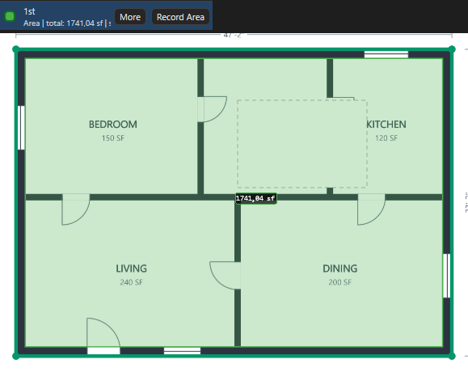
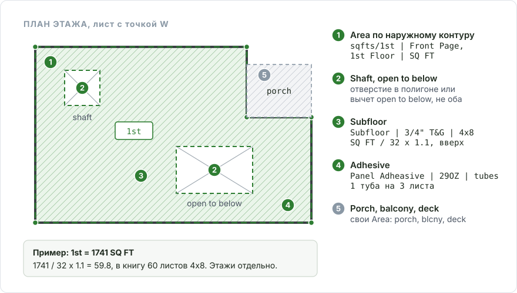

# Floor SQFT

<figure markdown>
  
  <figcaption markdown="span">Area along the outside outline of the floor on the sheet with the W point, name `1st`. Shafts and open to below are holes inside the polygon. The area goes to the Front Page and to every "per SQFT" row.</figcaption>
</figure>

## What it is

Floor SQFT is the floor area of each level measured to the outside outline. It
feeds the Front Page, subfloor and floor layers, blocking and other "per
SQFT" rows. Keep the floors separate even if they are identical: `1st`, `2nd`, `3rd`.
The other pages of this section (basement, loft, roof, deck, porch, balcony,
cantilevered) follow the same rules with the specifics of their type.

## General area rules {#rules}

1. Area tool along the real outside outline on the plan sheet with the W point
   (`a101 1st`). Sheet scale checked against a known dimension.
2. Shafts, stair openings and open to below are holes inside the polygon
   or a separate `open to below` deduction; not both.
3. One type on one building can be built from several polygons in one
   takeoff. Do not join separate zones with a bridge.
4. Do not draw a rectangle to hit a known SQFT number: the outline must match
   the plan.
5. Name = a token the export understands: `base`, `1st`...`8th`, `blcny`,
   `porch`, `deck`, `cant`, `rf 6`, `flat`, `conc areas`, `open to below`.
   An Area with such a name goes to `sqfts` by itself; there are no floor
   subfolders inside `sqfts`.
6. The area must reach Excel and update when the takeoff is edited: compare
   the number in the workbook with the app before delivery.
7. Linear exclusions (`cat walk 4'`) are a length with a known width, not an Area.

## Where to find it on the plans

| Sheet | What to take |
| --- | --- |
| Floor plans (`a101 1st`, `a102 2nd`) | Floor outline, shafts, open to below |
| Framing plans (`s201 2nd`) | Joist direction and zones (that is already a [J Area](../horizontal/floor-framing/joist.md), not SQFT) |
| Sections (`sec`) | Which levels exist: basement, loft, mezzanine |
| Floor assemblies (`ft`) | What goes over the area: subfloor, underlayment, sound mat |

## Tree name and DFL row

| Tree name | DFL row | Material | Unit | Formula |
| --- | --- | --- | --- | --- |
| `sqfts/1st` | Front Page, `1st Floor` | | `SQ FT` | as measured |
| `sqfts/1st` | `Subfloor` | `3/4" T&G` | `4x8` | `=CEILING(SQFT/32*1.1,1)` |
| `sqfts/1st` | `Panel Adheasive` | `29OZ` | `pcs` | per template |
| `sqfts/1st` | `Underlayment` and layers per assembly | per [Floor Sheathing](../vertical/sheathing/floor.md) | `4x8` | same |
| `sqfts/open to below` | deduction | | `SQ FT` | minus |

Export: the XL strip, SF button, moves the `sqfts` branch to the Front Page and
the template spec cells.

## Common mistakes

- Floors merged into one area, or one floor copied to another with someone else's formulas.
- A shaft deducted twice (hole plus separate deduction).
- A rectangle "to hit the number" instead of the plan outline.
- Area fixed in the app, the old one left in Excel.
- Porch and balcony empty on the Front Page (they are counted separately, see [Porch](porch.md), [Balcony](balcony.md)).

All area mistakes: [common-mistakes](../../start/common-mistakes.md#sqft).

## Example

```text
Takeoffs/Main/sqfts/
  base             Area   1620 SF
  1st              Area   1741 SF   (2 polygons: house and addition)
  2nd              Area   1690 SF
  open to below    Area     84 SF
  blcny            Area    112 SF
  rf 6             Area   2210 SF
```

<figure markdown>
  
  <figcaption markdown="span">Floor SQFT gives sheets: SQFT / 32 x 1.1, rounded up to a whole sheet. Floors separate.</figcaption>
</figure>

## See also

- [Basement](basement.md), [Loft](loft.md), [Roof](roof.md), [Deck](deck.md), [Porch](porch.md), [Balcony](balcony.md), [Cantilevered](cantilevered.md)
- [Subfloor](../horizontal/floor-framing/subfloor.md), [Floor Sheathing](../vertical/sheathing/floor.md)
- [Takeoff names and sheet points](../../reference/takeoff-naming.md), [Formulas](../../reference/formulas.md)
