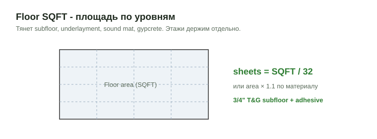

# Floor SQFT (площади этажей 1st, 2nd, ...)

<figure markdown>
  
  <figcaption markdown="span">Area по наружному контуру этажа на листе с точкой W, имя `1st`. Шахты и open to below - отверстия внутри полигона. Площадь уходит в Front Page и во все строки "per SQFT".</figcaption>
</figure>

## Что это

Floor SQFT - площадь перекрытия каждого уровня по наружному контуру. Она
кормит Front Page, subfloor и слои пола, blocking и другие строки "per
SQFT". Этажи держим отдельно, даже если они одинаковые: `1st`, `2nd`, `3rd`.
Остальные страницы раздела (basement, loft, roof, deck, porch, balcony,
cantilevered) - те же правила с особенностями своего типа.

## Общие правила площадей {#rules}

1. Инструмент Area по реальному внешнему контуру на листе плана с точкой W
   (`a101 1st`). Масштаб листа проверен по известному размеру.
2. Шахты, лестничные проёмы и open to below - отверстия внутри полигона
   или отдельный вычет `open to below`; не оба сразу.
3. Один тип на одном корпусе можно собирать несколькими полигонами в одной
   позиции. Раздельные зоны не соединяй перемычкой.
4. Не рисуй прямоугольник под известное число SQFT: контур должен совпадать
   с планом.
5. Имя = токен, который экспорт понимает: `base`, `1st`...`8th`, `blcny`,
   `porch`, `deck`, `cant`, `rf 6`, `flat`, `conc areas`, `open to below`.
   Area с таким именем уходит в `sqfts` сама; внутри `sqfts` подпапок по
   этажам нет.
6. Площадь должна дойти до Excel и обновляться при правке замера: сверяй
   число в книге с программой перед сдачей.
7. Линейные исключения (`cat walk 4'`) - это длина с известной шириной, не Area.

## Где искать на чертежах

| Лист | Что взять |
| --- | --- |
| Floor plans (`a101 1st`, `a102 2nd`) | Контур этажа, шахты, open to below |
| Framing plans (`s201 2nd`) | Направление и зоны joists (это уже [J Area](../horizontal/floor-framing/joist.md), не SQFT) |
| Sections (`sec`) | Какие уровни есть: basement, loft, mezzanine |
| Floor assemblies (`ft`) | Что лежит на площади: subfloor, underlayment, sound mat |

## Как назвать в дереве и строка DFL

| Имя в дереве | Строка DFL | Материал | Unit | Формула |
| --- | --- | --- | --- | --- |
| `sqfts/1st` | Front Page, `1st Floor` | | `SQ FT` | как измерено |
| `sqfts/1st` | `Subfloor` | `3/4" T&G` | `4x8` | `=ОКРВВЕРХ(SQFT/32*1.1;1)` |
| `sqfts/1st` | `Panel Adheasive` | `29OZ` | `pcs` | по шаблону |
| `sqfts/1st` | `Underlayment` и слои по assembly | по [Floor Sheathing](../vertical/sheathing/floor.md) | `4x8` | та же |
| `sqfts/open to below` | вычет | | `SQ FT` | минус |

Экспорт: полоса XL, кнопка SF, переносит ветку `sqfts` в Front Page и
спек-ячейки шаблона.

## Частые ошибки

- Этажи слиты в одну площадь или один этаж скопирован на другой с чужими формулами.
- Шахта вычтена дважды (отверстие и отдельный вычет).
- Прямоугольник "под число" вместо контура плана.
- Площадь поправлена в программе, в Excel осталась старая.
- Porch и balcony на Front Page пустые (считаются отдельно, см. [Porch](porch.md), [Balcony](balcony.md)).

Все ошибки по площадям: [common-mistakes](../../start/common-mistakes.md#sqft).

## Пример

```text
Takeoffs/Main/sqfts/
  base             Area   1620 SF
  1st              Area   1741 SF   (2 полигона: дом и пристройка)
  2nd              Area   1690 SF
  open to below    Area     84 SF
  blcny            Area    112 SF
  rf 6             Area   2210 SF
```

<figure markdown>
  
  <figcaption markdown="span">SQFT этажа даёт листы: SQFT / 32 x 1.1, вверх до целого. Этажи отдельно.</figcaption>
</figure>

## См. также

- [Basement](basement.md), [Loft](loft.md), [Roof](roof.md), [Deck](deck.md), [Porch](porch.md), [Balcony](balcony.md), [Cantilevered](cantilevered.md)
- [Subfloor](../horizontal/floor-framing/subfloor.md), [Floor Sheathing](../vertical/sheathing/floor.md)
- [Имена takeoffs и точки листа](../../reference/takeoff-naming.md), [Формулы](../../reference/formulas.md)
