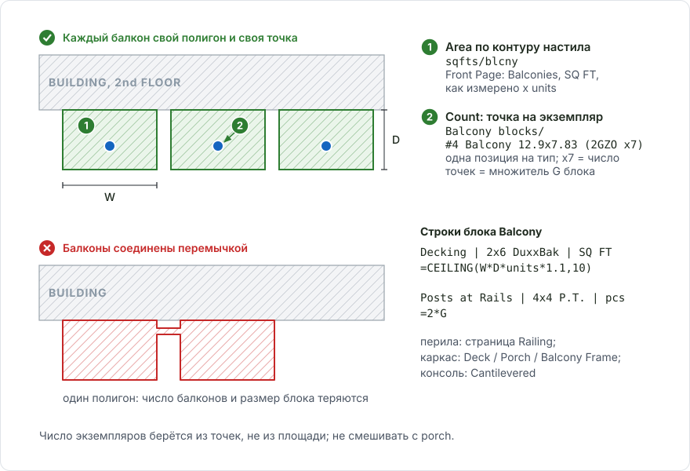

# Balcony SQFT

<figure markdown>
  
  <figcaption markdown="span">Each balcony is traced as its own polygon; balconies are never joined by a bridge. The area is an Area `blcny`; typical balconies are marked as blocks with a point for every instance.</figcaption>
</figure>

## What it is

A balcony is a raised exterior platform, cantilevered or on its own frame,
attached to the building. The area gives the decking and build-up; the frame and railing go
in separate rows. Do not join balconies with a bridge into one polygon and do not
mix them with a porch: they are different blocks with different multipliers. General measuring rules:
[Floor SQFT, rules section](1st2nd.md#rules).

## Where to find it on the plans

| Sheet | What to take |
| --- | --- |
| Floor plans, unit plans (`u`) | Outline, balcony type per unit, number of repeats |
| Framing plans, details (S) | Cantilever or frame, end joists, hangers, beam-to-post connections |
| Details (`d`) | Decking `2x6 DuxxBak`, sleepers, membrane, railing system |
| Elevations | Side and floor of every balcony |

## How to measure in OurPlanCore

1. Area along the decking outline of one balcony, name `blcny`. Identical balconies:
   polygons in one takeoff, or one polygon plus a multiplier in the block.
2. Typical balconies: one Count takeoff per type (`#4 Balcony 12.9x7.83`),
   a point for every instance, unit, side and floor in the Notes; folder
   `Balcony blocks`. The number of instances comes from the points, not from the area.
3. A cantilevered balcony changes the rim, blocking and holdowns: see
   [Cantilevered](cantilevered.md).

## Tree name and DFL row

| Tree name | DFL row (Balcony block) | Material | Unit | Formula |
| --- | --- | --- | --- | --- |
| `sqfts/blcny` | Front Page, `Balconies` | | `SQ FT` | as measured x units |
| `sqfts/blcny` | `Decking` | `2x6 DuxxBak` per spec | `SQ FT` | `SQFT x 1.1 x units` |
| Line along the edge | `Posts at Rails 4x4 P.T.` | 2 per balcony | `pcs` | `=2*G` |
| same line | `Rails (top & bottom)`, `Balustrades`, `Cap Rail` or a composite system | per detail | `LFT`, `pcs` | [Railing](../deck/railing.md) |

## Common mistakes

- A balcony block without its own units multiplier (900 SF instead of 60).
- Balconies joined with a bridge into one polygon.
- Sheathing added where the detail gives decking with no sheathing.
- Railing counted by components and as a system at the same time.
- Balcony trims merged with the general exterior trims.

All area mistakes: [common-mistakes](../../start/common-mistakes.md#sqft).

## Example

```text
Takeoffs/Main/sqfts/
  blcny               Area   58 SF
Takeoffs/Main/Balcony blocks/
  #4 Balcony 12.9x7.83 (2GZO x7)   Count 7
Balcony #4
Decking        2x6 DuxxBak     447   SQ FT   58 x 7 x 1.1
Posts at Rails 4x4 P.T.         14   pcs
```

## See also

- [Deck / Porch / Balcony Frame](../deck/deck-porch-balcony-frame.md), [Balcony build-up](../exterior-trims/balcony-buildup.md)
- [Railing](../deck/railing.md), [Balcony trims](../deck/balcony-trims.md), [Cantilevered](cantilevered.md)
