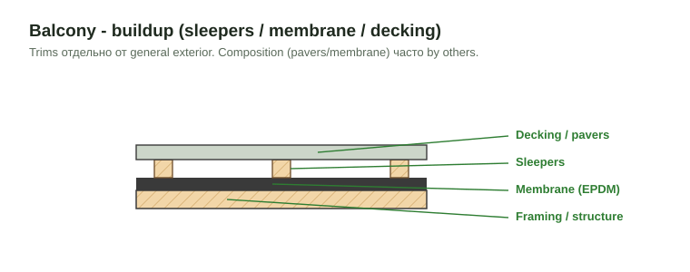

# Balcony SQFT (площадь балкона)

<figure markdown>
  
  <figcaption markdown="span">Балкон: каркас, sleepers, membrane, decking. Площадь - Area `blcny`; типовые балконы размечаются блоками с точкой на каждый экземпляр.</figcaption>
</figure>

## Что это

Balcony - приподнятая наружная площадка на консоли или на своём каркасе,
привязанная к зданию. Площадь даёт decking и buildup, каркас и railing идут
отдельными строками. Балконы не соединяй перемычкой в один полигон и не
смешивай с porch: это разные блоки и разные множители. Общие правила замера -
[Floor SQFT, раздел правил](1st2nd.md#rules).

## Где искать на чертежах

| Лист | Что взять |
| --- | --- |
| Floor plans, unit plans (`u`) | Контур, тип балкона по юниту, число повторов |
| Framing plans, details (S) | Консоль или каркас, end joists, hangers, соединения балка-пост |
| Details (`d`) | Decking `2x6 DuxxBak`, sleepers, membrane, railing система |
| Elevations | Сторона и этаж каждого балкона |

## Как мерить в OurPlanCore

1. Area по контуру настила одного балкона, имя `blcny`. Одинаковые балконы -
   полигоны в одной позиции или один полигон плюс множитель в блоке.
2. Типовые балконы: одна позиция Count на тип (`#4 Balcony 12.9x7.83`),
   точка на каждый экземпляр, в Notes юнит, сторона и этаж; папка
   `Balcony blocks`. Число экземпляров - из точек, не из площади.
3. Консольный балкон меняет rim, blocking и holdowns: см.
   [Cantilevered](cantilevered.md).

## Как назвать в дереве и строка DFL

| Имя в дереве | Строка DFL (блок Balcony) | Материал | Unit | Формула |
| --- | --- | --- | --- | --- |
| `sqfts/blcny` | Front Page, `Balconies` | | `SQ FT` | как измерено x units |
| `sqfts/blcny` | `Decking` | `2x6 DuxxBak` по spec | `SQ FT` | `SQFT x 1.1 x units` |
| Line по краю | `Posts at Rails 4x4 P.T.` | 2 на балкон | `pcs` | `=2*G` |
| та же линия | `Rails (top & bottom)`, `Balustrades`, `Cap Rail` или composite система | по детали | `LFT`, `pcs` | [Railing](../deck/railing.md) |

## Частые ошибки

- Блок балкона без своего множителя units (900 SF вместо 60).
- Балконы соединены перемычкой в один полигон.
- Sheathing добавлен там, где деталь даёт decking без листа.
- Railing по элементам и как система одновременно.
- Balcony trims слиты с общими exterior trims.

Все ошибки по площадям: [common-mistakes](../../start/common-mistakes.md#sqft).

## Пример

```text
Takeoffs/Main/sqfts/
  blcny               Area   58 SF
Takeoffs/Main/Balcony blocks/
  #4 Balcony 12.9x7.83 (2GZO x7)   Count 7
Balcony #4
Decking        2x6 DuxxBak     447   SQ FT   58 x 7 x 1.1
Posts at Rails 4x4 P.T.         14   pcs
```

## См. также

- [Deck / Porch / Balcony Frame](../deck/deck-porch-balcony-frame.md), [Balcony build-up](../exterior-trims/balcony-buildup.md)
- [Railing](../deck/railing.md), [Balcony trims](../deck/balcony-trims.md), [Cantilevered](cantilevered.md)
