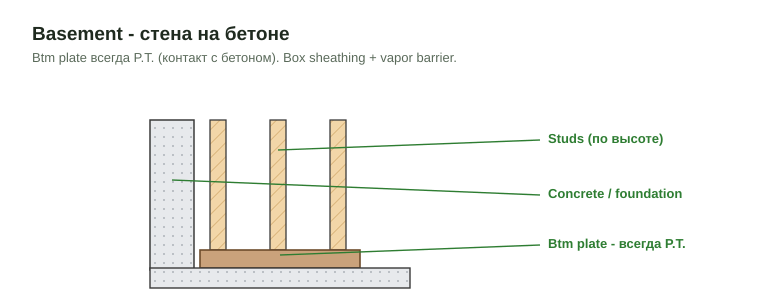

# Basement SQFT

<figure markdown>
  
  <figcaption markdown="span">Basement Area along the slab outline, name `base`. The area is needed for the Front Page and for whatever goes on the slab: sleepers, underlayment, insulation per the assembly.</figcaption>
</figure>

## What it is

Basement SQFT is the area of the lowest level on the slab. Unlike the floors above,
there is usually no subfloor on joists here: the area drives over-slab layers (sleepers,
underlayment, rigid) only when the assembly shows them. Basement wall framing
(studs, P.T. plates, box sheathing) is a separate page:
[Basement Walls](../vertical/walls/basement.md). General measuring rules:
[Floor SQFT, rules section](1st2nd.md#rules).

## Where to find it on the plans

| Sheet | What to take |
| --- | --- |
| Basement plan (`a100 base`) | Slab outline, stair opening, mech areas |
| Foundation plan (`s101 f`) | What is concrete, what is wood; existing or podium |
| Floor assemblies (`ft`), sections | Over-slab: sleepers, underlayment, insulation |
| Code / finish notes | Finished basement or not |

## How to measure in OurPlanCore

1. Area along the slab outline on the `a100 base` sheet (W point). Name `base`
   (not `bsmt`): the token goes to `sqfts`.
2. A basement under part of the house: only that part; crawl space separately, if
   needed.
3. Do not count existing or podium conditions as standard panels without details.

## Tree name and DFL row

| Tree name | DFL row | Material | Unit | Formula |
| --- | --- | --- | --- | --- |
| `sqfts/base` | Front Page, `Basement` | | `SQ FT` | as measured |
| `sqfts/base` | `Sleepers` | `2x4 P.T.` per detail | `LFT` | by spacing |
| `sqfts/base` | `Plywood` / `Underlayment` over slab | per assembly | `4x8` | `=CEILING(SQFT/32*1.1,1)` |
| `sqfts/base` | `Rigid Insulation` over slab | per assembly | `SQ FT` | as measured |

## Common mistakes

- Plywood and sleepers on the slab missed because "it is concrete there".
- Name `bsmt` instead of `base`: the area did not go to `sqfts`.
- Basement measured to the 1st floor outline, not to the slab.

All area mistakes: [common-mistakes](../../start/common-mistakes.md#sqft).

## Example

```text
Takeoffs/Main/sqfts/
  base      Area   1620 SF   (a100 base)
Basement
Sleepers        2x4 P.T. 16" o.c.    1340   LFT   8/A500
Plywood         3/4" T&G              56   4x8   over sleepers
```

## See also

- [Floor SQFT](1st2nd.md), [Basement Walls](../vertical/walls/basement.md)
- [Box Sheathing](../vertical/sheathing/box-sheathing.md), [Subfloor](../horizontal/floor-framing/subfloor.md)
