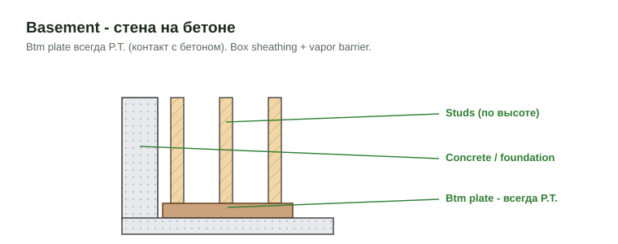

# Basement SQFT (площадь подвала)

<figure markdown>
  
  <figcaption markdown="span">Area подвала по контуру плиты, имя `base`. Площадь нужна для Front Page и для того, что лежит на плите: sleepers, underlayment, insulation по сборке.</figcaption>
</figure>

## Что это

Basement SQFT - площадь нижнего уровня на плите. В отличие от этажей выше,
здесь обычно нет subfloor на joists: площадь тянет over-slab слои (sleepers,
underlayment, rigid) только когда assembly их показывает. Каркас стен подвала
(studs, P.T. plates, box sheathing) - отдельная страница
[Basement Walls](../vertical/walls/basement.md). Общие правила замера -
[Floor SQFT, раздел правил](1st2nd.md#rules).

## Где искать на чертежах

| Лист | Что взять |
| --- | --- |
| Basement plan (`a100 base`) | Контур плиты, лестничный проём, mech зоны |
| Foundation plan (`s101 f`) | Что бетон, что дерево; existing или podium |
| Floor assemblies (`ft`), sections | Over-slab: sleepers, underlayment, insulation |
| Code / finish notes | Finished basement или нет |

## Как мерить в OurPlanCore

1. Area по контуру плиты на листе `a100 base` (точка W). Имя `base`
   (не `bsmt`): токен уходит в `sqfts`.
2. Подвал под частью дома - только эта часть; crawl space отдельно, если
   нужен.
3. Existing или podium условия не считать стандартными панелями без деталей.

## Как назвать в дереве и строка DFL

| Имя в дереве | Строка DFL | Материал | Unit | Формула |
| --- | --- | --- | --- | --- |
| `sqfts/base` | Front Page, `Basement` | | `SQ FT` | как измерено |
| `sqfts/base` | `Sleepers` | `2x4 P.T.` по детали | `LFT` | по шагу |
| `sqfts/base` | `Plywood` / `Underlayment` over slab | по assembly | `4x8` | `=ОКРВВЕРХ(SQFT/32*1.1;1)` |
| `sqfts/base` | `Rigid Insulation` over slab | по assembly | `SQ FT` | как измерено |

## Частые ошибки

- Plywood и sleepers на плите пропущены, потому что "там бетон".
- Имя `bsmt` вместо `base`: площадь не ушла в `sqfts`.
- Подвал посчитан по контуру 1st floor, а не по плите.

Все ошибки по площадям: [common-mistakes](../../start/common-mistakes.md#sqft).

## Пример

```text
Takeoffs/Main/sqfts/
  base      Area   1620 SF   (a100 base)
Basement
Sleepers        2x4 P.T. 16" o.c.    1340   LFT   8/A500
Plywood         3/4" T&G              56   4x8   over sleepers
```

## См. также

- [Floor SQFT](1st2nd.md), [Basement Walls](../vertical/walls/basement.md)
- [Box Sheathing](../vertical/sheathing/box-sheathing.md), [Subfloor](../horizontal/floor-framing/subfloor.md)
