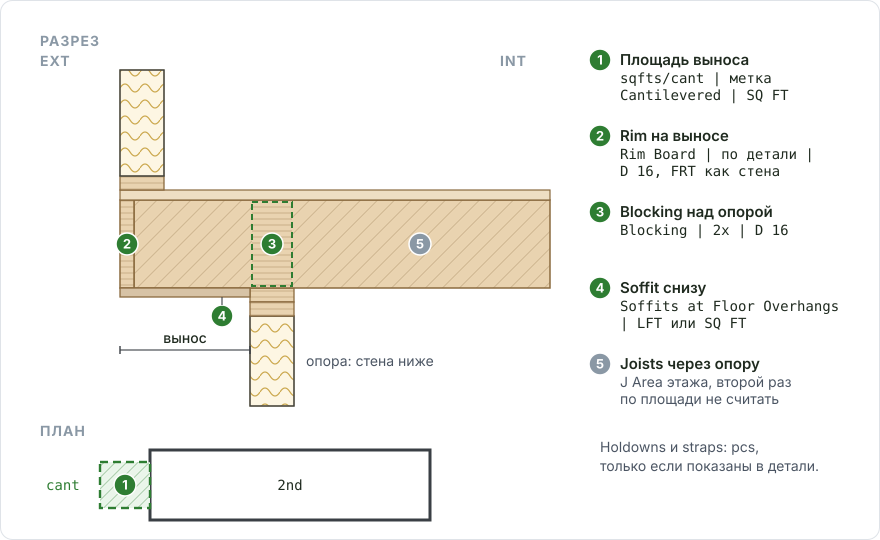

# Cantilevered SQFT

<figure markdown>
  
  <figcaption markdown="span">The joists run past the bearing to the outside. On the cantilever the rim, blocking and often holdowns change, and a soffit appears underneath. The cantilever area is a separate Area `cant`.</figcaption>
</figure>

## What it is

A cantilever is part of a floor, roof or deck that extends past the bearing with no
post underneath. The cantilever area is counted separately because it has a different
rim, extra blocking, FRT per the exterior wall rules, and a soffit underneath. In the
deliverable keep a visible `Cantilevered` label so it is clear why the
area is separated. General measuring rules: [Floor SQFT, rules section](1st2nd.md#rules).

## Where to find it on the plans

| Sheet | What to take |
| --- | --- |
| Framing plan (S) | Where the joists run past the wall; direction, cantilever length |
| Details (`d`) | Rim on the cantilever, blocking over the bearing, straps or holdowns, soffit |
| Sections (`sec`) | Height and layers underneath (soffit, insulation) |
| Floor plan (A) | Cantilever outline (bay, bump-out) |

## How to measure in OurPlanCore

1. Area along the cantilever outline on the floor framing plan (W point). Name `cant`.
   Trace only the projection: the outside face of the upper floor minus the outside
   face of the lower floor, one polygon per projection. Every floor that projects
   past the floor below needs a `cant`.
2. The projection also stays inside the area of its own floor (`2nd` is traced to the
   outside face of the 2nd floor walls, bay included): `cant` is an additional area and
   it is not deducted from the floor. The general rule:
   [Floor SQFT, rule 8](1st2nd.md#rules).
3. The cantilever joists are drawn with the J Area as part of the joist zone; the `cant` area
   is needed for the soffit, rim and blocking, not for counting the joists a second time.
4. The soffit under the cantilever is `Soffits at Floor Overhangs` by length or area
   ([Soffit and Fascia](../exterior-trims/soffit-fascia.md)).

## Tree name and DFL row

| Tree name | DFL row | Material | Unit | Formula |
| --- | --- | --- | --- | --- |
| `sqfts/cant` | `Cantilevered` label in the floor block | | `SQ FT` | as measured |
| cantilever perimeter | `Rim Board` | per detail, FRT if the exterior wall is FRT | `16` | `=CEILING(G/D,1)`: 16' boards, G = LFT |
| bearing line | `Blocking` | `2x` between joists over the wall | `16` | `=CEILING(G/D,1)`, G = LFT of the bearing line |
| underneath, trims in scope | `Soffits at Floor Overhangs` | Vinyl / T&G per the section | `SQ FT` | `=CEILING(cant SQFT*1.1,10)` |
| underneath, a narrow projection closed by one board | `Soffits at Floor Overhangs` | `1x12` | `LFT` | edge length x 1.1 |
| underneath, Frame scope | `Soffit Sheathing` at the end of that floor's framing list | wall sheathing | `4x8` | `=CEILING(cant SQFT/32*1.1,1)` |
| details | `Holdowns` / straps | only if shown | `pcs` | |

## Common mistakes

- No separate `cant` Area: rim and blocking on the cantilever not changed, soffit lost.
- `cant` deducted from the floor area: the floor comes out smaller than it is.
- The soffit underneath forgotten.
- Holdowns or straps added without a detail (or missed when there is one).
- Cantilever joists counted a second time through the area.

All area mistakes: [common-mistakes](../../start/common-mistakes.md#sqft).

## Example

```text
Takeoffs/Main/sqfts/
  2nd        Area   1690 SF   (bay included)
  cant       Area     48 SF   (bay 2nd floor, 2' x 24' projection)
2nd Floor Framing List
Rim Board (Cantilevered)     11-7/8" LSL Rim    2   16      3/S401      2 + 24 + 2 = 28 LFT; 28 / 16 = 1.75
Blocking                     2x12               2   16      over wall   24 LFT; 24 / 16 = 1.5
Soffits at Floor Overhangs   Vinyl             60   SQ FT               48 x 1.1 = 52.8, round up to 10
```

## See also

- [Rim Board](../horizontal/floor-framing/details/rim.md), [Blocking](../horizontal/floor-framing/details/blocking.md), [Joist](../horizontal/floor-framing/joist.md)
- [Balcony](balcony.md), [Soffit and Fascia](../exterior-trims/soffit-fascia.md)
