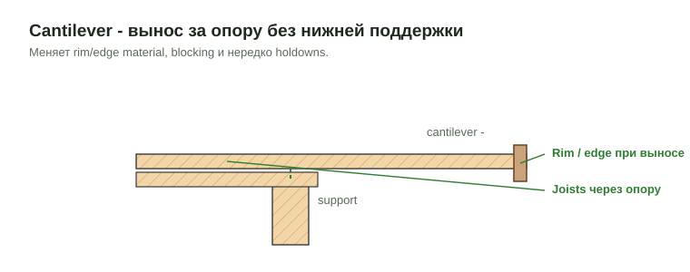

# Cantilevered SQFT (консольный вынос)

<figure markdown>
  
  <figcaption markdown="span">Joists проходят через опору наружу. На выносе меняются rim, blocking и часто holdowns, снизу появляется soffit. Площадь выноса - отдельная Area `cant`.</figcaption>
</figure>

## Что это

Cantilever - часть перекрытия, крыши или деки, вынесенная за опору без
стойки снизу. Площадь выноса считается отдельно, потому что на ней другой
rim, extra blocking, FRT по правилам наружной стены и soffit снизу. В
выдаче оставляй видимую метку `Cantilevered`, чтобы было понятно, почему
площадь отделена. Общие правила замера - [Floor SQFT, раздел правил](1st2nd.md#rules).

## Где искать на чертежах

| Лист | Что взять |
| --- | --- |
| Framing plan (S) | Где joists выходят за стену; направление, длина выноса |
| Details (`d`) | Rim на выносе, blocking над опорой, straps или holdowns, soffit |
| Sections (`sec`) | Высота и слои снизу (soffit, insulation) |
| Floor plan (A) | Контур выноса (bay, bump-out) |

## Как мерить в OurPlanCore

1. Area по контуру выноса на плане перекрытия (точка W). Имя `cant`.
2. Joists выноса рисуются J Area как часть зоны joists; площадь `cant`
   нужна для soffit, rim и blocking, не для второго счёта joists.
3. Soffit под выносом - `Soffits at Floor Overhangs` по длине или площади
   ([Soffit and Fascia](../exterior-trims/soffit-fascia.md)).

## Как назвать в дереве и строка DFL

| Имя в дереве | Строка DFL | Материал | Unit | Формула |
| --- | --- | --- | --- | --- |
| `sqfts/cant` | метка `Cantilevered` в блоке перекрытия | | `SQ FT` | как измерено |
| периметр выноса | `Rim Board` | по детали, FRT если наружная стена FRT | `LFT` | `x 1.1` |
| линия опоры | `Blocking` | `2x` между joists над стеной | `LFT` | по детали |
| снизу | `Soffits at Floor Overhangs` | `1x12` / Vinyl / `5/8" Ext Gyp` | `LFT` / `SQ FT` | |
| детали | `Holdowns` / straps | только если показаны | `pcs` | |

## Частые ошибки

- Вынос растворён в площади этажа, rim и blocking на нём не поменяны.
- Soffit снизу забыт.
- Holdowns или straps добавлены без детали (или пропущены при детали).
- Joists выноса посчитаны второй раз через площадь.

Все ошибки по площадям: [common-mistakes](../../start/common-mistakes.md#sqft).

## Пример

```text
Takeoffs/Main/sqfts/
  cant       Area   48 SF   (bay 2nd floor, 2' вынос)
2nd Floor Framing List
Rim Board (Cantilevered)   11-7/8" LSL Rim   26   LFT   3/S401
Blocking                   2x12              22   LFT   over wall
```

## См. также

- [Rim Board](../horizontal/floor-framing/details/rim.md), [Blocking](../horizontal/floor-framing/details/blocking.md), [Joist](../horizontal/floor-framing/joist.md)
- [Balcony](balcony.md), [Soffit and Fascia](../exterior-trims/soffit-fascia.md)
