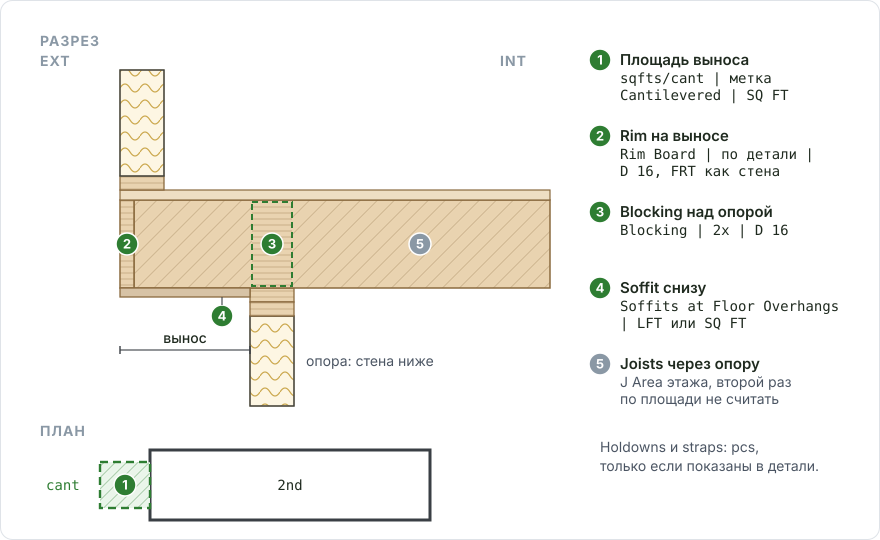

# Cantilevered SQFT (консольный вынос)

<figure markdown>
  
  <figcaption markdown="span">Joists проходят через опору наружу. На выносе меняются rim, blocking и часто holdowns, снизу появляется soffit. Площадь выноса - отдельная Area `cant`.</figcaption>
</figure>

## Что это

Cantilever - часть перекрытия, крыши или деки, вынесенная за опору без
стойки снизу. Площадь выноса считается отдельно, потому что на ней другой
rim, extra blocking, FRT по правилам наружной стены и soffit снизу. В
выдаче оставляй видимую метку `Cantilevered`, чтобы было понятно, почему
площадь отделена. Общие правила замера - [Floor SQFT, раздел правил](1st2nd.md#rules).

## Где искать на чертежах

| Лист | Что взять |
| --- | --- |
| Framing plan (S) | Где joists выходят за стену; направление, длина выноса |
| Details (`d`) | Rim на выносе, blocking над опорой, straps или holdowns, soffit |
| Sections (`sec`) | Высота и слои снизу (soffit, insulation) |
| Floor plan (A) | Контур выноса (bay, bump-out) |

## Как мерить в OurPlanCore

1. Area по контуру выноса на плане перекрытия (точка W). Имя `cant`.
   Обводится только вынос: наружная грань верхнего этажа минус наружная
   грань нижнего, один полигон на каждый вынос. `cant` нужен каждому этажу,
   который выступает за нижний.
2. Вынос остаётся и внутри площади своего этажа (`2nd` обведён по наружной
   грани стен 2-го этажа вместе с bay): `cant` - дополнительная площадь, из
   этажа она не вычитается. Общее правило:
   [Floor SQFT, правило 8](1st2nd.md#rules).
3. Joists выноса рисуются J Area как часть зоны joists; площадь `cant`
   нужна для soffit, rim и blocking, не для второго счёта joists.
4. Soffit под выносом - `Soffits at Floor Overhangs` по длине или площади
   ([Soffit and Fascia](../exterior-trims/soffit-fascia.md)).

## Как назвать в дереве и строка DFL

| Имя в дереве | Строка DFL | Материал | Unit | Формула |
| --- | --- | --- | --- | --- |
| `sqfts/cant` | метка `Cantilevered` в блоке перекрытия | | `SQ FT` | как измерено |
| периметр выноса | `Rim Board` | по детали, FRT если наружная стена FRT | `16` | `=ОКРВВЕРХ(G/D;1)`: доски по 16', G = LFT |
| линия опоры | `Blocking` | `2x` между joists над стеной | `16` | `=ОКРВВЕРХ(G/D;1)`, G = LFT линии опоры |
| снизу, trims в scope | `Soffits at Floor Overhangs` | Vinyl / T&G по разрезу | `SQ FT` | `=ОКРВВЕРХ(SQFT cant*1.1;10)` |
| снизу, узкий вынос под одну доску | `Soffits at Floor Overhangs` | `1x12` | `LFT` | длина кромки x 1.1 |
| снизу, scope Frame | `Soffit Sheathing` в конце framing list этого этажа | обшивка стен | `4x8` | `=ОКРВВЕРХ(SQFT cant/32*1.1;1)` |
| детали | `Holdowns` / straps | только если показаны | `pcs` | |

## Частые ошибки

- Отдельной Area `cant` нет: rim и blocking на выносе не поменяны, soffit потерян.
- `cant` вычтен из площади этажа: этаж стал меньше настоящего.
- Soffit снизу забыт.
- Holdowns или straps добавлены без детали (или пропущены при детали).
- Joists выноса посчитаны второй раз через площадь.

Все ошибки по площадям: [common-mistakes](../../start/common-mistakes.md#sqft).

## Пример

```text
Takeoffs/Main/sqfts/
  2nd        Area   1690 SF   (вместе с bay)
  cant       Area     48 SF   (bay 2nd floor, вынос 2' x 24')
2nd Floor Framing List
Rim Board (Cantilevered)     11-7/8" LSL Rim    2   16      3/S401      2 + 24 + 2 = 28 LFT; 28 / 16 = 1.75
Blocking                     2x12               2   16      over wall   24 LFT; 24 / 16 = 1.5
Soffits at Floor Overhangs   Vinyl             60   SQ FT               48 x 1.1 = 52.8, вверх до 10
```

## См. также

- [Rim Board](../horizontal/floor-framing/details/rim.md), [Blocking](../horizontal/floor-framing/details/blocking.md), [Joist](../horizontal/floor-framing/joist.md)
- [Balcony](balcony.md), [Soffit and Fascia](../exterior-trims/soffit-fascia.md)
