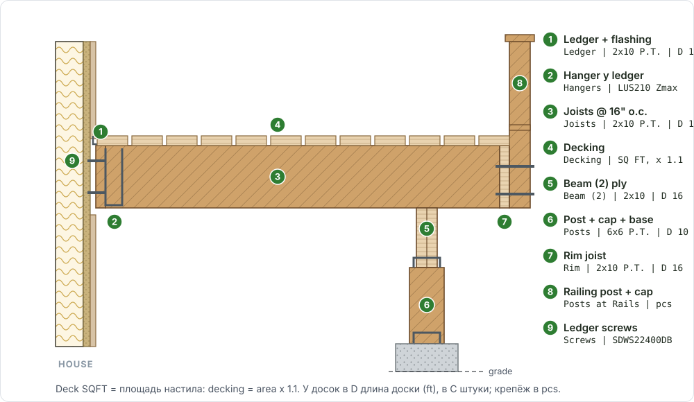

# Deck SQFT

<figure markdown>
  
  <figcaption markdown="span">Deck: ledger to the house, joists on hangers, beam on posts, decking, railing. The decking area is an Area `deck`; frame and railing are on their own pages.</figcaption>
</figure>

## What it is

A deck is an open exterior platform with no roof, on its own frame. The decking
area gives the decking, sleepers and underlayment per the detail; the frame (ledger,
joists, beams, posts) is counted on the
[Deck / Porch / Balcony Frame](../deck/deck-porch-balcony-frame.md) page.
On many COM jobs the deck is not in scope: check, do not assume. General
measuring rules: [Floor SQFT, rules section](1st2nd.md#rules).

## Where to find it on the plans

| Sheet | What to take |
| --- | --- |
| Floor plan / site plan (A) | Deck outline, stairs |
| Deck framing plan, details (S) | Ledger, joists, beams, posts, attachment (bolts, screws) |
| Details (`d`) | Decking material, sleepers, underlayment, railing |
| Scope | Whether the deck is in the job |

## How to measure in OurPlanCore

1. Area along the decking outline on the plan (W point). Name `deck`; several decks
   of one type are polygons in one takeoff, different types are different takeoffs.
2. Deck stairs are not part of the area: stringers and steps separately.
3. Railing is a Line along the open perimeter, in `trims` or `framing` per the
   agreed tree.

## Tree name and DFL row

| Tree name | DFL row | Material | Unit | Formula |
| --- | --- | --- | --- | --- |
| `sqfts/deck` | Front Page, `Deck` | | `SQ FT` | as measured |
| `sqfts/deck` | `Decking` | composite / `5/4x6 P.T.` per spec | `SQ FT` or `LFT` | `SQFT x 1.1` |
| `sqfts/deck` | `Underlayment` | `1/2"` per detail | `4x8` | `=CEILING(SQFT/32*1.1,1)` |
| Line along the edge | `Railing`, `Posts at Rails 4x4 P.T.` | per detail | `LFT`, `pcs` | [Railing](../deck/railing.md) |

## Common mistakes

- Deck counted though it is not in scope (or the other way around).
- LVL rim used by default: only when a deck attaches to it.
- Railing and stairs forgotten; guards as a separate row.
- Deck area assigned to a house floor.

All area mistakes: [common-mistakes](../../start/common-mistakes.md#sqft).

## Example

```text
Takeoffs/Main/sqfts/
  deck       Area   240 SF
Ground Decks Framing List
Decking         5/4x6 P.T.      264   SQ FT
Posts at Rails  4x4 P.T.          8   pcs
```

## See also

- [Deck / Porch / Balcony Frame](../deck/deck-porch-balcony-frame.md), [Railing](../deck/railing.md), [Anchor Bolts](../deck/anchor-bolts.md)
- [Rails and Decking](../exterior-trims/rails-decking.md), [Porch](porch.md), [Balcony](balcony.md)
