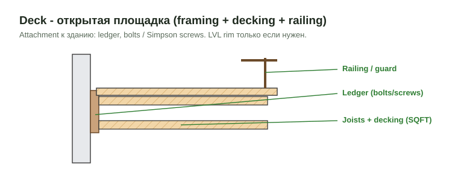

# Deck SQFT (площадь открытой деки)

<figure markdown>
  
  <figcaption markdown="span">Deck: ledger к дому, joists на hangers, beam на posts, decking, railing. Площадь настила - Area `deck`; каркас и railing - по своим страницам.</figcaption>
</figure>

## Что это

Deck - открытая наружная площадка без крыши на своём каркасе. Площадь
настила даёт decking, sleepers и underlayment по детали; каркас (ledger,
joists, beams, posts) считается на странице
[Deck / Porch / Balcony Frame](../deck/deck-porch-balcony-frame.md).
На многих COM jobs deck не входит в scope: проверь, а не предполагай. Общие
правила замера - [Floor SQFT, раздел правил](1st2nd.md#rules).

## Где искать на чертежах

| Лист | Что взять |
| --- | --- |
| Floor plan / site plan (A) | Контур deck, лестницы |
| Deck framing plan, details (S) | Ledger, joists, beams, posts, attachment (bolts, screws) |
| Details (`d`) | Decking материал, sleepers, underlayment, railing |
| Scope | Есть ли deck в заказе |

## Как мерить в OurPlanCore

1. Area по контуру настила на плане (точка W). Имя `deck`; несколько дек
   одного типа - полигоны в одной позиции, разные типы - разные позиции.
2. Лестницы deck не входят в площадь: стрингеры и ступени отдельно.
3. Railing - Line по открытому периметру, в `trims` или `framing` по
   принятому дереву.

## Как назвать в дереве и строка DFL

| Имя в дереве | Строка DFL | Материал | Unit | Формула |
| --- | --- | --- | --- | --- |
| `sqfts/deck` | Front Page, `Deck` | | `SQ FT` | как измерено |
| `sqfts/deck` | `Decking` | composite / `5/4x6 P.T.` по spec | `SQ FT` или `LFT` | `SQFT x 1.1` |
| `sqfts/deck` | `Underlayment` | `1/2"` по детали | `4x8` | `=ОКРВВЕРХ(SQFT/32*1.1;1)` |
| Line по краю | `Railing`, `Posts at Rails 4x4 P.T.` | по детали | `LFT`, `pcs` | [Railing](../deck/railing.md) |

## Частые ошибки

- Deck посчитан, хотя не в scope (или наоборот).
- LVL rim поставлен по умолчанию: только когда к нему крепится deck.
- Railing и stairs забыты; guards отдельной строкой.
- Площадь deck приписана к этажу дома.

Все ошибки по площадям: [common-mistakes](../../start/common-mistakes.md#sqft).

## Пример

```text
Takeoffs/Main/sqfts/
  deck       Area   240 SF
Ground Decks Framing List
Decking         5/4x6 P.T.      264   SQ FT
Posts at Rails  4x4 P.T.          8   pcs
```

## См. также

- [Deck / Porch / Balcony Frame](../deck/deck-porch-balcony-frame.md), [Railing](../deck/railing.md), [Anchor Bolts](../deck/anchor-bolts.md)
- [Rails and Decking](../exterior-trims/rails-decking.md), [Porch](porch.md), [Balcony](balcony.md)
