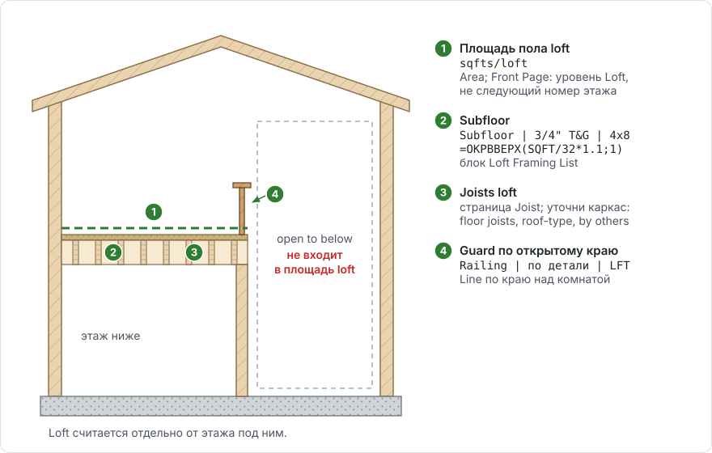

# Loft SQFT

<figure markdown>
  
  <figcaption markdown="span">Loft: the loft floor inside the volume of a story plus a guard along the open edge. The area is a separate Area, not part of the floor below.</figcaption>
</figure>

## What it is

A loft is a loft or mezzanine inside the volume of a story, often over part of the
plan. Its area is counted separately from the floor below it: it drives its own
subfloor, its own joists and the guard along the open edge. On the Front Page the level
is called `Loft`, not the next floor number. General measuring rules:
[Floor SQFT, rules section](1st2nd.md#rules).

## Where to find it on the plans

| Sheet | What to take |
| --- | --- |
| Loft / mezzanine plan (A) | Floor outline, open edge, stair |
| Sections (`sec`) | Height, framing type: floor framing, roof framing or by others |
| Framing plan (S) | Loft joists, beams, bearing; depth and hangers |
| Door / guard notes | Guard along the open edge |

## How to measure in OurPlanCore

1. Area along the loft floor outline on the loft plan sheet (W point). Name `loft`.
2. The open edge (over the room below) is not part of the loft area, but it is needed
   as the guard length: a Line in `trims` or `framing` per the agreed tree.
3. Confirm the framing type: floor joists, roof-type or by others; that decides
   where the joists go ([Joist](../horizontal/floor-framing/joist.md)).

!!! note "The name `loft` and the `sqfts` folder"
    The word `loft` is not among the names the app sends to `sqfts` by itself
    (the floors `1st`...`8th`, `base`, `porch`, `deck`, `blcny`, `cant`,
    `flat`, `rf` go there). After creating the takeoff, check that it sits in `sqfts`; if
    not, move it there or add a rule in Settings > Takeoff Name
    Routing. The SF export understands the name `loft` and puts the area in the fifth
    floor cell: the loft `Subfloor` row must point at it.

## Tree name and DFL row

| Tree name | DFL row | Material | Unit | Formula |
| --- | --- | --- | --- | --- |
| `sqfts/loft` | Front Page, `Loft` | | `SQ FT` | as measured |
| `sqfts/loft` | `Subfloor` in `Loft Framing List` | `3/4" T&G` | `4x8` | `=CEILING(SQFT/32*1.1,1)` |
| J Area of the loft joist zone | `Joists 16" o.c.` in `Loft Framing List` | per the S plan | board length in feet | C = number of joists: [Joist](../horizontal/floor-framing/joist.md) |
| Line along the open edge | `Railing` / guard | per detail | `LFT` | [Railing](../deck/railing.md) |

## Common mistakes

- Loft not found: it is on the architectural sheets, the framing is on the structural ones.
- Guard along the open perimeter forgotten.
- Loft written as `5th` instead of `Loft` on the Front Page.
- Joists written in `LFT`: C holds the number of boards, D the board length.

All area mistakes: [common-mistakes](../../start/common-mistakes.md#sqft).

## Example

```text
Takeoffs/Main/sqfts/
  loft      Area   340 SF   (20' x 17')
Loft Framing List
Joists 16" o.c.    2x10       16   18    S203   20 x 12/16 = 15, plus 1; 17' span = 18' board
Subfloor           3/4" T&G   12   4x8          340 / 32 x 1.1 = 11.7
```

## See also

- [Floor SQFT](1st2nd.md), [Joist](../horizontal/floor-framing/joist.md), [Stair](../horizontal/floor-framing/stair.md)
- [Railing](../deck/railing.md)
